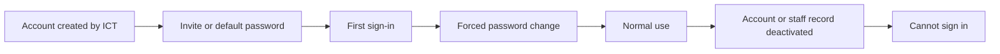

# 01 – Getting Started with the Staff Portal

## 1. Purpose

This manual explains how to sign in to the GWL Staff Portal, change your password, find your way around, and understand why you can see some modules and not others. Every member of staff should read it first. The other manuals (one per module) assume you know the basics covered here.

## 2. Who can do what

Everyone who has an active portal account can sign in, see the home page, change their own password and e-mail address, read their notifications, and use the Leave and Health & Safety modules for their own needs. What else you see depends on your **role**.

| Action | Any signed-in user | Notes |
|---|---|---|
| Sign in with Staff ID and password | Yes | Only while your account **and** your staff record are active |
| Change your own password | Yes | Compulsory on first sign-in if you were given a default password |
| Change your own account e-mail | Yes | |
| See the home page summary | Yes | Cards show only what applies to you |
| Open the notification bell | Yes | |
| Open the Letters bell | Only if your role has the Letters module | |
| Open the Regional Blog | Yes (if the Blog is switched on) | You read your own region's articles only |
| Delete your own account | **No** | Staff accounts are managed by the system administrators |
| Create accounts, assign roles | **No** | Done by the ICT team, Global Admin or Super Admin (see manual 02) |

**What you cannot do:** you cannot reset another person's password, switch on a module for yourself, or see a module your role does not include. If you need a different role, ask the ICT team or your Head Office HR contact.

**Reach (where in the organisation you see data):** this differs per module. In general, Head Office staff see Head Office, regional staff see their own region, and district staff see their own district or region. Each module manual states its own rule. Records outside your reach are shown as **not found** rather than "not allowed".

## 3. How to open it

The portal is a web site. Open the address your ICT team gave you in a normal browser (Chrome, Edge, Firefox). You land on the **Log in** page. There is nothing to install.

A separate full-screen **Visitor kiosk** page exists for the reception desk; it does not need a login (see manual 06).

## 4. Screen-by-screen guide

### 4.1 The Log in page

[Screenshot: Log in page – the Staff ID and Password fields and the Log in button]

| Field / control | What it means |
|---|---|
| **Staff ID** | Your staff number, for example `12345`. Required. This is **not** your e-mail address. |
| **Password** | Your portal password. Required. |
| **Remember me** | Keeps you signed in on this browser. Do not tick it on a shared computer. |
| **Forgot your password?** | Opens a page where you type your **e-mail** address to receive a reset link (see section 5.4). |
| **Log in** | Signs you in. A "Signing in" animation shows while it works. |

### 4.2 The home page (after sign-in)

[Screenshot: Home page – greeting, summary cards and "Your modules" grid]

At the top you see a greeting ("Good morning, <first name>"), today's date, your district and region, and your job title (or your role if you have no job title on file). An **Apply for leave** button is one click away.

**Your summary** shows small cards. A card only appears if it applies to you:

- **Annual leave left** – days left out of your total for the year, and how many you have used.
- **Awaiting your decision** (or **Pending approvals in your zone**) – leave requests waiting for you or your zone. Shown to people who approve leave.
- **Unread letters** – letters in your Letters inbox. Shown only if your role has Letters.
- **Visitors today** – visitors signed in today and how many are on site now. Shown only if your role has Visitors.

**Your modules** is a grid of cards, one per module you may open. Click a card (or **Open**) to go there. The Leave card is marked **Everyone**. The Letters card shows a number badge when hardcopy letters handed to you still need your confirmation.

> Only modules that are switched on for the organisation **and** allowed for your role appear. A missing card is not a fault – see section 9.

### 4.3 The header (top bar)

[Screenshot: Header – module tabs, jump-to search, Blog link, bells, theme switch, account menu]

From left to right:

1. **Menu button** (small screens) – opens the sidebar as a drawer.
2. **GWL Staff Portal** logo – click to go back to the home page.
3. **Module tabs** – one tab per module you may open. The current module is highlighted.
4. **Jump to a page** search (shortcut **Ctrl K**) – type part of a page name, use the arrow keys, press **Enter** to open it, **Esc** to close. It lists only pages you can open.
5. **Blog** link – opens the Regional Blog in a **new tab**. Hidden when the Blog is switched off.
6. **Notification bell** – see 4.5.
7. **Letters bell** – only for people with the Letters module (it works from any module).
8. **Theme switch** – toggles light and dark theme. Your choice is remembered on that browser.
9. **Account menu** (your initials) – **Profile**, the theme toggle, and **Sign Out**.

### 4.4 The sidebar and breadcrumb

The left sidebar lists the pages of the module you are in. It changes when you change module. Items you may not use are hidden. Group headings (for example "Data", "Settings") fold related pages together. Above the page title a **breadcrumb** shows where you are.

Under your name in the header area you see your job title and your "district – region".

### 4.5 The notification bell

[Screenshot: Notification bell open – Unread/All tabs and a list of notices]

1. Click the bell. A red number shows how many notices are unread (99+ if more).
2. Use the **Unread** and **All** tabs to filter.
3. Click a notice to open the page it refers to; it is marked as read.
4. Click **Mark all read** to clear the number.

The bell refreshes by itself every few seconds, and a sound cue plays when a new notice arrives. Notices never contain sensitive details such as amounts or names in some modules (Finance, Health & Safety, G-Water keep them to counts and reference numbers).

The **Letters bell** is separate and carries only letter notices (see manual 05).

### 4.6 The Profile page

[Screenshot: Profile page – employee details, Account Email, Update Password]

Open it from the account menu → **Profile**.

- **Employee details** (read-only): Staff ID, Title, Full Name, Email, Job Title, Department, and so on from your staff record. If your account has no staff record linked, the page says "No employee record is linked to this account." – tell HR.
- **Account Email** – change your e-mail and click **Save Email**. If e-mail verification is in use you may see "Your email address is unverified" with **Re-send verification email**.
- **Update Password** – fields **Current Password**, **New Password**, **Confirm Password**; click **Save Password**; "Saved." confirms it.
- **Account Deletion** – for staff accounts this only says "Employee accounts are managed by UAC and cannot be self-deleted."

## 5. Step-by-step tasks

### 5.1 Sign in for the first time

1. Open the portal address. You see the **Log in** page.
2. Type your **Staff ID** and the default password you were given.
3. Click **Log in**.
4. The portal takes you straight to **Profile** with the message "You are using the default password. Change it before continuing to the portal."
5. Fill **Current Password** (the default one), **New Password** and **Confirm Password**.
6. Click **Save Password**. You can now use the rest of the portal.

**Password rules:** at least **5 characters**, with **at least one letter and at least one number**, and the confirmation must match. The current password must be correct.

Until you change a default password you cannot open any other page; every click returns you to Profile.

### 5.2 Sign in on a normal day

1. Enter Staff ID and password. Tick **Remember me** only on your own device.
2. Click **Log in**. You arrive on the home page.

### 5.3 Sign out

1. Click your initials (top right).
2. Click **Sign Out**.

### 5.4 Reset a forgotten password

1. On the Log in page click **Forgot your password?**
2. Type your account e-mail address and submit.
3. Open the e-mail and follow the link to choose a new password.

If you have no working e-mail address on your account, or the mail does not arrive, ask the ICT team: they can send you a fresh invitation (manual 02).

### 5.5 Find a page quickly

1. Press **Ctrl K** (or click **Jump to a page**).
2. Type a few letters, e.g. "visitors".
3. Press **Enter**.

### 5.6 Change your e-mail address

1. Account menu → **Profile**.
2. In **Account Email** type the new address.
3. Click **Save Email**.

## 6. Workflow and status lifecycle

An account can be in these states:

| State | What you experience |
|---|---|
| **Invited / default password** | You must change the password at first sign-in |
| **Active** | Normal use |
| **Inactive** (account switched off, or your staff record deactivated) | Sign-in fails and any open session is ended |

A staff record can be deactivated by HR when someone leaves (manual 03). That also stops sign-in.

## 7. Reports, exports and printing

Nothing at portal level. Each module has its own exports (see its manual). The notification bell has no export.

## 8. Imports

None at portal level. Bulk user and staff imports are covered in manuals 02 and 03.

## 9. Rules and gotchas in user terms

- **Staff ID, not e-mail**, is what you type to sign in.
- **Five wrong attempts** lock you out for about **two minutes** ("try again in 2 minutes time"). The lock is per Staff ID and computer.
- **Roles decide the tabs.** The portal shows the tabs your role may open. A role grants *module access*; inside a module, finer *permissions* decide which buttons and pages you get.
- **Everyone has Leave** and (when switched on) **Health & Safety** and the **Blog**.
- **Some modules may be switched off** for the whole organisation: Commercial, Health & Safety, G-Water, Finance and Audit, and the Blog each have an on/off switch. When off, no tab appears for anyone and their addresses answer "not found". Parts of Assets (Mobile device management), the Commercial Customer List and Commercial SMS have their own extra switches.
- **Location matters.** Head Office is treated as its own district. Regional staff see their own region. Records belonging to another location look as if they do not exist ("not found"), not "forbidden".
- **Nothing important is deleted.** Most records are voided or deactivated with a reason, so there is always a trail.
- **Super Admin** accounts are invisible to ordinary users everywhere (user lists, audit logs).
- Dates are shown in the day-month-year style used on screen; amounts in Ghana cedis.

### How roles and module access work

1. An administrator gives you one or more **roles**.
2. Each role opens certain **modules** (the tabs).
3. Each role also carries **permissions** (for example "export", "approve").
4. If you have several roles you get everything they give.

Default module access by role is listed in the README of this manual set (the role quick-reference matrix). Your administrator can change roles for individual people, so your own tabs may differ.

## 10. Troubleshooting and FAQ

**1. I typed the right password but I am sent back with "Invalid Staff ID or Password".**
Check you typed your Staff ID (not e-mail) and that Caps Lock is off. After five failures wait two minutes.

**2. I see "You don't have access, contact Administrator."**
Your account or your staff record is inactive. Contact HR or the ICT team.

**3. I keep being sent to the Profile page.**
You still have the default password. Change it (section 5.1).

**4. My new password is refused.**
It needs at least 5 characters including a letter and a number, and the two new-password boxes must match. The current password must be right.

**5. A module tab is missing.**
Either your role does not include it, or that module is switched off. Ask the ICT team which roles you hold. See also the README matrix.

**6. A page says "not found" although I was sent a link.**
The record is probably in another region or district, or does not exist. Ask the sender; you may not be meant to see it.

**7. I clicked a link and was told I do not have permission (403).**
You have the module but not the specific permission. Ask your administrator if you believe you need it.

**8. The reset e-mail never arrives.**
Check spam and that the e-mail on your profile is correct; otherwise ask the ICT team to re-send your invitation.

**9. The bell shows a number but I cannot find the notice.**
Open the bell and use the **Unread** tab; click **Mark all read** if you want to clear them.

**10. The screen layout looks wrong on my phone.**
Use the menu button (top left) to open the sidebar drawer; module tabs are inside it.

**11. Where is the Blog tab?**
The Blog is not a tab: use the **Blog** link at the right of the header. It opens in a new browser tab.

## 11. Glossary

- **Module** – a main area of the portal, shown as a tab (Staff, Leave, Letters and so on).
- **Role** – a job-type label (for example Manager) that opens modules and carries permissions.
- **Permission** – a single right inside a module (for example "export reports").
- **Staff ID** – your employee number; your sign-in name.
- **Head Office / Region / District** – the three levels of location; Head Office is treated as a district of its own.
- **Bell** – the notification icon in the header.
- **Jump to a page** – the Ctrl K search.

## 12. Screenshot placeholders

- [Screenshot: Log in page – Staff ID, Password, Remember me, Log in]
- [Screenshot: Forced password change – Profile page with the yellow default-password warning]
- [Screenshot: Home page – summary cards and Your modules]
- [Screenshot: Header – tabs, search, Blog link, bells, account menu]
- [Screenshot: Notification bell open – Unread/All tabs]
- [Screenshot: Jump to a page – search box with results]

## To confirm

- A public **Register** page exists in the code (`/register`), but the Log in page does not link to it and the code writes a field the user table no longer has; treat it as not available to staff. Confirm with the development team whether it should be removed.
- The "Unread notifications" figure passed to the home page is fixed in code; the home page does not show it as a card, so the bell is the only reliable count.
- Whether the e-mail verification step is enforced in production.
