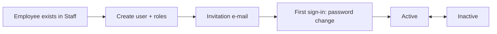

# 02 – UAC (User Access Control)

## 1. Purpose

UAC is where **user accounts and roles** are managed. Here administrators create a portal login for a member of staff, give them roles, switch accounts on and off, re-send invitations, edit what each role can open and do, import users in bulk, and (for Super Admin only) read the audit log.

Typical users: the **ICT team**, the **Global Admin**, and the **Super Admin**.

## 2. Who can do what

The module tab is called **Access Control**. It opens for the roles **Super Admin**, **Global Admin** (`admin`) and **ICT Team**.

Roles are ranked in tiers: **Super Admin > Global Admin > ICT Team > everyone else**. Nobody can give a role above their own tier.

| Action | Super Admin | Global Admin | ICT Team | Others |
|---|---|---|---|---|
| Open Access Control | Yes | Yes | Yes | No |
| See the Users list, view a user | Yes (all) | Yes (not Super Admin accounts) | Yes, within their location only | – |
| Create a user from an employee | Yes | Yes | Yes (location rules below) | – |
| Edit a user's roles | Any role | Any role except Super Admin | Only roles marked "ICT may assign", only for people in their location, **never their own** | – |
| Activate / deactivate a user | Yes | Yes | Within their location, not themselves | – |
| Resend invite | Yes | Yes | Within their location | – |
| Roles & Permissions screen | Yes | Yes (cannot change protected roles) | **No** | – |
| Bulk Import | Yes | Yes | **No** | – |
| Audit Log | Yes | **No** | **No** | – |
| See Super Admin accounts and their audit rows | Yes | No | No | No |

**Reach of the ICT team.** An ICT Team member works in one location: either **Head Office** or **one region**. They see and manage only users based there. A regional ICT member does not see Head Office staff.

**Roles that need a particular location.**

- **Head Office only:** Global Admin, Head Office HR (`hr_headoffice`), Chief Manager. These cannot be given to someone based in a region or district.
- **Region or district only:** Regional HR (`hr_region`), Regional Chief Manager, District Manager.
- If you try to give a role that does not fit the person's location, the portal refuses with a message. When a person holding a Head Office-only role is moved out of Head Office, those roles are removed automatically, the person, the Global Admins and whoever moved them are notified, and the roles cannot be given back until the person is at Head Office again. Their other roles stay.

**What each role cannot do.** The ICT Team cannot create or edit roles, cannot change role permissions, cannot import users, cannot see the audit log, and cannot grant a role that carries Access Control rights. Global Admin cannot edit protected roles (Global Admin, Super Admin) and cannot see Super Admin accounts.

## 3. How to open it

- Click the **Access Control** tab in the header (or the Access Control card on the home page).
- Sidebar items: **Users**, **Roles & Permissions** (Global Admin and Super Admin only), **Bulk Import** (same), **Audit Log** (Super Admin only).
- No feature switch is needed.

## 4. Screen-by-screen guide

### 4.1 Overview (landing page)

[Screenshot: Access Control overview – statistic cards, recent users and recent activity]

Shows counts (users, roles, permissions, audit entries you may see), the five newest users, and the latest activity. Numbers only include what you are allowed to see.

### 4.2 Users

[Screenshot: Users list – filter bar and the table]

**Filters** (press the search button to apply):

- **Search name, email, or staff ID** – part of any of the three.
- **All Roles** – show only people holding one role.
- **All Status** – **Active** or **Inactive**.
- Rows per page – 10, 15, 20, 50 or 100 (default 15).

**Columns:** Full Name, Staff ID, Location, Roles, Status, Last Login, Actions.

**Row actions:**

- **View details** (eye icon) – opens the user's profile page.
- **Edit user** (pencil icon) – opens the **Edit User** dialog to change roles. Only roles you may change are offered; roles you may not touch are kept exactly as they were.
- **Deactivate / Activate** – switches the account off or on.
- **Resend Invite** – sends the set-password e-mail again.

**Create New User** button (top of the page) opens the **Create New User** dialog.

### 4.3 Create New User dialog

| Field | Meaning | Rules |
|---|---|---|
| **Employee (Search by Staff ID)** | Type a staff ID or name and pick the person. Only employees you may see are listed. | Required. The employee must already exist in Staff. |
| **Full Name**, **Email** | Filled automatically from the staff record. | Not typed by you. The e-mail comes from the staff record, so it must be correct there first. |
| **Roles** | Tick the roles to give. A counter shows how many are selected, and chips can be removed. | Optional. Only roles you may give, that fit the person's location. |

### 4.4 Roles & Permissions

[Screenshot: Roles & Permissions – role list, Module access and Permissions matrix]

1. Pick a role from the list on the left.
2. **Module access** – tick the modules (tabs) the role opens. A hint shows "x of y enabled".
3. **Permissions** – grouped by module; tick what the role may do. A counter shows how many are selected.
4. Click save. "Changes saved successfully." confirms.

A banner explains when a role is locked: "This role is locked and cannot be modified." (Super Admin and the implicit Employee role) or "This is a protected role: only a Super Admin can change its permissions."

Other actions:

- **Create role** – fields **Role Slug** (lower-case letters, numbers and underscores only, up to 50 characters, must be unique, e.g. `store_keeper`), **Display Name** (required, up to 100 characters) and **Description (optional)**. Message: "Role created successfully."
- **Edit role** – change the display name and description ("Role updated successfully."). System roles: "System roles cannot be edited."
- **Delete role** – only a Super Admin, only a role with no users and not a system role. Type **DELETE** to confirm. Messages: "System roles cannot be deleted.", "Remove this role from users before deleting.", "Type DELETE to confirm."
- **ICT may assign** toggle – decides whether the ICT team may hand this role out. It cannot be turned on for Global Admin, ICT Team or Super Admin.

> A permission can only be added to a role by someone who holds that permission-type themselves where it concerns Access Control; ordinary module permissions (staff, leave, letters…) are not compared, because the ICT team hands those roles out by design.

### 4.5 Bulk Import

See section 8.

### 4.6 Audit Log (Super Admin only)

[Screenshot: Audit Log – search box and table of actions]

Search by action, module, target type or IP address. Twelve rows per page. Shows who did what and when. Role and access changes by a Super Admin appear with the actor shown as "System" to anyone else who can see those rows.

## 5. Step-by-step tasks

### 5.1 Give a new member of staff a login

Before you start the person must exist in **Staff** (manual 03) with a correct e-mail and location.

1. Click **Access Control** → **Users**.
2. Click **Create New User**.
3. In **Employee (Search by Staff ID)** type the staff ID or name and pick the person.
4. Tick the roles they need (see the role guide in the README).
5. Click **Create User**.
6. You see "User created successfully." The person is created with the standard default password, must change it at first sign-in, and receives an invitation e-mail with a set-password link.

**If it fails:**

- "A user already exists for this employee." – they already have a login.
- A refusal naming the role – the role does not fit their location, or is above your tier. The whole creation is cancelled; nothing is half-saved.
- 403 with a reason – the person is outside your location.

### 5.2 Change someone's roles

1. **Users** → find the person → **Edit user**.
2. Tick or untick roles. Only roles you may change appear.
3. Click **Save Changes** ("User updated.").

You cannot change your own roles as an ICT Team member.

### 5.3 Switch an account off (or on)

1. **Users** → row → **Deactivate** (or **Activate**).
2. "User status updated." The person can no longer sign in; if signed in, they are signed out on their next click.

Deactivating the login does not deactivate the staff record; HR does that in Staff.

### 5.4 Re-send an invitation

1. **Users** → row → **Resend Invite**.
2. "Invite email resent successfully."

### 5.5 Create a custom role

1. **Roles & Permissions** → create role.
2. Enter **Role Slug** and **Display Name**; save.
3. Select the new role, tick modules and permissions, save.
4. Give the role to people in **Users**.

### 5.6 Look for a user's history

Super Admin only: **Audit Log** → search the staff ID, the module name (e.g. `uac.users`) or an action such as `create_user`.

## 6. Workflow and status lifecycle

User account: **Created (default password, must change)** → **Active** ⇄ **Inactive**. No user is deleted.

Notifications: the new person gets the invitation e-mail. When a Head Office-only role is removed because of a transfer, the person and the Global Admins get an in-app notice.

Every user creation, status change, role change, role edit and permission change is written to the audit log.

## 7. Reports, exports and printing

None, apart from the audit log screen (view only) and the import template downloads (section 8).

## 8. Imports

**Bulk Import** (Global Admin and Super Admin) is a shared import workspace. The same workspace type also exists in Staff (manual 03).

File types: **.xlsx**, **.csv** or **.txt**. First row = column headings (exact names below). Download the **template** for each type from the screen.

| Type | Columns | Notes |
|---|---|---|
| Employees | `staff_id, full_name, title, gender, category, grade, email, job_title_name, department_name, district_name, region_name, date_of_birth, date_joined, unit, present_appointment` | `title` and `grade` may be left out of the file. Gender must be Male or Female. Dates must be valid dates. Job title, department, district and region must already exist, and the district must belong to the region. |
| Departments | `department_name` | |
| Regions | `region_name` | |
| Districts | `district_name, region_name` | |
| Job Titles | `job_title_name` | |
| Users | `staff_id, email, role_slugs, is_active` | `role_slugs` is required (one or more role names, as shown in Roles & Permissions). The staff ID must exist and be in your scope. |

**Steps:**

1. Pick the type and download the template.
2. Fill it in, then choose the file and click **Preview**. Nothing is saved yet.
3. Read the preview: valid rows, error rows with row number and message.
4. If there are too many bad rows the import is **blocked**: "Import blocked because x% of rows failed validation. The configured maximum is 20%." (20% is the normal limit.) Fix the file and preview again.
5. Click **Run import** to save. Message: "Import completed. n processed, n created, n updated." If some employees had no grade: "n imported with the grade missing."
6. **Clear** discards the preview.

**Typical errors and fixes**

| Message | Fix |
|---|---|
| Missing required columns: … | Use the template headings exactly. |
| The grade "…" is not recognised. Use one of: … | Use one of the official grade names (for example `Mgt. Gd. Level 2`, `Snr. Gd. Level 3`, `Junior Gd. Level 1`, `Charwoman`). |
| The category "…" does not match the grade "…" | The category follows the grade; fix or delete the category cell. |
| The job title / department / district / region must already exist | Create it first or import it earlier in the sequence. |
| The district must belong to the selected region | Fix region or district. |
| You can only import employees in your own region. | Regional users cannot import into other regions. |
| The selected staff ID is invalid or outside your scope. | The person is not in your location. |
| No validated rows are available. Please preview a file first. | Preview before running. |
| You are not allowed to import users. | Only Global Admin and Super Admin import users. |
| Grade missing for staff ID …: imported without a grade. | A warning; the person is saved without a grade (they get the flat standard leave entitlement until HR sets one). |

Suggested order when starting from nothing: Departments, Regions, Districts, Job Titles, Employees, then Users.

## 9. Rules and gotchas in user terms

- **Nothing is deleted** except unused custom roles. People are deactivated.
- **Default password.** New accounts start with a standard password and must change it at first sign-in.
- **Role must fit location.** See section 2.
- **You cannot raise yourself.** ICT cannot edit their own roles; nobody grants a role above their tier.
- **Super Admin is hidden.** Super Admin accounts do not appear in lists, pickers or counts for anyone else.
- **Editing only touches roles you may manage.** If a person has a role you cannot change, saving your edit leaves it alone.
- **Role changes affect people immediately** on their next page load; tell the people concerned.

## 10. Troubleshooting and FAQ

1. **I cannot find the person when creating a user.** They are not in Staff, or they are outside your location. Ask HR to add them, or ask a Global Admin.
2. **"A user already exists for this employee."** Search the Users list by staff ID; use Activate or Resend Invite instead.
3. **A role is missing from the tick list.** It is above your tier, not "ICT may assign", or does not fit the person's location.
4. **I removed a Chief Manager role and the person lost others.** Only Head Office-only roles are removed on transfer out of Head Office; check the audit log.
5. **A person says they never got the invitation.** Check the e-mail on their Staff record, then use **Resend Invite**.
6. **I deactivated a user but they still show in Staff.** Staff records are separate; HR deactivates those.
7. **The Roles & Permissions page is not in my sidebar.** It is for Global Admin and Super Admin only.
8. **My import is blocked.** More than the allowed share of rows failed. Fix the errors shown in the preview.
9. **Can I delete a role?** Only a Super Admin, only custom roles with no users.
10. **Why is the Audit Log missing?** Only Super Admin sees it.

## 11. Glossary

- **Tier** – the rank of a role: Super Admin, Global Admin, ICT Team, others.
- **Protected role** – Global Admin and Super Admin; only Super Admin may change what they can do.
- **ICT may assign** – a flag that lets the ICT team hand a role out.
- **Slug** – the short machine name of a role (lower case, underscores).
- **Module access** – which tabs a role opens. **Permission** – what it may do inside them.
- **Invite** – the e-mail with a link to set a password.

## 12. Screenshot placeholders

- [Screenshot: Users list – filters, table and row actions]
- [Screenshot: Create New User dialog – employee search and role ticks]
- [Screenshot: Edit User dialog – role chips]
- [Screenshot: Roles & Permissions – module access and permission matrix]
- [Screenshot: Create role dialog]
- [Screenshot: Bulk Import – preview with errors]
- [Screenshot: Audit Log]

## To confirm

- The exact wording of the buttons on the Bulk Import screen (Preview / Run / Clear) was taken from the routes; confirm against the screen.
- Whether the invitation e-mail is actually delivered in production (depends on mail settings).
