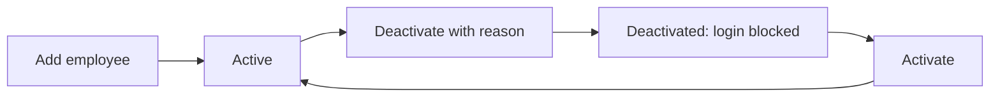

# 03 – Staff Management (HR Directory)

## 1. Purpose

Staff Management is the **HR directory** of the portal: the list of every employee, their department, grade, job title and location, plus the lists HR keeps (departments, regions, locations, job titles), staff imports and exports, staff reports, the **HR Dashboard** and **HR Analytics**.

Everything else in the portal reads from this directory. An employee must exist here before they can have a login (manual 02), apply for leave (manual 04) or be a payee, driver or host elsewhere.

Typical users: Head Office HR, Regional HR, and managers who need to look up their people.

## 2. Who can do what

The tab is called **Staff Management**.

| Action | Super Admin | Head Office HR | Regional HR | Managers* | Global Admin | Others |
|---|---|---|---|---|---|---|
| Open the staff list | Yes | Yes | Yes | Yes (view only) | **No** (HR tools only) | No |
| View a person's details | Yes | Yes | Yes | Yes (within scope) | – | – |
| Add / edit an employee | Yes | Yes | Yes (own region) | **No** | No | No |
| Deactivate / activate | Yes | Yes | Yes (own region) | No | No | No |
| Export the staff list | Yes | Yes | Yes | Yes (view and export what they see) | – | – |
| Import employees | Yes | Yes | Yes (own region) | No | No | No |
| Departments, Regions, Locations, Job Titles | Yes | Yes | Yes | No | No | No |
| Staff Reports | Yes | Yes | Yes (own region) | No | No | No |
| HR Dashboard, HR Analytics | Yes | Yes | Yes (own region for analytics) | No | Yes | No |

\* Managers = Manager, Departmental Manager, District Manager, Chief Manager, Regional Chief Manager.

**Reach (who you see in the list):**

- **Super Admin and Head Office HR** – broad: all regions.
- **Regional HR and Regional Chief Manager** – their own region.
- **District Manager** – their own district.
- **Manager, Departmental Manager, Chief Manager** – the people in their department and location, as defined by their job position.
- Anyone whose login is not linked to an employee record sees **nobody** (the list fails closed).
- Super Admin accounts are never listed for anyone else.

**Cannot do:** managers cannot add, edit, deactivate or import. Regional HR cannot place an employee in a district outside their own region ("Choose a district in your own region.") and cannot import into other regions ("You can only import employees in your own region."). Global Admin has no access to the staff list itself; they reach the HR tools only.

## 3. How to open it

Click **Staff Management** in the header. If your role may see the HR tools but not the staff list (Global Admin), the tab opens the HR Dashboard instead.

Sidebar:

- **HR Dashboard**
- **All Employees**
- **Add Employee** (HR only)
- **HR Tools** group: **HR Analytics**, **Compulsory Leave**, **HR Contacts**, **Letter Settings**, **Acting Assignments**, **Leave Reports**, **Staff Reports** (the last two only if you hold the relevant permission; Compulsory Leave, HR Contacts, Letter Settings and Acting Assignments are explained in manual 04).
- **Data** group: **Import / Export**, **Departments**, **Regions**, **Locations**, **Job Titles** (each shown only if you have the matching permission).

## 4. Screen-by-screen guide

### 4.1 All Employees

[Screenshot: All Employees – filters, table and action buttons]

Top buttons: **Import** (HR), **Export** (downloads the current list as Excel), **Add Employee** (HR).

**Filters** (apply as you type; they are kept in the web address, so a link from a dashboard card opens an already-filtered list):

- Search – name, staff ID or e-mail.
- **Department**.
- **Category** (Junior Staff, Senior Staff, Management, Contract; "Management" also includes the old "Senior Management").
- **Grade** – a grade, or **No grade set**.
- **Location** – Head Office / Region / District.
- **Status** – Active, Deactivated, On Leave.
- Rows per page.

**Columns:** Name, Staff ID, Department, Category / Grade, Location, Annual Leave Balance, Status, Actions.

**Row actions:** view details (opens the person's profile panel), **Edit employee** (pencil), **Deactivate / Activate**.

### 4.2 Add / Edit Employee

[Screenshot: Employee form – personal, work and location sections]

| Field | Meaning | Rules |
|---|---|---|
| **Staff ID** | Employee number; also their sign-in name | Required, up to 50 characters, unique |
| **Title** | Mr., Mrs., Ms., Miss, Dr., Prof., Ing., Hon., Rev., Surv., Chief, Nana, Alhaji, Hajia | Optional |
| **Full Name** | | Required |
| **Gender** | Male or Female | Required |
| **Date of birth** | | Required, a valid date |
| **Date joined** | First day of service | Optional, a valid date. Drives leave entitlement (length of service) |
| **Grade** | One of the official grades (see below) | Required for new staff; a grade once set cannot be cleared; "Choose a grade from the list." if invalid |
| **Category** | Shown automatically from the grade. Only asked for if the person has no grade (older records) | |
| **Job title** | From the Job Titles list | Required |
| **Department** | From the Departments list | Required |
| **Unit** | Free text sub-unit | Optional |
| **Location (district)** | The district or office where the person works; the region follows automatically | Required. Regional HR: "Choose a district in your own region." |
| **Present appointment** | Date of the current appointment | Optional date |
| **Email** | Work e-mail | Required, valid, unique. Used for the login invitation and notices |

**Official grades and their categories:** Junior Gd. Level 1–6 (Junior Staff); Charwoman (Contract – no leave); Snr. Gd. Level 1–4 (Senior Staff); Mgt. Gd. Level 1–4 (Management). The category always follows the grade.

Messages: "Employee created successfully." / "Employee updated successfully." "Your profile needs a region before you can add employees." appears if your own record has no region.

### 4.3 Deactivate an employee

When you click **Deactivate** a dialog "Deactivate employee?" asks for a **Reason for deactivation**: Retirement, Resignation, Contract ended, Transfer, or Other (older records may show "left" or "dead"). Confirm to save. **Activate** reverses it and clears the reason and date.

Effects: the person's login stops working; HR analytics reads exits from the deactivation date (a **Transfer** is shown but is not counted as an exit).

### 4.4 Departments, Regions, Locations, Job Titles

Each screen has a directory table and an **Add / Edit** form beside it.

- **Departments** – column Department, number of employees. Field **Department Name** (required, up to 255, unique).
- **Job Titles** – **Job Title Name** (required, unique).
- **Regions** – **Region Name** (required, unique) and **Letter prefix** (2–6 capital letters or digits, unique; leave blank to have one made from the name). The prefix starts the serial numbers of that region's letters (for example `GA-2026-001`); changing it only affects future letters. Columns also show number of locations and employees. Message if clash: "Another region already uses this letter prefix."
- **Locations** – **Region** and **Location Name** (a district or office; unique within the rules shown). Editing a location re-saves its employees: their location type follows the new name (a location named Head Office makes its staff Head Office staff) and their region follows the region. Anyone left outside Head Office loses Head Office-only roles automatically.

**Delete** is allowed only when nothing depends on the item: "You cannot delete a department that still has employees assigned.", "…a job title…", "…a location that still has employees assigned.", "You cannot delete a region that still has locations or employees assigned."

### 4.5 HR Dashboard

Shows, for the current year: **Leave days taken per month**, **Requests by status**, **Pending approvals** (most recent first), **Approval turnaround** (average hours per stage), **Upcoming absences** (approved leave starting in the next 14 days), **Leave by type**, **Gender breakdown**, and **SLA breaches** (approvals that took more than 72 hours from submission). Scoped to your region for Regional HR.

### 4.6 HR Analytics

[Screenshot: HR Analytics – milestones, headcount and distribution]

Available to Super Admin, Global Admin, Head Office HR (all regions, with Region and Department filters) and Regional HR (own region only). Staff holding the Super Admin role are never counted.

- **Milestones** – birthdays and work anniversaries this month; people completing exactly 5, 10, 15 or 20 years this year; staff **approaching retirement** (the page states the retirement age and window used).
- **Headcount** – total active, new hires and exits this month and this year, turnover rate, average tenure, average age and age bands. A **Transfer** is not counted as an exit.
- **Distribution** – by department, region, location type, district (busiest 15), category, grade, age band, and permanent versus contract.
- **Exit reasons** this year – Retirement, Resignation, Contract ended, Transfer, Other.
- **Grade and entitlement** – how many active staff have **no grade** (links to the filtered list) and this year's annual leave entitlement by category (gross days, compulsory leave, available).

Figures are refreshed every few minutes, so a change you just made may take a short while to show.

### 4.7 Staff Reports

Filters: **Date range** (presets or a custom **From** / **To**), **Department**, **Region** (Head Office HR / Super Admin only), **District**. Shows summary cards, **Staff by category** and grade tables, and charts: Male vs Female total, Leave status breakdown, Staff by district, Staff by department, Approved leave days by type, Monthly leave requests, and a District numbers table. An **Excel export** button downloads the same figures.

## 5. Step-by-step tasks

### 5.1 Add a new employee (HR)

1. **Staff Management → Add Employee**.
2. Fill the fields in section 4.2. Make sure the job title, department and location already exist (add them under **Data** if not).
3. Click save. "Employee created successfully."
4. A login is created for the person automatically by the system and an invitation e-mail is sent; roles are given in Access Control (manual 02).

If you see "The staff ID has already been taken" or the e-mail is taken, check whether the person already exists (search the list, including Deactivated).

### 5.2 Change someone's grade, department or location

1. **All Employees** → search → **Edit employee**.
2. Change the field, save. "Employee updated successfully."
3. Changing grade, joining date or location recalculates their annual leave entitlement; days already used are never taken back. Every grade change is recorded in the audit trail.

### 5.3 Deactivate someone who has left

1. **All Employees** → find them → **Deactivate**.
2. Choose the **Reason** and confirm.
3. Their login stops working immediately. Their leave history stays.

To bring someone back: set Status to Deactivated, find them, click **Activate**.

### 5.4 Export the list

1. Set the filters you want.
2. Click **Export**. An Excel file of what you can see downloads.

### 5.5 Import employees

See section 8.

### 5.6 Move a district under another region (HR)

1. **Data → Locations** → edit the location.
2. Change the **Region** (or name) and save.
3. The employees there follow automatically.

## 6. Workflow and status lifecycle

An employee record is **Active** or **Deactivated** (with reason and date). **On Leave** is a display status derived from approved leave dates.

Automatic effects of employee changes:

- A login account is created, e-mail and staff ID are kept in step, and the active state is mirrored.
- A transfer out of Head Office removes Head Office-only roles (notifications go to the person and the Global Admins).

## 7. Reports, exports and printing

| Output | Who | Format |
|---|---|---|
| Employee list | Anyone who can open the list (within their scope) | Excel |
| Staff Reports export | Holders of the "staff reports" right (Head Office HR, Regional HR, Super Admin) | Excel |
| Leave Reports | See manual 04 | Excel |
| Import templates | HR | Excel |

No row limit is set on these exports other than your scope.

## 8. Imports

**Data → Import / Export** (HR only). Same workspace as in Access Control, with these types available: **Employees, Departments, Regions, Districts, Job Titles** (the Users type is for Global Admin and Super Admin under Access Control).

Employee file columns: `staff_id, full_name, title, gender, category, grade, email, job_title_name, department_name, district_name, region_name, date_of_birth, date_joined, unit, present_appointment`. `title` and `grade` columns may be omitted. A grade may be typed in any reasonable spelling (for example "snr gd level 2"); the category may be blank when there is a grade.

Steps: choose type → **download the template** → fill it → choose the file (.xlsx, .csv or .txt) → **Preview** → check errors → **Run import** (or **Clear**).

A preview with more than **20%** failed rows is blocked. Existing staff IDs are **updated**, new ones **created**; staff outside your scope cannot be touched by regional HR.

The error messages and fixes are listed in manual 02, section 8.

## 9. Rules and gotchas in user terms

- **The grade decides the category** and the annual leave entitlement. Staff with no grade keep the standard flat entitlement until graded; contract staff (Charwoman grade) have no leave.
- **Head Office is a district of its own.** A person's "Head Office" status comes from the *name* of their district.
- **Staff ID cannot be reused** and is the sign-in name.
- **Deactivate, don't delete.** Employees are never deleted.
- **Regional limits apply to everything** – list, edit, deactivate, import.
- **Letters prefix** of a region only affects letters created from then on.
- **Do not delete master data in use.** The system refuses.

## 10. Troubleshooting and FAQ

1. **I cannot see someone I know works here.** They are outside your scope (another region or district), or Deactivated – change the Status filter.
2. **"Choose a district in your own region."** You are Regional HR; pick a district of your region.
3. **I cannot clear a grade.** Once set, a grade cannot be removed; choose the right one instead.
4. **The new employee cannot log in.** Create their login in Access Control (manual 02). If an account already exists, use Resend Invite.
5. **Why is the leave balance blank or flat 31?** The person has no grade yet; set a grade.
6. **An import row says "Grade missing…".** It is a warning; the person is saved without a grade.
7. **I cannot delete a department.** Employees are still assigned; move them first.
8. **Turnover looks too low.** Transfers are not counted as exits.
9. **HR Analytics shows nothing for my region.** Your own employee record must have a region. Ask Head Office HR.
10. **Annual Leave Balance differs from Leave module.** It should match; if it does not, report it to the ICT team.
11. **Why does Global Admin not see All Employees?** By design they use only the HR tools.

## 11. Glossary

- **Category** – Junior Staff, Senior Staff, Management, Contract.
- **Grade** – the pay grade (for example Snr. Gd. Level 2); decides category and leave days.
- **Location / District** – where a person works; Head Office counts as a district.
- **Letter prefix** – the short code at the start of a region's letter numbers.
- **Turnover** – exits divided by average headcount for a period.
- **Entitlement** – the annual leave days a person is owed in a year.

## 12. Screenshot placeholders

- [Screenshot: All Employees – filters and table]
- [Screenshot: Add Employee form]
- [Screenshot: Deactivate employee? dialog with reason list]
- [Screenshot: Regions screen – directory and Add Region form]
- [Screenshot: Locations screen]
- [Screenshot: HR Dashboard]
- [Screenshot: HR Analytics – milestones and headcount]
- [Screenshot: Staff Reports – charts]
- [Screenshot: Import preview with errors]

## To confirm

- Exact scope of Manager, Departmental Manager and Chief Manager in the staff list (department-and-location rules in code were summarised from the design notes).
- The Global Admin view of the Staff tab (opens the HR Dashboard) – confirm this is the intended landing page.
- Whether "On Leave" appears for staff currently on approved leave (filter exists; display rule not re-checked).
