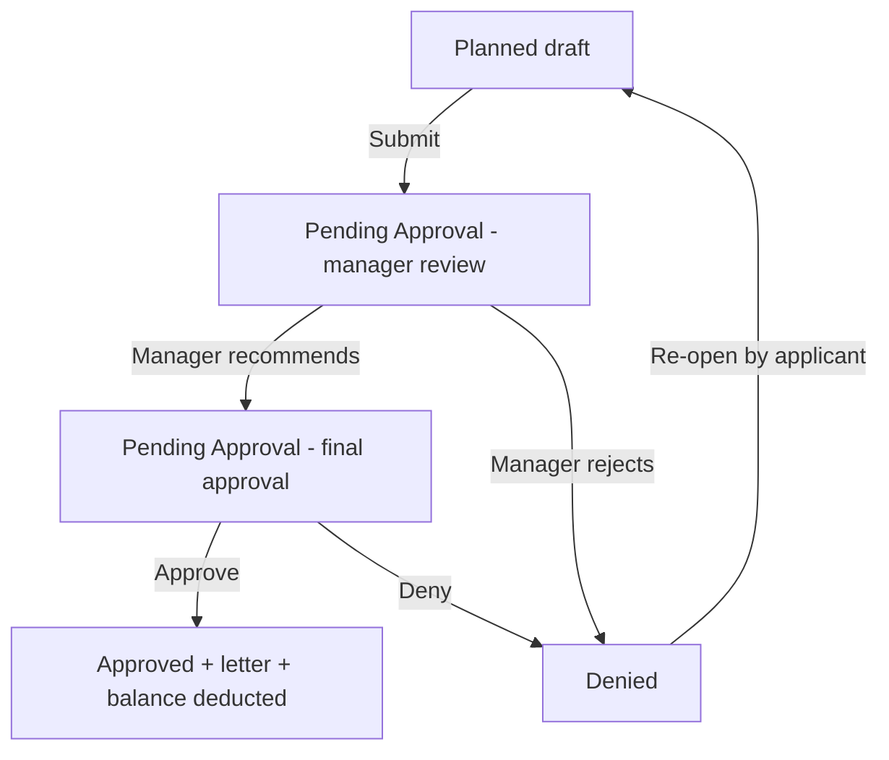

# 04 – Leave Management

## 1. Purpose

The Leave module lets every member of staff **apply for leave**, follow the request through approval, see their **balances**, and print the **approval letter**. Managers and approvers use it to recommend, approve or deny requests and to see who is away. HR uses it for entitlements, **compulsory leave**, HR contacts, letter settings and acting assignments.

Everyone has the Leave tab.

## 2. Who can do what

| Action | Employee (everyone) | Manager roles | Chief Manager / Regional Chief Manager / Managing Director | HR (Head Office / Regional) | Global Admin | Super Admin |
|---|---|---|---|---|---|---|
| Apply, save as planned, edit/delete own planned request, view own history | Yes | Yes | Yes | Yes | Yes | Yes |
| Recommend a request (first stage) | No | Yes, for people routed to them | – | No | No | Yes (not own) |
| Give final approval | No | No | Yes, for people routed to them (Chief Manager at Head Office, Regional Chief Manager in regions, Managing Director for the chiefs) | No | No | Yes (not own) |
| See **All Requests** | No | Their zone | Their zone | Their scope | Yes | Yes |
| Manager team dashboard | No | Yes | Yes | – | – | – |
| HR Dashboard / HR Analytics | No | No | No | Yes | Yes | Yes |
| Compulsory Leave page | No | No | No | **Head Office HR only** | Yes | Yes |
| HR Contacts | No | No | No | Yes (Regional HR: own region) | Yes | Yes |
| Letter Settings, Acting Assignments | No | No | No | Yes (Regional HR: own region only) | Yes | Yes |
| My Signature (apply a saved signature) | No | No | Yes (Chief Manager, Regional Chief Manager, Managing Director), plus anyone with an active acting assignment | Yes (HR who sign) | No (can only **revoke**) | No (can only revoke) |
| Leave Reports / exports | Only with the leave export right | Only with the right | Only with the right | Only with the right (not given to HR by default) | Yes (has the right by default) | Yes |

(The approval routing table is in section 6. "Manager roles" = Manager, Departmental Manager, District Manager.)

**Cannot do:**

- Nobody can approve or recommend **their own** request – not even a Super Admin.
- Contract staff (Charwoman grade) cannot request leave.
- You cannot edit a request once a manager has recommended it; you cannot delete one that is not Planned.
- Regional HR cannot open Compulsory Leave and sees only their own region.

**Reach:** approvers act only for people routed to them (same district, region, department or unit). HR sees their scope: Head Office HR sees Head Office staff and all regions; Regional HR sees their region. Head Office staff are always Head Office HR's, even though they share a region id.

## 3. How to open it

Click **Leave Management** in the header (or the Leave card on the home page). Sidebar items depend on your role:

- **Leave Home** (managers who are not HR land on the team dashboard first)
- **All Requests** (people who may review)
- **Apply for Leave**
- **My Leave History**
- **My Signature** (people who may sign letters)
- **Approvals** (people who approve)

HR tools (HR Analytics, Compulsory Leave, HR Contacts, Letter Settings, Acting Assignments, Leave Reports) sit in the **Staff Management** tab (manual 03).

## 4. Screen-by-screen guide

### 4.1 Leave Home

[Screenshot: Leave Home – balance cards, My Applied Leave, Public Holidays, Team Leave]

Shows balance cards (for example "x of y days used"), **My Applied Leave**, upcoming **Public Holidays**, and **Team Leave**. The Annual card shows **Gross entitlement**, **Compulsory leave** and **Available**. An **Apply for Leave** button is on the page.

### 4.2 Apply for Leave

[Screenshot: Apply for Leave – type, dates, working-days counter, buttons]

| Field | Meaning | Rules |
|---|---|---|
| **Leave Type** | Annual, Casual, Paternity, Maternity or Sick | Required |
| **Start Date** | First day | Required; cannot be before today ("The start date cannot be before today.") |
| **End Date** | Last day | Required; same as or after the start ("The end date must be the same as or after the start date.") |
| **Working days** | Counted for you | Weekends and public holidays are not counted |
| **Reason (Optional)** | Free text | |
| **Attachment (Optional)** | A medical note or supporting document | |

Buttons: **Save as Planned** (keeps it as a private draft; no approver needed yet) and **Submit Request**.

A box "Unavailable compulsory leave dates" lists shutdown dates you cannot book. Picking dates that overlap gives "Selected dates overlap compulsory leave."

Standard entitlements for other types: Casual 5 days, Paternity 7 days, Maternity 93 days, Sick unlimited. Annual days depend on your grade (see section 9).

### 4.3 My Leave History

[Screenshot: My Leave History – status tabs, request cards with Edit/Delete/Re-open]

All your requests. Each card has **View**; and, depending on status:

- **Edit** – a Planned request, or a Pending Approval one that no manager has yet recommended.
- **Delete** – Planned requests only (confirm "Delete planned request?"). Message "Planned request deleted."
- **Re-open** – a Denied request; it goes back to Planned ("Request reopened and set back to Planned.").
- **Print Letter** – on an Approved request.
- **Export Excel** of your history; a button to show past years.

### 4.4 Approvals

[Screenshot: Approvals – request cards with Approve and Deny]

Lists requests waiting for **you**. Each card is labelled **Manager review** (first stage) or **Final approval**. Use **View** to open the details drawer, type an optional **Comment (optional)**, then **Approve** or **Deny** (Deny asks "Deny leave request?"). At final approval you see **Apply my saved signature to the approval letter** (ticked if you have a signature). Search by employee name.

Messages: "Request approved for final review." (first stage), "Request approved." (final), "Request denied."

### 4.5 All Requests

For reviewers and HR. Filters: employee name, **Leave type**, **Department**, **Starting on or after**, **Ending on or before**, and status tabs. Columns: Employee, Region/District, Type, Dates, Days, Status. **Print Letter** on approved rows.

### 4.6 Team Dashboard (managers)

**My Team — Leave Overview**: Team size, On leave now, Pending approvals, Approved this month, Average cycle (submission → decision), Team leave by type, Upcoming leave (next 30 days), and **Export Team Leave** (Excel).

### 4.7 Leave Reports (HR/export right)

**Leave Reports** → **Monthly Leave Summary**: choose a **Format** (CSV or Excel (.xlsx)) and click **Export Report** to download approved leave summaries for your visible scope.

### 4.8 Compulsory Leave (Head Office HR, Global Admin, Super Admin)

Fields: **Leave Year**, **Compulsory days**, **Shutdown starts**, **Staff resume**, **Notes**. It also shows **Who it applies to** and **Staff covered by compulsory leave** (counted now). Years handled by the earlier deduction screen show "Handled by the earlier deduction" and cannot be edited. Saving recalculates everyone's entitlement for the year.

### 4.9 HR Contacts

Table **Contacts by scope** (Head Office and each region): Name, Email, Status. Edit a row to set **Name (optional)**, **Email**, and **Send emails to this contact**. Regional HR edit only their own region. This is where HR notice e-mails are configured.

### 4.10 Letter Settings and Acting Assignments (HR)

- **Letter Settings** – letterhead (heading, address lines, HR signatory, default cc) per location; company block (bankers, board, registered office, telephone, website, e-mail) for Head Office HR / Global Admin / Super Admin only. A region without an address is flagged "address not set". Also shows **Signatures on file** with a **revoke** option.
- **Acting Assignments** – who is acting for a Chief Manager, Regional Chief Manager or Managing Director post, for which region or department, and from/to dates (both days included). Head Office HR and Global Admin set any; Regional HR only a Regional Chief Manager of their region.

### 4.11 My Signature

Draw a signature on the canvas (undo and clear available) or upload a PNG/JPG up to 1 MB. The picture is checked, tidied, and stored privately. Saving or replacing asks for **your password**. **Delete** revokes it. Only you can apply your signature; nobody can see another person's.

## 5. Step-by-step tasks

### 5.1 Apply for leave

1. Click **Leave Management → Apply for Leave**.
2. Choose the **Leave Type**.
3. Pick **Start Date** and **End Date**. Check the **Working days** figure.
4. Add a reason and, if needed, an attachment.
5. Click **Submit Request**. "Leave request submitted for approval."

Or click **Save as Planned** ("Saved as planned.") and submit later from **My Leave History → Edit**.

Your approvers are told in-app and by e-mail.

**Common refusals**

| Message | Why / what to do |
|---|---|
| Casual leave is not allowed while Annual leave balance is greater than 0. | Use Annual leave first. |
| Contract staff are not eligible for leave… Contact HR if this is a mistake. | Your grade is Charwoman. |
| The start date cannot be before today. | Leave cannot be back-dated in the form. |
| Selected dates overlap compulsory leave. | Choose other dates. |
| A message naming a missing approver role | Nobody active holds the approver role for your location; tell HR. The attempt is logged so HR can fix the chain. |

### 5.2 Edit or cancel before approval

1. **My Leave History** → **Edit** (allowed until a manager has recommended).
2. Change dates and submit again ("Leave request updated and submitted." or "Planned leave request updated.").
3. To discard a Planned request use **Delete**.

If it says "This request can no longer be edited because a recommendation has already been given", ask your manager to deny it, then **Re-open** it.

### 5.3 Approve or deny (approvers)

1. **Approvals** → **View** the request.
2. Add a **Comment (optional)**.
3. Click **Approve** or **Deny**.
4. If someone else acted first you are told the request has already been actioned; nothing is applied twice.

Final approval deducts the days from the balance, creates the approval letter, and tells the applicant and HR of the location.

### 5.4 Print the approval letter

1. After approval, open **My Leave History** or **All Requests** → **Print Letter**.
2. The letter screen shows a text preview. HR (in scope) may edit the **reference number**, **cc list**, **signatory mode** and the **Christmas line** until the first print.
3. Click **Print Letter** / **Download PDF**. **Every PDF counts as a print**; after the first one the letter is locked.

Who can open a letter: the applicant, the approvers on the request, Regional HR for their region's staff, Head Office HR, Global Admin, Super Admin.

### 5.5 Save a signature

1. **My Signature**.
2. Draw it or upload a file (max 1 MB).
3. Enter your password and save.

### 5.6 Set the year's compulsory leave (Head Office HR)

1. **Staff Management → HR Tools → Compulsory Leave**.
2. Choose the **Leave Year**, enter **Compulsory days**, **Shutdown starts**, **Staff resume**, optional **Notes**.
3. Save. Everyone's entitlement for the year is recalculated; days already taken are never taken back.

### 5.7 Set the HR contact for a region

1. **HR Contacts** → **Edit** on the row.
2. Enter the **Email** (and name); tick **Send emails to this contact**; **Save**.

### 5.8 Assign an acting approver

1. **Acting Assignments** → add one: person, post, region/department, dates.
2. From then, the person can act on requests alongside the holder; the first to act wins.

## 6. Workflow and status lifecycle

**Statuses:** **Planned** → **Pending Approval** → **Approved** or **Denied**.

**Approval routing** (who recommends, who finally approves) comes from the applicant's location and their own role:

| Applicant | First stage (recommends) | Final approval |
|---|---|---|
| District staff | District Manager (same district) | Regional Chief Manager (same region) |
| Regional-office staff | Departmental Manager (same department and region, at the regional office) | Regional Chief Manager |
| District Manager / Departmental Manager in a region or district | none (single stage) | Regional Chief Manager |
| Head Office staff in a unit | that unit's Manager (same department and unit) | Chief Manager (same department) |
| Head Office staff with no unit | Departmental Manager (same department, Head Office) | Chief Manager |
| Head Office Manager / Departmental Manager | none (single stage) | Chief Manager |
| Chief Manager / Regional Chief Manager | none (single stage) | Managing Director |

Rules: only active people with an active staff record are considered; if several hold the role, all are notified and **whoever acts first wins**. A first-stage rejection is also the final decision. A single-stage request shows as already "Recommended" from submission.

**Notifications:** submitted/recommended → the next approvers (bell and e-mail); approved/denied/rejected → the applicant; after final approval → HR of the applicant's location (the HR contact for e-mail, and HR users in-app). An e-mail failure never stops the request.

**Locked afterwards:** after a manager's recommendation the applicant cannot edit; after the first print an approval letter is locked; approved requests are not editable.

**Time-keeping:** the system records when each stage happened; dashboards report manager response, final approval time and total cycle, and flag approvals that took longer than 72 hours.

## 7. Reports, exports and printing

| Output | Who | Format |
|---|---|---|
| My history | Applicant | Excel |
| Approved leave summary (**Leave Reports**) | People with the leave export right (by default only Global Admin and Super Admin; an administrator can grant it to HR roles) | CSV or Excel |
| Team leave | Managers with the export right | Excel |
| Approval letter | See 5.4 | PDF (A4) |

## 8. Imports

None for leave requests. Staff and grades are imported through Staff (manual 03).

## 9. Rules and gotchas in user terms

- **Annual entitlement depends on grade and length of service.** Junior Gd. Levels 1–3: 26 days, rising to 31 after 10 years; Junior Gd. Levels 4–6: 31; Senior and Management grades: 36. Length of service is counted in whole years up to 1 January of the leave year. Staff with **no grade yet** keep a flat 31 days until graded. Contract staff have none.
- **Compulsory leave** (default 11 days, usually the Christmas shutdown) is taken off Head Office and regional-office staff's entitlement. District staff are exempt. It is **not** charged against days you have used.
- **Casual leave** is only allowed when your Annual balance is zero.
- **Working days** exclude weekends and public holidays.
- **Carry-over** of unused annual leave expires after the configured period (about 90 days into the year, around 1 April); what is unused then is forfeited automatically.
- **Sick leave** has no limit.
- **Balance is deducted only at final approval.**
- **Nobody approves their own request.**
- **Acting approvers** can act alongside the post holder while their assignment is active.
- **Letters are frozen** at the time they are made: changing the letterhead later does not change an issued letter. A letter's reference, cc and signatory mode can only be changed before the first print.
- **Signatures** appear only in the PDF, never in e-mails or lists.

## 10. Troubleshooting and FAQ

1. **My request is stuck.** Open **My Leave History → View**; it shows whether it waits for the manager or the final approver. Ask that person, or HR.
2. **Submission blocked naming a role.** No active holder of that role exists for your location. Tell HR.
3. **"Casual leave is not allowed…"** You still have annual days.
4. **I cannot edit my request.** A manager has already recommended it.
5. **How many days do I have?** See the Annual card on Leave Home (Gross, Compulsory, Available).
6. **Why do I have 31 days and not 36?** You may have no grade set; ask HR.
7. **The approval letter says "address not set".** HR must fill the letterhead for your region in Letter Settings.
8. **I cannot find Print Letter.** The request must be Approved. If the letter failed to generate, HR can regenerate it from the letter screen.
9. **I signed in as a manager but only see the Team Dashboard.** That is the manager landing page; use Approvals in the sidebar.
10. **Two approvers got the same request; one says "already actioned".** Correct – the first action wins.
11. **My Signature page is missing.** Only people who sign letters have it.
12. **Dates greyed out.** They fall in compulsory leave.

## 11. Glossary

- **Planned** – a saved draft not yet sent.
- **Recommend** – the first-stage manager's approval, sending it to the final approver.
- **Single stage** – a request that skips the first stage because the applicant is themselves a manager.
- **Gross entitlement / Compulsory / Available** – total days / shutdown days removed / days you can book.
- **Acting assignment** – a temporary approver for a senior post.
- **SLA breach** – an approval that took more than 72 hours.
- **Retrospective** – leave starting before the approval date.

## 12. Screenshot placeholders

- [Screenshot: Leave Home – Annual card with Gross / Compulsory / Available]
- [Screenshot: Apply for Leave form]
- [Screenshot: My Leave History with Edit / Delete / Re-open]
- [Screenshot: Approvals – manager review card]
- [Screenshot: Approval letter screen with Print Letter]
- [Screenshot: My Signature – drawing canvas]
- [Screenshot: Compulsory Leave page]
- [Screenshot: HR Contacts]
- [Screenshot: Letter Settings]

## To confirm

- The exact set of roles allowed to open **All Requests** and to export (the right "leave export" is not given by default to most roles in the seed; Global Admin has it).
- Whether ordinary employees see the **Leave Reports** link at all (hidden unless the export right is held).
- The default permissions for leave apply/approve are not tied to routes (the approval chain decides); confirm that no further permission is needed for Employee to apply.
- Mail delivery for leave notices in production.
