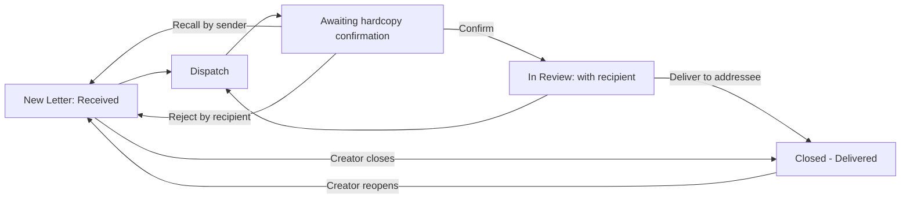

# 05 – Letters (Correspondence Tracking)

## 1. Purpose

Letters tracks **paper correspondence** from the day it arrives to the day it is delivered or closed. A secretary records the letter and gives it a serial number; it is then handed from desk to desk (secretary, manager, chief manager), each hand-over is **confirmed when the paper arrives**, managers add remarks, and the last holder records who finally received it. The module keeps a full trail and lets each holder print their own register.

Typical users: secretaries (record and route), managers and chief managers (review and remark), and Head Office HR / region staff who hold letters.

## 2. Who can do what

The tab is **Letters**. Default role access: Secretary, Manager, Departmental Manager, District Manager, Chief Manager, Regional Chief Manager, Head Office HR, Regional HR (module access), and Super Admin. The **Managing Director does not hold letters**; letters for them are held by their secretary and recorded as delivered.

| Action | Secretary | Manager / Departmental / District Manager | Chief Manager / Regional Chief Manager | Others with Letters access (HR) | Super Admin |
|---|---|---|---|---|---|
| View letters on their desk or in their history | Yes | Yes | Yes | Only if given the view right | Yes |
| Record a **New Letter** | Yes | No | No | No | Yes |
| **Dispatch** / forward | Yes | Yes | Yes | No | Yes |
| **Confirm** hardcopy receipt | Anyone a letter was handed to | | | | |
| Add remarks | Yes (secretary remarks) | Yes (own manager remarks) | Yes (own chief remarks) | No | Yes |
| **Close** a letter (by hand) | Creator only (and Chief/Secretary roles hold the close right) | | | | |
| **My register** (Excel/PDF) | Yes | Only if given the export right | Only if given | | Yes |

Seeded permission names: view (all letter roles), forward (secretary, managers, chief managers), remark (same), create (secretary), close (secretary, chief managers), export (secretary only). An administrator can extend these from Roles & Permissions.

**Reach.** You see a letter when it is on your desk, was on your desk, or you created it. A letter you cannot see answers "not found". People who can receive letters: active staff whose role has the view right **and** the Letters module. The picker never offers anyone else.

**Cannot do:** you cannot dispatch to yourself; you cannot dispatch, remark on or deliver a letter whose paper you have not confirmed; only the creator can edit, close or reopen a letter; only the sender can recall or remind; only the recipient can reject.

## 3. How to open it

Click **Letters** in the header. A number badge on the tab shows hand-overs waiting for you to confirm. The **Letters bell** (separate from the general bell) shows letter notices on every page.

Sidebar: **Dashboard**, **Active Letters**, **Transmittals** (with a count), **New Letter**, **Closed Letters**, **My register**.

## 4. Screen-by-screen guide

### 4.1 Dashboard

Totals and recent activity for your desk.

### 4.2 New Letter

[Screenshot: New Letter form]

| Field | Meaning | Rules |
|---|---|---|
| **Subject** | What the letter is about | Required, up to 255 characters |
| **Reference No.** | The sender's own reference | Optional |
| **Type** | **Internal** (from a staff member) or **External** | Required |
| **Memo Sender** | The staff member who wrote it (search by name or staff ID) | Required for Internal |
| **Company / External Sender** | The organisation or person | Required for External, up to 500 characters |
| **Date on Letter** | The date printed on the letter | Required |
| **Region** | The office recording the letter; its **letter prefix** forms the serial number | Required |

If scans of hardcopy are switched on, a picker lets you attach scans (PDF, JPG, PNG) while recording.

After saving, the letter has a serial number like `GA-2026-001` (prefix – year – running number) and status **Received**, held by you.

### 4.3 Active Letters

[Screenshot: Active Letters – tick column, quick filters, sticky action bar]

Lists open letters in your reach. Controls:

- **Search letters**.
- **Quick filters:** *Awaiting my confirmation*, *Ready to dispatch*.
- Tick boxes (only rows you can act on can be ticked), select-all for the page, and a sticky bar with **Dispatch selected**, **Confirm hardcopies**, **Clear**.
- Click a row (**View**) to open the letter drawer.

Letter drawer tabs/sections: details; **Dispatch letter**; **Confirm hardcopy received**; **Remarks** (**Manager remarks** / **Chief Manager remarks** / **Secretary remarks**); **Deliver to addressee**; **Scans of the hardcopy** (only if switched on); history.

### 4.4 Transmittals

A **transmittal** hands several letters to one person at once (number `TR-<year>-<id>`).

- **Incoming** – hand-overs waiting for you, grouped by transmittal, pre-ticked. Buttons **Confirm all** and **Confirm ticked** (unticked lines stay pending). A reject option asks for a reason.
- **Sent** – transmittals you created, "confirmed of total", per-line status and how long a line has waited, with **Recall** and **Remind**.
- A landscape A4 **hand-over sheet** (PDF) with signature lines can be printed; only the sender, the recipient and Super Admin may open it. The sheet is optional: digital confirmation is what counts.

### 4.5 Closed Letters

Closed or delivered letters in your reach. Same drawer; the creator can **reopen**.

### 4.6 My register

[Screenshot: My register – date filter and preview]

Filters: date range on **date received** (default: this month) and scope chips **All / Still with me / Dispatched / Closed**. A 25-row preview; **Export Excel** and **Export PDF**. Columns: No., Date received, SN, Ref no., Type, Date on letter, Sender, Received from, Subject, Date out, Sent to, Transmittal no., Status, Remarks I recorded (and "Scanned" when scans are on). Status is *With me*, *Dispatched*, *Closed* or *Delivered to …*.

## 5. Step-by-step tasks

### 5.1 Record an incoming letter (secretary)

1. **Letters → New Letter**.
2. Fill the form (section 4.2) and save.
3. Note the serial number. The letter is on your desk.

### 5.2 Hand a letter to the next person

1. **Active Letters** → open the letter → **Dispatch letter** tab (or tick several and **Dispatch selected**).
2. Pick the recipient. The picker pins "Return to previous holder" and recent recipients, then groups *Secretaries* and *Managers*; chips *My location*, *Head Office*, *Any*.
3. Add an optional note and click **Dispatch**.
4. The recipient is notified. Your copy becomes *Dispatched* and the letter shows as awaiting their hardcopy.

**Refusals**

| Message | Meaning |
|---|---|
| Confirm hardcopy receipt before dispatching this letter. | You have not yet confirmed you hold the paper. |
| Dispatch recipient must be different from the current secretariat. | You cannot send to yourself. |
| The selected recipient cannot receive letters. | They lack the Letters access or view right. |
| Select at least one letter to dispatch. | Nothing ticked. |
| These letters can no longer be dispatched by you: … Nothing was dispatched. | A transmittal is all-or-nothing. |
| Some of the selected letters are no longer available to you. Refresh and select again. | The list changed. |

A transmittal holds between 1 and 50 letters.

### 5.3 Confirm you received the paper

1. Open the letter (or **Transmittals → Incoming**).
2. Check the paper is physically with you, then click **Confirm hardcopy received** (or **Confirm all** / **Confirm ticked**).
3. The letter moves to **In Review** and is now yours to review, remark on or dispatch.

### 5.4 Reject, recall or remind

- **Reject** (recipient, before confirming): give a reason of at least 5 characters. "Give a reason of at least 5 characters so the sender knows why."
- **Recall** (sender, only while still unconfirmed): takes it back. "Only the sender of a hand-over can recall it."
- **Remind** (sender, unconfirmed lines): nudges the recipient; "You already reminded … You can remind again …" if you remind within about 24 hours.

### 5.5 Add remarks

1. Open the letter you hold (confirmed).
2. In **Remarks** choose the field for your role: a manager or chief manager records **as themselves** (the field is locked to your name); secretaries use **Secretary remarks**.
3. Type **Your remark** and save.

Refusals: "Enter your remark.", "Secretary remarks can only be added by a secretary…", "This letter is closed. Re-open it before adding remarks.", "Confirm hardcopy receipt before adding remarks to this letter.", "Only the current holder of this letter can add remarks." You can edit only your own remark.

### 5.6 Deliver to the addressee (last step)

1. The current confirmed holder opens **Deliver to addressee**.
2. Under **Who received it** choose a staff member **or** type **Received by (name)** — exactly one.
3. Set **Delivered at** (not in the future) and an optional note (up to 500 characters). Click **Deliver**.
4. The letter is closed and "Delivered to …" appears. The addressee needs no login.

### 5.7 Close or reopen

Only the creator can close ("Only the creator can close this letter."), and only when no hand-over is waiting ("This letter is still waiting for hardcopy confirmation and cannot be closed yet."). The creator can reopen a closed letter from **Closed Letters**.

### 5.8 Print my register

1. **My register** → pick the dates and chip.
2. **Export Excel** or **Export PDF**. If you are over the row cap (5,000) you are told to narrow the range.

## 6. Workflow and status lifecycle

Statuses: **Received** (on your desk) → **Dispatched** (you handed it on) / **In Review** (recipient confirmed) → **Closed** (or **Delivered**).

Notifications: the recipient gets a bell notice (one per transmittal); the sender is told on a rejection with the reason. Recalls remove the notice.

Locked: a confirmed hand-over cannot be recalled (the recipient must dispatch it back). History (status logs, remarks, deliveries) is never deleted.

## 7. Reports, exports and printing

| Output | Who | Format |
|---|---|---|
| My register | Holders with the export right | Excel, PDF (A4 landscape, remarks shortened to 120 characters in the PDF) |
| Transmittal sheet | Sender, recipient, Super Admin | PDF |

Your register shows **only your own** stays; only a Super Admin can ask for someone else's.

## 8. Imports

None.

## 9. Rules and gotchas in user terms

- **Paper first.** Nothing can be reviewed, remarked on, dispatched or delivered until the holder confirms the paper has arrived.
- **Serial numbers** are `PREFIX-YEAR-NNN`; they restart each year, and never change if a region later changes its prefix.
- **Transmittals are all-or-nothing** when dispatching; confirmation can be partial.
- **A scan never replaces the paper.** If scans are switched on you can attach PDF/JPG/PNG (10 files, 10 MB each, no duplicates); voiding a scan needs a reason and keeps the file.
- **Managers remark as themselves.**
- **Managing Director:** letters are held by their secretary.
- **Nothing is deleted.** Remarks, hand-overs and scans stay in history.

## 10. Troubleshooting and FAQ

1. **I cannot dispatch.** Confirm the paper first; and check you are not choosing yourself.
2. **The person I want is not in the picker.** They lack Letters access or the view right. Ask the ICT team.
3. **I sent to the wrong person.** If unconfirmed, **Recall** it; if confirmed, ask them to dispatch it back.
4. **I cannot close a letter.** Only the creator can, and only when nothing is awaiting confirmation. The holder can use **Deliver to addressee**.
5. **The Scans tab is missing.** Scans are switched off for the organisation.
6. **My register is empty.** Check the date range (default is this month) and the scope chip.
7. **Export refused.** You are over the 5,000-row cap, or you lack the export right.
8. **The Letters bell and the general bell differ.** Correct: letters have their own bell.
9. **The number on the Letters tab won't go away.** It counts hand-overs waiting for you; confirm or reject them.
10. **A dispatched batch failed entirely.** One letter could not be sent, so none were; the message names it.

## 11. Glossary

- **Serial number (SN)** – the number the system gives a letter.
- **Hardcopy / paper** – the physical letter.
- **Dispatch** – hand to another person.
- **Transmittal** – a batch of letters handed over together.
- **Holder / desk** – the person who currently has the paper.
- **Remark** – a written comment on a letter.
- **Delivered** – final step; the addressee has the paper.

## 12. Screenshot placeholders

- [Screenshot: New Letter]
- [Screenshot: Active Letters with bulk bar]
- [Screenshot: Letter drawer – Dispatch tab and recipient picker]
- [Screenshot: Transmittals – Incoming checklist]
- [Screenshot: Deliver to addressee]
- [Screenshot: My register]
- [Screenshot: Transmittal sheet PDF]

## To confirm

- Whether **Head Office HR** and **Regional HR** actually hold letters by default: they have Letters module access but no letter permissions in the default setup, so they cannot be given letters unless an administrator grants the view right.
- Whether letter scans are switched on in production.
- The tab names inside the letter drawer were taken from the code labels; confirm on screen.
