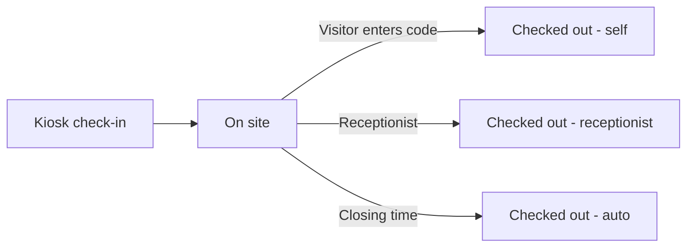

# 06 – Visitors Log (including the Kiosk)

## 1. Purpose

The Visitors module records everyone who enters the building. Visitors sign themselves in at a **kiosk screen** at reception (name, phone, who they are visiting, purpose, signature) and receive a short **checkout code**. The receptionist sees a live list of who is inside, can check people out, and can look up and export past visits. Anyone still inside at closing time is checked out automatically.

Users: **Receptionists** (the log and exports), **visitors** (the kiosk), and Head Office HR / Regional HR / Super Admin who can open the module.

## 2. Who can do what

Module access: Receptionist, Head Office HR, Regional HR, Super Admin. The log pages themselves are restricted to the **Receptionist** role (and Super Admin, who passes every check).

| Action | Receptionist | Super Admin | HR roles | Everyone else |
|---|---|---|---|---|
| Use the kiosk page (check in / check out) | Yes | Yes | Yes (page is open to anyone who has the address) | Yes (no login needed) |
| Open Today's Log | Yes | Yes | **No** (page restricted to receptionists) | No |
| Check a visitor out from the log | Yes | Yes | No | No |
| View Historical Log | Yes | Yes | No | No |
| View a visitor's signature | Yes | Yes | No | No |
| Export Excel / PDF | Yes (has the export right) | Yes | No | No |

**Reach:** the log shows all visitors of the building where the portal runs. There is no region filter.

**Cannot do:** a receptionist cannot edit or delete a visit; visits are history.

## 3. How to open it

- **Receptionist screens:** click the **Visitors Log** tab (sidebar: **Today's Log**, **Historical Log**, **Kiosk Screen**).
- **The kiosk:** open **Kiosk Screen** from the sidebar (or the address `/kiosk` on the reception tablet/PC). The kiosk page needs no login so it can stay open on the reception screen.
- No feature switch.

## 4. Screen-by-screen guide

### 4.1 Kiosk

[Screenshot: Kiosk – step 1 Name & Phone]

A guided flow with a progress bar ("Check-in progress"):

| Step | Heading | Fields | Rules |
|---|---|---|---|
| 1 | **Name & Phone** | Visitor name, Phone | Name required (up to 255 characters). Phone required, exactly 10 digits ("Please enter a 10-digit phone number."; "Please enter your phone number.") |
| 2 | **Who are you visiting?** | Search employee ("Type a name, staff ID, department, or location") | Required ("Please select the employee you are visiting.") |
| 3 | **Purpose** | Purpose (placeholder "Optional") | Optional, up to 1,000 characters |
| 4 | **Signature** | Draw with finger/mouse; **Clear** | Required ("Signature is required.") |

After saving the visitor sees **Welcome <name>!** and a **checkout code** (a number of 1 to 3 digits, unique among visitors who are inside). The kiosk then resets itself after about five seconds ready for the next visitor.

If the phone number already belongs to someone currently inside today, a yellow warning shows: "A visitor with this phone number is already checked in today." It is only a warning.

**Checking out? (on the kiosk)**: type the **Checkout code**, sign, and confirm. "Checkout complete. Thank you." If the code is not found: "No active visit was found for that code." If empty: "Enter your checkout code to find your visit."

### 4.2 Today's Visitor Log

[Screenshot: Today's Log – stat tiles and live table]

Four tiles: **Total Today**, **Currently Inside**, **Checked Out**, **Auto-checkout Time** ("Anyone still inside is checked out then"). Search ("Search visitor or staff") and a **Status** filter (All statuses, On site, Checked out). The table "Live visitor table" refreshes every 30 seconds.

Columns: Visitor Name, Visiting, Purpose, Check-in Time, Check-out Time, Code, Status, Actions. Actions: **View signature**, **Check out** (confirmation "Check out visitor?").

### 4.3 Historical Visitor Log

Read-only. Filters: **Start date**, **End date** (range), search, Status. Same columns; the last column is **Signature**. Message when empty: "No visitors found for this date range."

### 4.4 Exports

Buttons for **Excel** and **PDF** export the selected date or date range; the file name carries the dates.

## 5. Step-by-step tasks

### 5.1 A visitor signs in (visitor)

1. Stand at the kiosk. Enter your name and 10-digit phone number, tap **Next**.
2. Search for the staff member you are visiting and pick them, **Next**.
3. Optionally type your purpose, **Next**.
4. Sign with your finger and submit.
5. Note the **checkout code** on screen.

### 5.2 A visitor signs out (self)

1. On the kiosk choose **Checking out?**
2. Enter the **Checkout code**, sign, confirm.
3. "Checkout complete. Thank you."

### 5.3 Receptionist checks someone out

1. **Visitors Log → Today's Log**.
2. Find the visitor (filter **On site**).
3. Click **Check out** → confirm **Check out visitor?**.

### 5.4 Find an old visit

1. **Historical Log**, set **Start date** and **End date**.
2. Search by visitor or staff name; open **View signature** if needed.

### 5.5 Export

1. **Historical Log** (or Today's Log), set the dates.
2. Click the Excel or PDF export button.

## 6. Workflow and status lifecycle

Statuses: **On site** (inside) → **Checked out**. How a visit ends is recorded: **self** (visitor at the kiosk), **receptionist**, or **auto** (system at closing time, default 18:00 daily).

No notifications are sent to the host in this version. Visits and signatures are never edited afterwards.

## 7. Reports, exports and printing

| Output | Who | Format |
|---|---|---|
| Visitor log for a day or range | Receptionist, Super Admin | Excel, PDF |

## 8. Imports

None.

## 9. Rules and gotchas in user terms

- **Phone numbers are exactly 10 digits** (for example 0241234567, entered without spaces).
- **Checkout codes are short** and only unique among people currently inside; a code can be reused later.
- **The kiosk needs no login.** Leave it on the reception device; it resets itself.
- **Auto-checkout** runs at the closing time set by the organisation (18:00 unless changed). It needs the scheduler running on the server.
- **Hosts** can only be active employees you can find by name, staff ID, department or location.
- **Signatures** are visible only to receptionists and Super Admin.

## 10. Troubleshooting and FAQ

1. **"Please enter a 10-digit phone number."** Remove spaces, plus sign or country code.
2. **The host I want is not found.** Try their staff ID; they may be deactivated.
3. **A warning says the phone is already checked in.** Someone with that number is still inside today; check them out first or continue if it is a different person.
4. **Visitor forgot their code.** The receptionist finds them in Today's Log (Code column) and checks them out.
5. **Everyone shows as checked out at 18:00.** That is the automatic checkout.
6. **I cannot see the Visitors tab.** Only receptionists (and HR roles for module access) have it; the log pages need the Receptionist role.
7. **The kiosk won't reset.** Refresh the page.
8. **The list is not updating.** It refreshes every 30 seconds.
9. **I can't export.** You need the export right (receptionists have it).
10. **Can I delete a wrong visit?** No; visits are permanent history.

## 11. Glossary

- **Kiosk** – the self-service sign-in screen.
- **Checkout code** – the short number a visitor uses to sign out.
- **On site** – visitor currently inside.
- **Auto-checkout** – the system checking out everyone still inside at closing time.

## 12. Screenshot placeholders

- [Screenshot: Kiosk – Name & Phone step]
- [Screenshot: Kiosk – Who are you visiting? search]
- [Screenshot: Kiosk – Signature step]
- [Screenshot: Kiosk – Welcome screen with checkout code]
- [Screenshot: Today's Visitor Log]
- [Screenshot: Historical Visitor Log with date range]

## To confirm

- The `/kiosk` address and the "Kiosk Screen" sidebar item open for any visitor, even without a login – confirm this is intended on a public network.
- Whether Head Office HR / Regional HR (module access but no receptionist role) are meant to see the Visitors tab.
- The exact export button labels on the log pages.
