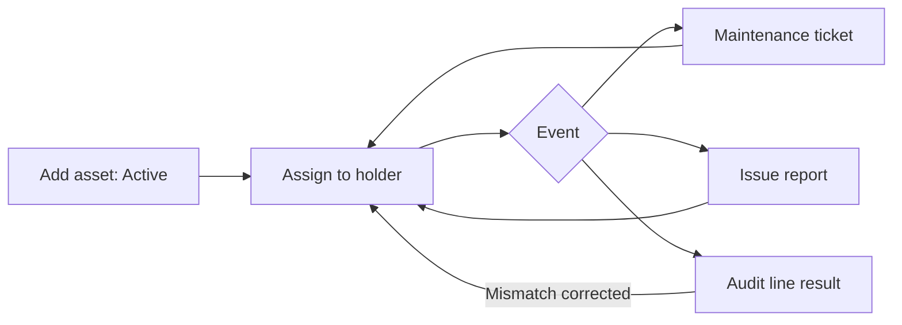

# 07 – ICT Assets and Mobile Device Management (MDM)

This manual has two parts: **Part A – ICT Assets** (the inventory of computers, phones and network equipment) and **Part B – Mobile device management (Android Enterprise)** for company-owned Android phones.

---

# Part A – ICT Assets

## 1. Purpose

ICT Assets is the **inventory** of the company's ICT equipment: who holds which computer, printer, phone or network device, where it is, what state it is in, when it was serviced, which issues were reported, and whether a physical **stock check (audit)** found it. It also reports on age, warranty and replacement due dates.

Users: the **ICT Team** (day-to-day), the **Super Admin**, and ICT management.

## 2. Who can do what

The tab is **ICT Assets**. Module routes are open to **ICT Team** and **Super Admin** only. (The **Global Admin** has the Assets tab only for MDM – see Part B.)

| Action | ICT Team | Super Admin | Global Admin |
|---|---|---|---|
| Dashboard and Summary | Yes | Yes | No |
| View inventory (Assets, Phones, Network, an employee's assets) | Yes | Yes | No |
| Add / edit an asset | Yes (own region) | Yes | No |
| Export inventory (Excel/PDF) | Yes | Yes | No |
| Maintenance log (and export) | Yes | Yes | No |
| Asset audits (start, verify, complete, export) | Yes | Yes | No |
| Issue reports (and export) | Yes | Yes | No |
| Settings: manufacturers, models, IP ranges | Models and manufacturers: **not by default**; Issue categories: Yes | Yes | No |
| Settings: replacement policy | Not by default | Yes | No |
| Agent Reports (device telemetry) | **No** | Yes | No |
| Correct assignment history | Not by default | Yes | No |

(The default ICT Team permissions are: dashboard, inventory view/export, create, edit, maintenance, audits, issue reports, issue categories and the exports. Manufacturers, models, IP ranges, replacement policy and "correct assignment history" are given to Super Admin only; an administrator can grant them to a role in Access Control.)

**Reach (reading is wider than writing):**

- **Head Office ICT** and **Super Admin** can *list and filter* assets of **every region** (the district filter lists all districts, labelled with their region).
- A **regional ICT** user sees only **their own region**.
- **Creating and editing** is limited to the ICT user's **own region**; rows elsewhere show "Read only".
- A record outside your region that you try to open directly answers "not found".

## 3. How to open it

Click **ICT Assets** in the header. Sidebar:

- **Dashboard**, **Summary**
- **All Assets**: **Assets**, **Phones**, **Network**
- **Maintenance**, **Audits**, **Reporting** (issue reports)
- **Mobile Devices** (only if MDM is switched on): **MDM Devices**, **Enroll Phone**, **MDM Policies**
- **Settings**: **Manufacturers**, **Models**, **IP Ranges**, **Issue Categories**, **Replacement Policy**
- **Agent → Agent Reports** (Super Admin only)

Items you lack the right for are hidden.

## 4. Screen-by-screen guide

### 4.1 Dashboard

[Screenshot: ICT Asset Dashboard]

Tiles: **Total Assets**, **Computers**, **Laptops**, **Printers**, **Phones**, **Network**, **Unassigned**. Charts and tables: **Device allocation by category**, **Assets by district** (District Breakdown), **Recently updated assets**, and **Unassigned Assets**.

### 4.2 Assets, Phones, Network lists

[Screenshot: Assets list with filters and Add Asset form]

Three lists of the same kind, one per device category:

- **Assets:** Desktop (PC), All-in-One (AIO), Laptop, Server, Printer (PRT), Photocopier (PTC).
- **Phones:** POS Terminal, SIM Card, Phone.
- **Network:** Router, Switch, Access Point, MiFi, P2P Radio, 4G Router.

Filters: **Search assets**, **Asset type**, **Status**, **District**, **UPS**, rows per page. Columns include Asset, Type / Model, Assigned To, Location, Processor (computers), UPS, Status. Buttons: **Export Excel**, **Export PDF**, **Add Asset**, **Edit** per row, and a link to the asset's detail page. The "Last seen" dot (for computers reporting by agent): green = seen in the last 24 hours, amber = last 7 days, red = older or never.

**Add / Edit Asset form**

| Field | Meaning | Rules |
|---|---|---|
| **Asset Name** | Unique name or tag | Required, unique |
| **Serial Number** | Manufacturer serial | Required, unique |
| **Asset Type** | From the list for the category | Required |
| **Model** | From the Models list | Required |
| **Status** | Active, Damaged, In Repair, Retired, Lost | Required |
| **Status reason** | Why | Required when Damaged |
| **On a UPS / UPS condition / UPS notes** | For desktops, all-in-ones, servers, printers, photocopiers | UPS condition (Working or Spoiled) required when "On a UPS" |
| **Processor** | For computers | Optional |
| **General use (not assigned to a person)** | A shared device | If ticked, there is no holder |
| **Assigned To** | The employee holding it | Required unless general use |
| **Department**, **District** | | Required. District must be in your own region |
| **Asset Tag**, **Actual Location**, **Purchase date**, **Notes** | | Optional |

When you change the holder, you must say *why*: **reassigned** (a handover) or **correction** (picked the wrong person). A "previous holder" is derived from the history.

### 4.3 Asset detail

Tabs/sections: **Overview**, **Assignment history** (who held it and when; marking an old row a correction needs the special right), **Lifecycle** (age, warranty, replacement due), **Maintenance tickets**, **Issue reports linked to this asset**, **Stock checks** (audit results; "Never audited." if none), and **Asset history** (field changes).

### 4.4 Employee assets

From a person's name you can see all equipment they hold.

### 4.5 Maintenance

[Screenshot: Maintenance log]

Filters: search, type, status. Columns: Asset, Type, Status, Reported Date, Completion Date, Technician, Notes. **Export Excel/PDF**.

Form: **Asset Type** (required) → **Asset** (required) → **Maintenance Type** (required) → **Status** (Open, In Progress, Completed, Cancelled) → **Reported Date** (required, not in the future) → completion date, **Technician**, **Notes**.

### 4.6 Reporting (issue reports)

Filters: search, issue type, status. Form **New Issue Report**: **Title** (required), **Issue Type** (required; options come from Issue Categories), **Status** (Open, In Progress, Resolved, Closed), **Linked Asset** (required for categories that need a device), region/district reported from, **Reason / Details**, **Date Solved**. For some categories you are also asked **Is this device still Active?**. **Export Excel/PDF**.

### 4.7 Audits (stock checks)

[Screenshot: Asset audit – lines and result filter]

**Asset Audits** lists audits with title, scope, status (**In progress** or **Completed**), started date and reconciliation rate. **New Asset Audit** takes a **Title**, and a **scope**: device category, region, district. For every matching asset a line is created.

On an audit, each line shows Expected vs Actual (holder, district, status). Set the **Result**: **Matched**, **Mismatch**, **Not found**, **Damaged**. A reason is required for anything except Matched. A mismatch can be **corrected** (applies the actual holder/district/status to the asset). When every line is done, **complete** the audit; the **Reconciliation rate** is calculated. Export Excel/PDF.

### 4.8 Summary

Management view: assets by status, type, age, warranty status and replacement due date, employees with the most assets, most repaired assets, models with the most issues, issue reports and maintenance per month, and average turnaround. Filters include a district and a **From date**. Export Excel/PDF.

### 4.9 Settings

- **Manufacturers** and **Models** – the catalogue used in the Model field.
- **IP Ranges** – label, start/end IP or CIDR, region/district, active flag.
- **Issue Categories** – categories and their options; reorder with Move up / Move down; a category can be marked **Needs a linked device**.
- **Replacement Policy** – a **default** number of years, and **per-type overrides** (**Asset type**, **Replace after (years)**).

### 4.10 Agent Reports (Super Admin)

Telemetry that a small program on staff computers sends to the portal: **Hostname**, **Serial**, **OS / CPU / RAM**, **Last Seen**, **Match status** (Matched / Unmatched). Unmatched rows can be linked by hand to an existing asset (**Select asset**).

## 5. Step-by-step tasks

### 5.1 Register a new device

1. **ICT Assets → Assets** (or Phones / Network) → **Add Asset**.
2. Fill the form (4.2). Pick the holder, or tick **General use**.
3. Save. The device appears in the list and on the holder's page.

### 5.2 Hand a device to someone else

1. **Edit** the asset.
2. Change **Assigned To**.
3. Choose the kind: **reassigned** (handover) or **correction** (wrong person picked); give the reason if asked.
4. Save. The history records the end of the old spell and the start of the new one.

### 5.3 Mark a device damaged or lost

1. **Edit** → **Status** = Damaged (give the **Status reason**) or Lost.
2. For a phone under MDM, the system offers to start **Lost Mode** (see Part B).

### 5.4 Record maintenance

1. **Maintenance → add**; choose type, asset, status, dates, technician.
2. Update the status to **Completed** with a completion date when done.

### 5.5 Run a stock check

1. **Audits → New Asset Audit**, set a title and scope.
2. For each line, check the physical device and set the **Result** (add a reason when not Matched).
3. Correct mismatches if appropriate.
4. When no line is pending, complete the audit. Pending lines block completion: "n line(s) are still pending. Verify every asset before completing."
5. Export the result.

Messages: "Give the audit a title.", "No assets match this scope, so there is nothing to audit.", "This audit is completed and can no longer be changed.", "A correction was already applied from this line, so its result is locked."

### 5.6 Log an issue

1. **Reporting → New Issue Report**.
2. Choose the Issue Type, link the device if required, describe, save.
3. Update the status as it progresses; set **Date Solved** when resolved.

### 5.7 Export

On any list use **Export Excel** or **Export PDF**. The export honours your filters and region.

## 6. Workflow and status lifecycle

- **Asset status:** Active → Damaged / In Repair → Retired / Lost (can return to Active).
- **Maintenance:** Open → In Progress → Completed or Cancelled.
- **Issue report:** Open → In Progress → Resolved → Closed.
- **Audit:** In progress → Completed (then read-only). Each line: Pending → Matched / Mismatch / Not found / Damaged.

Every assignment spell, status change and correction is recorded with who did it. Nothing is deleted.

## 7. Reports, exports and printing

| Output | Right needed | Format |
|---|---|---|
| Asset, phone, network lists | Export inventory | Excel, PDF |
| Maintenance | Export maintenance | Excel, PDF |
| Audit | Export audits | Excel, PDF |
| Issue reports | Export reports | Excel, PDF |
| Summary | Dashboard view | Excel, PDF |

## 8. Imports

None in the portal. (Devices can report automatically through the agent; see 4.10.)

## 9. Rules and gotchas in user terms

- **One holder at a time.** A person can hold many devices, but each device has one current holder (or is "General use").
- **Region limits.** You can read other regions only if you are Head Office ICT; you can edit only your own region.
- **Serial number and asset name are unique.**
- **History is permanent.** "Previous assigned to" is worked out from the history, not typed.
- **Marking an old handover as a correction** needs a special right (Super Admin by default).
- **Retire, don't delete.**

## 10. Troubleshooting and FAQ

1. **I see "Read only" on a row.** It belongs to another region.
2. **"Serial number has already been taken".** The device already exists; search by serial (include retired).
3. **I cannot choose a district.** It must be in your own region.
4. **Where is Agent Reports?** Super Admin only.
5. **I cannot complete the audit.** Some lines are still Pending.
6. **A mismatch cannot be corrected.** Only mismatch lines can; and once corrected the result is locked.
7. **The Models list is read-only.** Ask for the "Manage Models" right.
8. **Phones need a UPS?** No; UPS fields apply to desktops, all-in-ones, servers, printers and photocopiers.
9. **Dashboard counts differ from my filter.** Dashboard counts follow your region scope.
10. **An asset's last-seen dot is red.** Its agent has not reported for over 7 days.

## 11. Glossary

- **Asset** – any listed device.
- **General use** – a shared device without a holder.
- **UPS** – uninterruptible power supply.
- **Audit / stock check** – a physical verification of the inventory.
- **Reconciliation rate** – share of audit lines that matched.
- **Agent** – the telemetry program on staff computers.

## 12. Screenshot placeholders

- [Screenshot: ICT Asset Dashboard]
- [Screenshot: Assets list with filters]
- [Screenshot: Add Asset form]
- [Screenshot: Asset detail – Assignment history]
- [Screenshot: Maintenance log]
- [Screenshot: Asset audit – lines]
- [Screenshot: Replacement Policy]

---

# Part B – Mobile device management (Android Enterprise "MDM")

> **This part appears only if the organisation has switched MDM on.** If you do not see **Mobile Devices** in the Assets sidebar, MDM is off or your role lacks the right.

## B1. Purpose

MDM manages **company-owned Android phones** from the portal: enrol a phone with a QR code, push a security **policy** (allowed apps, screen-lock rules, camera and USB limits), see whether each phone is **compliant**, and send commands: **lock**, **reboot**, **reset passcode**, **Lost Mode**, or **wipe**.

## B2. Who can do what

| Right | Lets you | ICT Team | Global Admin | Super Admin |
|---|---|---|---|---|
| View | See devices, details, policies | Yes | Yes | Yes |
| Enroll | Generate enrolment QR codes | Yes | Yes | Yes |
| Command | Lock, reboot, reset passcode, Lost Mode, confirm a device's identity | Yes | Yes | Yes |
| Manage policies | Create, edit and publish policies | No | Yes | Yes |
| Wipe | Wipe a phone (also needs your own password) | No | Yes | Yes |
| One-time Android Enterprise set-up | | No | No | Yes |

**Reach:** ICT users (not Global Admin / Super Admin) see, enrol and command only phones whose asset is in **the region of their own staff record** – even Head Office ICT. Global Admin and Super Admin see every region plus unlinked devices. The Global Admin may use MDM only; their ICT Assets tab opens the MDM dashboard and the rest of Assets answers "forbidden".

## B3. How to open it

**ICT Assets → Mobile Devices → MDM Devices / Enroll Phone / MDM Policies** (or, for Global Admin, the ICT Assets tab opens MDM Devices directly).

Behind the scenes MDM needs a background worker and a per-minute scheduler on the server. If devices do not update or commands do not arrive, tell the ICT team (see FAQ).

## B4. Screens

### MDM Devices

[Screenshot: MDM Devices dashboard]

Tiles: **Compliant**, **Non-compliant**, **Needs review**, **Lost**, **Awaiting report**, **No report in 24h**, and intake health (unprocessed / failed events). Filter and search "managed phones". Tables: **Managed phones** (Phone, Assigned to, Policy, Compliance, Last check-in, Status), **Recent enrollments**, **Recent commands** (Command, Requested by, Status, When).

### Device page

Sections: **Device**, **Identity** (serial, IMEI), **Policy compliance** (reasons listed when not compliant), **Installed apps** (App, Package, Version), **Actions**, **Command history**.

Actions: **Lock phone**, **Reboot phone**, **Reset passcode** (enter **New passcode**), **Start Lost Mode** (confirm asset tag, serial, IMEI and holder; fill **Message**, **Phone number to call**, **Return address**), **Stop Lost Mode**, **Wipe phone**.

**Wipe** needs: tick **I understand this phone will be erased**, optional **Also erase external storage (SD card)**, **Keep factory reset protection** (leave ticked), and **Your password**.

A banner **Identity needs review** appears when the phone's serial or IMEI does not match the asset record: lock, reboot and Lost Mode are disabled until an authorised person clicks **Confirm identity** (wipe stays available).

### Enroll Phone

Choose the phone (only eligible phones in your region) and a published policy, then **Generate QR code**. The QR is **one-time use, valid 60 minutes**, shown once.

### MDM Policies

List of policies; **create / edit** (Global Admin and Super Admin) covers app catalogue and install type, Play Store mode, block install/uninstall, factory-reset block, factory reset protection accounts, other users, screenshots, camera, USB data, unknown sources, developer settings, passcode rules and system updates. A standard "GWL Standard Phone" policy exists.

## B5. Tasks

### Enrol a phone

1. **Factory reset** the phone (Settings → System → Reset options → Erase all data).
2. On the **Welcome** screen tap the screen **6 times** to open the QR scanner; connect to Wi-Fi.
3. In the portal: **Enroll Phone** → choose the phone and policy → **Generate QR code**.
4. Scan the QR code with the phone; wait for apps to install.
5. Within a minute or two the phone shows as **Compliant** under MDM Devices.

If the QR will not scan: enlarge the window, hold the phone 20–30 cm away, or generate a fresh code.

### Lost or stolen phone

1. Open the device → **Start Lost Mode**; check the details and message; confirm. The phone locks and shows your message and number.
2. If found: **Stop Lost Mode**.
3. Only after **24 hours or more** unrecovered, and with approval, use **Wipe phone** (Global Admin / Super Admin, with your password). A switched-off phone is erased when it next connects.

### Retire or reassign a phone

1. **Wipe phone** (removes it from management and resets it), or factory reset if offline.
2. Update the asset record (holder, location, status).
3. To reuse it, enrol again.

## B6. Status and workflow

Device: **Awaiting first report** → **Compliant** / **Non-compliant** / **Needs review** (identity) → **Lost** (while Lost Mode is on) → **Removed from management**. Commands are queued and delivered when the phone is online; each command and outcome is in the history and the audit log. Passcodes are never kept after delivery.

## B7. Rules

- Limits: commands are rate-limited (about 6 per user per minute); an undelivered command stays valid for about 60 minutes.
- "Not reported recently" means no report in 24 hours.
- The portal never wipes a phone by itself.
- Wipe always needs your password and a tick.

## B8. FAQ

1. **Mobile Devices is missing.** MDM is switched off or your role lacks the View right.
2. **Nothing appears after enrolling.** The server's background services may not be running; tell the ICT team.
3. **A command stays "pending".** The phone is offline or the worker is stopped.
4. **Device "Needs review".** Serial/IMEI disagree with the asset record; correct the record, then **Confirm identity**.
5. **The Wipe button is missing.** Only Global Admin and Super Admin have it.
6. **Phone stays Non-compliant.** Open it and read the listed reasons (e.g. an app that failed to install).
7. **I'm regional ICT and cannot see a phone.** It belongs to another region.
8. **QR expired.** Generate a new one.

## B9. Glossary

- **MDM** – mobile device management.
- **Policy** – the rule set pushed to a phone.
- **Compliant** – meeting the policy.
- **Lost Mode** – locks the phone and shows a return message.
- **Factory reset protection** – the phone needs a company account after a reset.

## To confirm

- Which exact export and list buttons appear for ICT Team versus Super Admin (permissions list taken from the default setup).
- Whether MDM is switched on in production.
- The wording of some buttons on the audit and issue-report forms (taken from code labels).
- The "UPS" filter and "Processor" column visibility per category.
