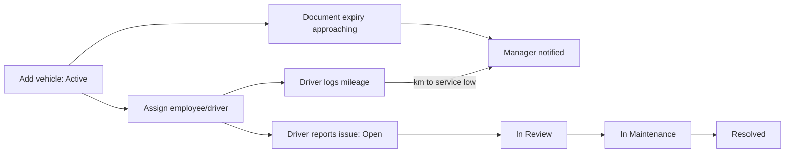

# 08 – Transport (Fleet Management)

## 1. Purpose

Transport manages the company's **vehicle fleet**: the register of vehicles, who they are assigned to, **mileage logs**, **issues** (faults) reported by drivers, **maintenance** and **document renewals** (insurance and road worthiness), **expenses**, and **reports**. It warns managers when a vehicle is due for service or its documents are about to expire.

Users: **Transport Managers** (run the fleet of their location), **Drivers** (log mileage, report issues), and **Employees** who have a vehicle assigned to them (see their own vehicle).

## 2. Who can do what

Module access: Transport Manager, Driver, Employee, Super Admin.

| Action | Transport Manager | Driver | Employee | Super Admin |
|---|---|---|---|---|
| Dashboard | Yes (whole fleet in reach) | Own vehicle card | Own vehicle card | Yes |
| View all vehicles in reach | Yes | No (own only) | No (own only) | Yes |
| Add / edit vehicles, import vehicles | Yes | No | No | Yes |
| Assign vehicles / drivers | Yes | No | No | Yes |
| Log mileage | Yes | Yes (own vehicle) | No | Yes |
| Report an issue | Yes | Yes (own vehicle) | No | Yes |
| Manage issues (change status) | Yes | No | No | Yes |
| Maintenance records and document renewals | Yes | No | No | Yes |
| Expenses (record) and export | Yes | No | No | Yes |
| Reports (and PDF/Excel) | Yes | No | No | Yes |
| Settings: Vehicle Brands / Models | Yes | No | No | Yes |

**Reach (very important):** your **role gives you the rights, but your location decides which vehicles you reach**.

- **Super Admin** – all vehicles, including ones not yet placed in a location.
- **Head Office staff** – only vehicles based in the **Head Office** district.
- **Everyone else (regional or district staff)** – vehicles of **their own region, excluding Head Office**.
- A login with no staff record or no region reaches **nothing**.
- A vehicle outside your reach answers **"not found"**, never "not allowed".
- A Transport Manager in Ashanti manages Ashanti's fleet only.

**Cannot do:** you cannot assign a driver or user who is not based at the vehicle's location (Head Office versus region). A Transport Manager cannot put a vehicle in another location – the vehicle takes the location of the person who creates it (only Super Admin picks a region and district).

## 3. How to open it

Click **Transport** in the header. Sidebar: **Dashboard**, **Vehicles**, **Operations** (**Mileage**, **Issues**, **Maintenance**, **Expenses**), **Reports**, and **Settings** (**Vehicle Brands**, **Vehicle Models**) for catalogue managers. Drivers and employees see only the items they may use.

## 4. Screen-by-screen guide

### 4.1 Dashboard

[Screenshot: Transport Dashboard]

For managers: **Fleet Size**, **Active**, **Open Issues**, **This Month Spend**, **Highest Spend**, **Expiring Documents** (insurance or road worthiness due within 90 days, with days remaining), **Upcoming Maintenance** (vehicles closest to their next service, "Remaining" in km), **Fleet By Department**, **Issues By Status**, **Highest spending vehicles**.

For a driver or employee: **My Assigned Vehicle** with current mileage and km remaining to service. If nothing is assigned: "No vehicle is assigned to your account."

### 4.2 Vehicles (Fleet Register)

[Screenshot: Fleet Register and the Add Vehicle form]

Filters: search, **Type**, **Status**. Buttons: **Add Vehicle**, an **Excel or CSV file** import, **Edit**, details with **Assignment history**.

| Field | Meaning | Rules |
|---|---|---|
| **Photo** | Picture of the vehicle | Optional image, up to 4 MB |
| **Type** | Sedan, SUV, Pickup, Van, Bus, Motorcycle, Truck | Required |
| **Brand**, **Model** | Chosen from the catalogue | Required |
| **Add new brand / Add new model** | Quick panels to add a catalogue entry | Only for people allowed to manage the catalogue |
| **Color** | | Optional |
| **Number Plate** | | Required, unique |
| **Year purchased** | | Optional, 1950 to this year |
| **Pool car** | Shared vehicle with no assigned employee | Tick if shared |
| **Assigned Employee** | The person it is assigned to | Optional; must be based at the vehicle's location |
| **Department** | | Optional |
| **Location (Region / District)** | Shown read-only (your own); Super Admin picks | Required |
| **Driver Type** | Self drive or Assigned driver | Required |
| **Assigned Driver** | | Optional; must fit the location |
| **Current Mileage** | Odometer | Required, whole number, 0 or more |
| **Maintenance Interval KM** | Distance between services | Required, 1–100,000 |
| **Insurance Expiry**, **Road Worthiness Expiry** | Dates | Optional |
| **Status** | Active, Maintenance, Retired | Required |
| **Notes** | | Optional |

**Import:** a file (.xlsx, .csv or .txt, up to 5 MB) with columns such as `type, brand, model, color, number_plate, year_purchased, is_pool_car, assigned_user_email, assigned_driver_email, department_name, district_name, region_name, current_mileage, maintenance_interval_km, insurance_expiry_date, road_worthiness_expiry_date, status`. After importing you see "n created / n updated / n failed". A plate that exists outside your reach is reported as "already registered" without saying where.

### 4.3 Mileage

**Mileage Tracking**: managers see all **Mileage logs**; drivers see **My Mileage Logs**. Columns: Date, Vehicle, Driver, Before, After, Distance, Purpose. Form **Mileage Entry / New Mileage**: **Vehicle**, **Trip Date** (required), **Previous Mileage** (before, required), **After** (required), **Trip Purpose** (required, up to 255). A "Service interval used" bar shows progress to the next service.

### 4.4 Issues

**Issue Board** (managers) / **My Issues** (drivers). **Report Issue**: **Vehicle**, **Types** (tick one or more: engine, tires, lights, brakes, battery, bodywork, suspension, other – at least one), **Severity** (low, medium, high, critical), **Description** (required, up to 5,000), **Photo** (optional image, up to 4 MB). Managers change **Status** with **Update Status**: Open, In Review, In Maintenance, Resolved. Filters: severity and status.

### 4.5 Maintenance

Managers record **Maintenance History** with **Maintenance Type**, **Service Date**, **Description**, **Provider**/**Performed By**, **Cost**, **Mileage At Service**, **Next Service Date / Next Mileage**, and **Receipt Photo**. **Upcoming Maintenance** lists vehicles closest to their service point. **Renew Documents** records an insurance or road worthiness renewal with a **New Expiry Date** and optional document/amount.

### 4.6 Expenses

**Expense Register**: **Log Expense** with **Vehicle**, **Type** (fuel, insurance, maintenance, repair, road worthiness, parking, toll, fine, other), **Amount** (more than 0), **Currency** (3 letters, e.g. GHS), **Expense Date**, **Description**, **Receipt Photo**. Filters: vehicle, type, **From date**, **To date**. Totals: **Filtered Total** and **Spend by vehicle**. Export button for Excel.

### 4.7 Reports

**Transport Reports** with a **Date range** and department filter: cards plus charts for Monthly fleet expenses, Expense breakdown by type, Top 5 most expensive vehicles, Mileage logged per month, Issues reported versus resolved, Issues by type, Vehicle status distribution, Vehicles by department, **Maintenance due by mileage**, and **Upcoming document renewals** (due within 60 days). **Export Excel** and **Export PDF**.

### 4.8 Settings – Vehicle Brands and Models

Lists with search, counts of models and vehicles, and an active/inactive status. You can **add**, **rename**, **move a model to another brand**, **activate / deactivate**. Nothing is deleted. Renaming or moving updates the text on existing vehicles automatically (including retired ones). Needs the "manage vehicle catalogue" right (Transport Manager and Super Admin by default). The catalogue is shared and not limited to a region.

## 5. Step-by-step tasks

### 5.1 Add a vehicle

1. **Transport → Vehicles → Add Vehicle**.
2. Choose type, brand and model (add a new brand/model if missing and allowed), enter the plate and mileage.
3. Set the maintenance interval and document expiry dates.
4. Optionally assign an employee and driver based at the same location.
5. Click **Save Vehicle**.

### 5.2 Assign or change a driver

1. **Edit** the vehicle.
2. Set **Driver Type**, **Assigned Driver** and/or **Assigned Employee**; save.
3. The **Assignment history** records who had it and when. A person who is not based at the vehicle's location is refused.

### 5.3 Log mileage (driver)

1. **Transport → Mileage → New Mileage**. Your vehicle is preselected.
2. Enter the date, the odometer before and after, and the purpose.
3. Save. If the new reading is not higher: "New mileage must be greater than previous mileage."
4. The vehicle's current mileage and "km remaining" update.

### 5.4 Report a fault (driver)

1. **Issues → Report Issue**; tick the issue types, choose the severity, describe and optionally add a photo.
2. Submit. Transport managers are notified.

### 5.5 Work an issue (manager)

1. **Issues** → choose the status in **Update Status** (In Review, In Maintenance, Resolved).

### 5.6 Record a service

1. **Maintenance → Add Maintenance Record**. Fill type, date, mileage at service, cost, next service.
2. Save. The vehicle's next-service point resets.

### 5.7 Renew documents

1. **Maintenance → Renew Documents**; pick the vehicle, Insurance or Road Worthiness, the **New Expiry Date**.
2. Save. The vehicle's expiry date updates.

### 5.8 Record and export expenses

1. **Expenses → Log Expense**.
2. Filter by date range or vehicle and click the export button for a spreadsheet (needs the expense export right).

### 5.9 Import vehicles

1. **Vehicles →** choose the file in the import box.
2. Read the summary. Fix failed rows and import again.

## 6. Workflow and status lifecycle

- **Vehicle status:** Active → Maintenance → Retired.
- **Issue status:** Open → In Review → In Maintenance → Resolved.
- **Documents:** the system checks every morning (about 07:30) for insurance and road-worthiness expiries and tells Super Admin and the Transport Managers of the vehicle's location; service-due warnings and new-issue alerts are sent the same way.

Notifications go only to the Super Admin and Transport Managers **of that vehicle's location** (never other regions). Expenses and mileage logs are history; they are not edited by drivers.

## 7. Reports, exports and printing

| Output | Who | Format |
|---|---|---|
| Transport Reports | Transport Manager, Super Admin | Excel, PDF |
| Expense register | Those with the expense export right | Excel |

Reports are limited to the vehicles in your reach, and cached figures are kept separately per reach.

## 8. Imports

**Vehicles import** (see 4.2): .xlsx/.csv/.txt, 5 MB. New plates are created, existing ones updated. The location of an imported vehicle follows the same rule as the form: your own location, or the district/region columns for Super Admin.

## 9. Rules and gotchas in user terms

- **Head Office is separate.** A vehicle at Head Office belongs to Head Office staff only; regional managers never see it.
- **One person, one vehicle:** a person can hold only one vehicle at a time, wherever it is.
- **Plates are unique** (stored in capitals).
- **Mileage only goes up.**
- **Nothing is deleted.** Vehicles are retired; brands and models are deactivated.
- **Your location is stamped** on a new vehicle; you cannot choose another.
- **Photos and receipts** are images only, up to 4 MB.

## 10. Troubleshooting and FAQ

1. **I cannot see a vehicle I know exists.** It is in another region or at Head Office (outside your reach), or has no location yet.
2. **"No vehicle is assigned to your account."** Ask your Transport Manager to assign you one.
3. **My driver can't be selected.** They are not based at the vehicle's location.
4. **"New mileage must be greater than previous mileage."** Check the odometer reading.
5. **The import says a plate is already registered.** It exists (possibly outside your reach).
6. **I can't add a brand.** You need the catalogue right.
7. **Expiry warnings stopped.** They go to managers of the vehicle's location; check the vehicle has a location and expiry dates.
8. **The Reports page is empty.** Widen the date range or check your reach.
9. **Why can't I change the region of a vehicle?** Only Super Admin can.
10. **Retired vehicle still in history.** Retired vehicles and their history stay visible.

## 11. Glossary

- **Fleet Register** – the vehicle list.
- **Pool car** – a shared vehicle with no assigned employee.
- **Road worthiness** – the roadworthy certificate.
- **Service interval** – distance between services.
- **Assignment history** – the record of who held a vehicle.
- **Catalogue** – the shared list of brands and models.

## 12. Screenshot placeholders

- [Screenshot: Transport Dashboard]
- [Screenshot: Fleet Register]
- [Screenshot: Add Vehicle form]
- [Screenshot: New Mileage entry]
- [Screenshot: Issue Board]
- [Screenshot: Maintenance – Renew Documents]
- [Screenshot: Transport Reports]
- [Screenshot: Vehicle Brands settings]

## To confirm

- The exact column headings of the vehicle import file (taken from the code; download the template if one is offered).
- The Employee role's tab: its Transport tab opens only if the person has an assigned vehicle; confirm the landing page.
- Whether the driver mobile app (a separate program) is in use; it is not described here.
- The Health & Safety equipment vehicle picker is not yet limited by Transport reach (known gap).
