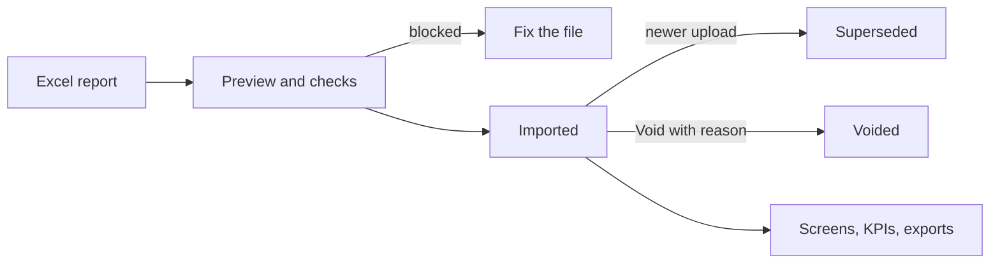

# 09 – Commercial (Reading, Billing, KPIs, Customer List and SMS)

> **Switches.** The whole Commercial module can be switched off for the organisation. Two parts have their own extra switches: the **Customer List** (normally on when Commercial is on) and **SMS to customers** (normally **off**, and only for the Accra West region). If you do not see **Customer List** or **SMS** in the Commercial sidebar, that part is off or your role/region does not allow it.

## 1. Purpose

Commercial turns the weekly and monthly **reports from the billing system** into charts and tables the Commercial team can use:

- **Meter reading** – how many customers were read, skipped or visited, by month, region and meter reader (called a **CCA** on screen).
- **Billing** – volumes, amounts billed, payments, closing balances, unbilled and estimated bills, by region, district and route.
- **KPIs against targets** – sales volume, billing, collection and arrears against yearly district targets.
- **Summary** – one page that combines reading and billing.
- **Customer List** – the full customer base (millions of accounts), analysed and searchable.
- **SMS** – text messages to Accra West customers.

You upload the Excel files; the portal checks that they add up, stores them, and builds the screens.

## 2. Who can do what

Module access: Commercial Officer, Commercial Manager, District Manager, Chief Manager, Regional Chief Manager, Super Admin.

| Action | Commercial Officer | Commercial Manager | District Manager / Chief Manager / Regional Chief Manager | Super Admin |
|---|---|---|---|---|
| Overview, Summary | Yes | Yes | Yes | Yes |
| Reading (region totals) | Yes | Yes | Yes | Yes |
| Reader-level screens (Readers, Exceptions, Scorecard, reader detail) | Yes | Yes | **No** | Yes |
| Billing and KPIs | Yes | Yes | Yes | Yes |
| Upload reports (reading, billing) | Yes | Yes | No | Yes |
| Resolve unmatched readers/districts | Yes | Yes | No | Yes |
| Void a batch | Yes | Yes | No | Yes |
| Export to Excel/PDF | Yes | Yes | No | Yes |
| Change settings and KPI targets | No | Yes | No | Yes |
| Customer List: analytics and lists | Yes | Yes | Yes | Yes |
| Customer List: see customer **names and addresses** | No | No | No | Yes |
| Customer List: upload | Yes | Yes | No | Yes |
| SMS: send, templates, campaigns, reports, balance | Yes | Yes | No | Yes |
| SMS settings | No | No | No | Yes |

**Reach (very important):**

- Super Admin, Global Admin and **Head Office** staff see all regions' data (Global Admin has no Commercial tab by default).
- Everyone else sees only **their own region** (from their staff record). A region in a link that is not yours is ignored or answers "not found". Users with no region cannot upload ("Your account has no region assigned, so you cannot upload reports. Contact an administrator.").
- **Individual staff performance is protected.** Reader-level screens need the "reader performance" right. Without it, a home district with fewer than 3 active readers shows no reading figures, so a person cannot be singled out.
- **SMS is locked to Accra West** (see section 6) — Head Office staff are not allowed even though they share that region's code.

## 3. How to open it

Click **Commercial** in the header. Sidebar: **Overview**, **Summary**, **Reading**, **Billing**, **KPIs**, **Customer List**, **SMS**, **Settings**, **Uploads**. Items you may not use are hidden.

## 4. Screen-by-screen guide

### 4.1 Overview

Tiles of the latest data and a **Monthly trend** (skip rate and coverage per month). Reminders show when an upload type is overdue.

### 4.2 Uploads (reading and billing reports)

[Screenshot: Uploads – table and Upload a report]

Table of batches (type, region, period, segment, rows, status, uploaded by/when) with filters **All reports** and **All statuses**.

**Upload a report:** choose the file (.xlsx only, up to 10 MB), optionally notes (up to 2,000 characters), then **Preview File**. The preview shows counts, whether totals reconcile, and warnings. **Import** saves; **Cancel** discards.

Two kinds of report are accepted: the **Customer Meter Reading Report – CCA Summary – By Month** and the **Billing Summary Report By Routes**. The system detects which one it is.

- **Blocked** (cannot import): the file's rows do not add up to its own totals; wrong file type; no region on your account. Message: "Import blocked: n problem(s) must be fixed first."
- **Warns only**: a reader or district that cannot be matched to staff or a district. The batch imports and the item waits to be resolved.
- A newer upload of the same region, period and segment **supersedes** the older one automatically; older ones stay as history.

**Batch detail:** summary, reconciliation results, warnings, an **unmatched** list with **Resolve** (link a reader to a staff member, or map a district name, remembered for future uploads — "Region remembered for future uploads."), **Re-match**, and **Void batch**.

### 4.3 Reading

[Screenshot: Reading – tabs]

Filters: region, **From month**, home district. Tabs include the monthly volume, **Month by month**, coverage, skip rate, **Month-to-date pace at each upload**, and (with reader-performance right) **League table** (CCAs ranked by visits), **Month-on-month movement**, **Inactive and under-used CCAs**, **Workload balance**, **Skip-rate outliers**, **Consistency**, **CCA scorecard**. The current month is "in progress" and is left out of movement, inactive, workload and consistency figures.

Rates are percentages of **counts**, never taken from the source file's own percentages (those are measured against the whole region and mislead). A rate with no denominator shows blank. Click a reader to open the **reader page**: months with visits, read, skipped, skip rate per month. Another region's reader answers forbidden.

### 4.4 Billing

Filters: region, **customer segment**, **period**, snapshot. Shows **Billing for the period**, **Balance roll-forward**, **Cash collection ratio**, **Collected against this period's billing**, **Cash that was arrears from earlier months**, **Estimated bills / Estimated share of volume**, **Unbilled**, **Customers billed by method**, **Credit balances by district**, **Domestic consumption bands**, **Route exceptions** and **Compare two months** (single-month snapshots only).

A snapshot is one upload's view (the newest per region, segment and period). Figures are never added across snapshots (balances roll forward). A **negative balance is a customer credit** (confirmed by the Commercial team). Times shown are **upload** times; the reports print no run date.

### 4.5 KPIs

[Screenshot: KPIs against targets]

**KPIs against targets** with **Region**, **Customer segment**, **Months shown**. A district table shows each KPI's actual and **efficiency = actual ÷ target × 100**: sales (volume), billing, collection and arrears, plus the **Age of arrears** table. Charts show actual against target by month and **Year-to-date efficiency by district**.

- Targets are **yearly**, set per district, KPI and calendar year; a month's target is the annual figure ÷ 12. No target = blank efficiency (never guessed). The region target counts only if every district has one.
- **Arrears** = what customers owe; credits are never netted off.
- **Age of arrears** is a working formula (arrears ÷ that month's billing, in months) and is not yet confirmed by the Commercial team.

**Set targets** (Commercial Manager, Super Admin): choose a district, enter the targets for the year, **Save the targets**; a **Target history** per district is kept.

### 4.6 Summary

One page: **Data freshness**, **Data quality** ("Things to fix before relying on the numbers"), **Coverage**, **Billing snapshot**, **Cash collection ratio**, **Unbilled rate**, **District scorecard**, **Estimation and skip rate**, **Route exceptions**. Reading and billing are different populations (billing is a customer segment; reading covers everyone and reading by district uses the reader's *home* district), and the page says so.

### 4.7 Settings

**Commercial settings** (Commercial Manager and Super Admin; saved only when different from the default): targets (skip rate 10%, coverage 90%, collection 95%), reader thresholds (minimum visits to be judged an outlier 200, outlier z-score 2.0, workload bands 50%–150% of the median, minimum readers for district figures 3), route exception thresholds, export row caps (Excel 5,000 rows; PDF 1,500), upload reminders (reading after 10 days, billing after 35 days, repeated every 7 days), and Customer List options. The screen previews how many routes your exception thresholds would flag.

### 4.8 Export

Buttons on the analytic screens download **Excel** or **PDF** of what you see (same filters, same region). Needs the export right plus the right to view that report (reader reports also need the reader-performance right). Capped at the row limits above; every download is recorded.

## 5. Customer List (when switched on)

### 5.1 What it is

Weekly or monthly **customer details** exports from the billing system (one district per file) keep a **current picture of every customer**: category, status, meter, balance, last bill, last payment, consumption. The analysis answers questions like "how many billing accounts have a faulty meter?" or "who owes and has not paid in 90 days?". Names, addresses, phone numbers and e-mails are personal data and are heavily protected.

### 5.2 Customer List analysis

Tabs: **A. Overview**, **B. Meters**, **C. Receivables**, **D. Billing & collection**, **E. Dormancy**, **F. Growth & churn**, **G. Consumption** (including consumption against each account's own history), **H. Data quality**, **I. Trends & compare**, **J. Coverage & efficiency**. Filters: period, region (for all-region viewers), district, route, category group, status, meter status, "billing accounts only", and **Break down by** district/route/category/status/meter status. These screens show totals, never lists of personal data. Lists drill from the counts. Data-quality lists hold up to 10,000 accounts per issue (the count is always exact).

Billing accounts are those with status ACTB. A bill is "valid" if dated in the last 30 days and above zero. Arrears means what customers owe; credits are never netted off.

### 5.3 Find customers

Search and drill-down lists (**Customer search**, **List filters**, **Order**, **Arrears bucket**, **Data-quality issue**). You must choose a district or type a search. **Phones and e-mails are masked** (for example `024****567`). Names appear only for those who hold the customer-details right. The search by phone, e-mail or name is offered only to holders of that right. Tick customers and use **Send SMS to ticked** (SMS holders only).

### 5.4 One customer

**Account** page with **Account history** (what changed between uploads) and **Contact details**. **Show full contact details** is available to holders of the right and **is recorded** in the audit log.

### 5.5 Customer uploads

[Screenshot: Customer list uploads and batch progress]

**Upload a customer list**: choose the **Upload type** and file (.xlsx; big files up to about 200 MB), click **Upload**. Progress is live on the batch page. The process: find the district → read the file in pieces → check each route against its own totals → merge changes → rebuild the summaries → remove the temporary copies (including the uploaded workbook). A **queue worker must be running**; if nothing moves, tell the ICT team.

Statuses: **Queued**, **Processing**, **Needs a match** (the region/district in the file cannot be matched — resolve it), **Blocked**, **Failed**, **Imported**, **Superseded**, **Voided**.

- **Blocked** (nothing changes): a route that does not add up to its own totals (GH¢1 slack), duplicate account numbers in the file, a missing required column, a region you may not load, or a file **older** than the district's current data.
- **Warn only**: an unknown category/status/meter code, a customer count that moved by more than 20% (a partial export looks like that), malformed rows (counted; first 40 listed by row number), a route without a totals row.
- **Same file twice** is recognised. A different file with identical content (nothing changed) adds no customer rows.
- **One district at a time**: a second upload for the same district waits.
- **Void**: only the **newest** batch of a district can be voided, and it restores the earlier values exactly (contact details are not rolled back).

### 5.6 Categories, statuses and cadence (settings)

**Customer list: categories, statuses and upload cadence** (Commercial settings right): name and group of each customer **category**, the meaning of each **account status** with flags **Active**, **Billing** and **Meaning confirmed**, meter status meanings, and each district's expected upload **cadence** (weekly, monthly, not expected). New codes found in a file are flagged here for review. Several status codes (TRFR, VACN, DISO, NFLO) are not yet confirmed and are not used to form SMS groups.

Reminders tell the officers of the region when a district's newest upload is older than its cadence allows (weekly 10 days, monthly 35 days).

## 6. SMS to customers (when switched on)

### 6.1 What it is

Commercial staff of **Accra West** can send a text message to Accra West customers: everyone, hand-picked customers, or a named group. The balance of credit is shown, and every campaign has a delivery report.

Who may use it: staff whose staff record is in **Accra West** (not Head Office) with the SMS right, plus Super Admin. Head Office staff and Global Admin outside Accra West are refused. Another region's campaign answers "not found".

### 6.2 Screens

- **SMS** home: **balance** (refreshed every 5 minutes; **Refresh** is limited), a low-balance banner when credit falls below about 200.
- **Send SMS** (four steps, **Next** / **Back**): 
  1. **Who should get the message?** – choose **Group** and filters (see below). The count shown is live and exact.
  2. **What do you want to say?** – **Sender ID** (only approved ones), **Template**, **Message** (up to 1,000 characters; merge fields `{account_no}`, `{balance}`, and `{name}` only if you hold the customer-names right). The screen shows message parts and estimated cost. **Save as a template** keeps the wording (never customer data).
  3. **Check before you send** – three masked sample recipients and cost against balance.
  4. **Confirm** – type the number of recipients to confirm (or tick a box under 20 recipients). Choose **send now** or schedule (at least a minute ahead, at most 90 days).
- **Campaigns** (status filter, **Cancel** for an open one), **campaign report** (totals, timeline, failures by reason, recipients with masked numbers, Excel export), **Templates**, **Settings** (Super Admin).

**Groups** available include: all customers, debtors (balance greater than an amount you type — default GH¢100), no payment in 30/60/90/180 days (default 60), the most valuable customers (top N, default 500, or top percent, default 5), faulty or no meter, and status groups ACTB, ACTN, DISC, SUSP, with district, route, category-group and arrears-bucket filters. Accounts missing from the latest file are left out unless you switch them in. Only the **first** mobile number of each customer is used, and **one SMS per number** per campaign (accounts sharing a number are collapsed).

### 6.3 Refusals

| Message | Meaning |
|---|---|
| Choose one of the approved sender IDs. | Sender not on the approved list |
| No customer in this audience can be messaged: none has a valid number. | Empty audience |
| This audience has n recipients; one campaign may have at most 50,000. Narrow it down. | Too large |
| Type the number of recipients (n) to confirm. / Tick the box to confirm that you want to send this message. | Confirmation missing |
| This campaign has already been submitted. Check the campaigns list. | Double-click protection |
| Write the message. / The message is too long (1,000 characters at most). | Message rules |
| Unknown merge field … You can use {name}, {account_no} and {balance}. | Fix the text |
| {name} needs the permission to see customer names. Take it out of the message. | You lack the names right |
| Pick a time at least a minute from now… / A campaign can be scheduled at most 90 days ahead. | Scheduling |
| Give the template a name (80 characters at most). / A template with that name already exists. | Templates |

### 6.4 Campaign statuses

**Scheduled** → **Queued** → **Running** → **Completed**; or **Cancelling** → **Cancelled**; or **Failed** / **Blocked** (stops with a plain reason, for example when the whole chunk is refused or the balance is too low). One campaign runs at a time per region; a second waits. A message is never sent twice: if the system cannot tell whether a message went, it is marked **unknown** and never retried.

## 7. Step-by-step tasks

### 7.1 Upload a reading or billing report

1. **Commercial → Uploads → Upload a report**.
2. Choose the .xlsx file; add notes if useful; click **Preview File**.
3. Read warnings and the reconciliation. If blocked, fix the file at source and try again.
4. Click **Import**. "Batch imported with n rows."
5. Open the batch; resolve unmatched readers or districts.

### 7.2 Resolve an unmatched reader or district

1. Open the batch → the **unmatched** list.
2. Pick the staff member (or district) → **Resolve**.
3. The match is remembered; click **Re-match** to apply it to the batch.

### 7.3 Void a wrong upload

1. Open the batch → **Void batch**, enter a **reason** (required: "A reason is required to void a batch.").
2. The numbers it supplied disappear and an earlier batch becomes effective again. "This batch has already been voided." if repeated.

### 7.4 Set yearly KPI targets

1. **Commercial → KPIs → Set targets**.
2. Choose a district, enter each KPI's annual target, **Save the targets**.

### 7.5 Upload a customer list

1. **Customer List → Customer uploads** (or **Uploads** and switch to customer lists).
2. Choose the **Upload type**, pick the file, **Upload**.
3. Watch the batch page; fix any "Needs a match" or "Blocked" reason.

### 7.6 Find overdue accounts and message them

1. **Find customers** → choose district → apply filters (e.g. **Arrears bucket**).
2. Or go to **SMS → Send SMS** and choose the group **Debtors** with a minimum owed.
3. Check the sample, cost and count; confirm; send or schedule.
4. Open **Campaigns** → the report later to see delivered/failed.

## 8. Workflow and status lifecycle

Report uploads: **Preview** → **Imported** → **Superseded** (a newer one replaced it) or **Voided** (with reason). Rows are never edited; the "effective" data are the newest non-voided batch for each region, period and segment.

Notifications: upload reminders go to the officers of a region when the latest non-voided upload is too old; SMS low-balance notices go to the region's officers and Super Admin.

## 9. Reports, exports and printing

| Output | Who | Format / limit |
|---|---|---|
| Reading, billing, KPI, summary exports | Export right + view right | Excel (5,000 rows), PDF (1,500 rows) |
| Customer List summary | Export + analytics | Excel (aggregates only) |
| Customer List list export | Export + analytics | Excel, up to 100,000 rows; large ones are built in the background and available for 7 days to the person who asked; phones/e-mails masked |
| SMS campaign report | SMS reports + export | Excel; numbers masked |

## 10. Imports

Described in 4.2 and 5.5. Common errors:

| Message | Fix |
|---|---|
| Import blocked: n problem(s) must be fixed first. | Open the issues list in the preview. |
| Your account has no region assigned… | Ask HR/ICT to set your region. |
| You can only map a report to your own region. | Choose your region. |
| File older than the district's current data | Upload a more recent file. |
| Needs a match | Match the region/district in the batch page. |

## 11. Rules and gotchas in user terms

- **Use counts, not the source percentages.** Rates are recomputed.
- **The current month is in progress** and left out of several comparisons.
- **A negative balance is a credit.**
- **Billing is a segment; reading is everyone.** Do not compare them without the notes on screen.
- **Never commit real exports** or share them; they hold staff and customer information.
- **Personal data stays private:** no name, address, number or e-mail goes into logs, audit rows or notices. Unmasking is audited.
- **Customer data is the current picture, not history** of each upload (the changes between uploads are kept).
- **SMS never sends twice** and never goes outside Accra West.
- **SMS cost is an estimate** (recipients × message parts).

## 12. Troubleshooting and FAQ

1. **Commercial or Customer List/SMS is missing.** A switch is off, your role lacks it, or (SMS) you are not an Accra West officer.
2. **The upload says my file is blocked.** The rows do not add up to the file's totals, or it is the wrong report; re-export from the billing system.
3. **A reader shows as unmatched.** Link them to the right staff record in the batch page.
4. **I cannot see reader names/scores.** You lack the reader-performance right.
5. **District reading figures are hidden.** Fewer than 3 active readers live there.
6. **Efficiency is blank.** No target set for that district and year.
7. **Customer upload stays "Queued".** The background worker is not running; tell the ICT team.
8. **Export says too many rows.** Narrow the filters; caps are 5,000 (Excel) and 1,500 (PDF).
9. **Phone numbers show with stars.** By design; unmask one customer from the account page if you hold the right.
10. **SMS balance shows "unavailable".** The provider could not be reached; try Refresh later. Sending is blocked if the balance cannot be read.
11. **Why can't Head Office staff send SMS?** Locked to Accra West.
12. **I voided the wrong customer batch.** Only the newest batch of a district can be voided; upload the right file again.

## 13. Glossary

- **CCA** – the meter reader (customer care assistant).
- **Batch** – one uploaded report.
- **Effective** – the newest non-voided upload used on screens.
- **Segment** – the customer group a billing report covers (for example New Service Customers).
- **Snapshot** – one billing upload's view.
- **Skip rate** – skipped ÷ visited.
- **Coverage** – visited ÷ verified strength.
- **Collection ratio** – payments ÷ billing.
- **ACTB / ACTN / DISC / SUSP** – account statuses: active billing, active non-billing, disconnected, suspended.
- **Cadence** – how often a district is expected to upload.
- **Arrears bucket** – grouping by number of bills owed.
- **Campaign** – one SMS send.

## 14. Screenshot placeholders

- [Screenshot: Commercial Overview]
- [Screenshot: Uploads – preview with reconciliation]
- [Screenshot: Batch detail – unmatched list]
- [Screenshot: Reading – league table]
- [Screenshot: Billing – roll-forward]
- [Screenshot: KPIs against targets]
- [Screenshot: Customer List – Receivables tab]
- [Screenshot: Find customers]
- [Screenshot: Customer uploads progress]
- [Screenshot: SMS – Send SMS step 3 (Check before you send)]
- [Screenshot: SMS campaign report]

## To confirm

- **Age of arrears** formula is a working definition, not confirmed.
- Status codes TRFR, VACN, DISO and NFLO are still "meaning not confirmed".
- The definition of "most valuable customers" for SMS is a proposal.
- Arkesel (SMS provider) behaviour is untested with a live account in the code (response shapes unverified); delivery reports may show "accepted only".
- Whether Commercial Officer should hold the customer-names right (they currently do not).
- Whether the Commercial Manager is meant to have SMS rights: the default setup gives them send/reports/balance rights, which the SMS design notes say they should not have.
- Wording of some tab names inside the Customer List screens was taken from the design notes; confirm on screen.
