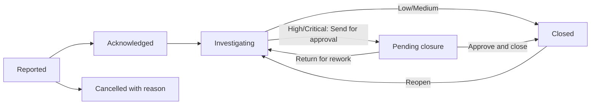

# 10 – Environmental Health and Safety

> **Switch.** This module can be switched off for the organisation. When on, **every member of staff** can report an incident; what else you see depends on your role and location.

## 1. Purpose

The Health & Safety module (called **Environmental Health and Safety** on the home page) replaces the four Microsoft Forms used to report incidents. It lets anyone **report an incident or near miss**, and lets the Health & Safety team follow each report to **closure**, keep a register of **fire extinguishers** and **first aid kits** (with checks, servicing and expiry dates), manage **personal protective equipment (PPE)** — stock, issuing to staff and gaps — print **QR code labels** for equipment and **posters** for sites, and export registers.

## 2. Who can do what

Everyone has the module. Rights come from the role:

| Right | Everyone | District Manager | Regional Chief Manager | H&S Officer | H&S Manager | Super Admin |
|---|---|---|---|---|---|---|
| Report an incident, see **My reports**, **My PPE**, **My equipment** (if named responsible) | Yes | Yes | Yes | Yes | Yes | Yes |
| Record a report on behalf of someone | No | Yes | No | Yes | Yes | Yes |
| View the incident register | No | Own district | Own region | Own region | All regions | All |
| Overview (dashboard) | No | Yes | Yes | Yes | Yes | Yes |
| Manage incidents (acknowledge, triage, investigate, actions) | No | No | No | Yes | Yes | Yes |
| See injury details | No | No | No | Yes | Yes | Yes |
| **Approve closure** of High/Critical incidents | No | No | Yes | **No** | Yes | Yes |
| View equipment (extinguishers, kits, PPE stock/issues/gaps, expiry register) | No | Yes (view only) | Yes | Yes | Yes | Yes |
| Record a check on equipment | Only their own named items | Yes | No | Yes | Yes | Yes |
| Manage equipment (add/edit, import, labels) | No | No | No | Yes | Yes | Yes |
| Manage PPE (receive, issue, adjust, import) | No | No | No | Yes | Yes | Yes |
| Master data (sites, PPE types, entitlements, reorder levels, kit templates, site posters) | No | No | No | Yes | Yes | Yes |
| Settings | No | No | No | No | Yes | Yes |
| Export reports | No | No | Yes | Yes | Yes | Yes |

**Reach (what you see):**

- **Super Admin and H&S Manager** – all regions. Anyone at **Head Office** who has the register right sees all regions.
- **H&S Officer and Regional Chief Manager** – their own region.
- **District Manager** – their own district.
- **A reporter** always sees their own reports (and ones recorded for them).
- A login with no staff record or no region sees nothing beyond their own.
- Outside your reach a record shows as not found.

**Privacy rules:** a **confidential** report hides the reporter's name from everyone who views it (it shows "Reporter" or "Confidential"). An **anonymous** report stores no user, staff record, network address or uploader at all. Notices never name a reporter. Injury details are visible only to those with the injury-details right.

**Cannot do:** you cannot see the investigation findings of a report unless you manage incidents; a reporter sees the closure note only after the report is closed; the H&S Officer cannot close a High or Critical incident (it needs the approver).

## 3. How to open it

Click **Environmental Health and Safety** in the header. Sidebar (hidden items are those you cannot use): **Overview**, **Report an incident**, **My reports**, **Incidents**, **Actions**, **Fire extinguishers**, **First aid kits**, **Expiry register**, **My equipment**, **PPE stock**, **PPE issues**, **PPE gaps**, **My PPE**, **Kit templates**, **Import equipment**, **PPE types**, **PPE entitlements**, **PPE reorder levels**, **Sites**, **Settings**.

## 4. Screen-by-screen guide

### 4.1 Report an incident

[Screenshot: Report an incident – step 1 "Where did it happen?"]

A short wizard. A red strip "In an emergency, call first" shows the emergency numbers if the team has set them. Steps:

1. **Where did it happen?** – **Regional Office** (choose a **Department**), **District Office** (choose the district), **Pay Point** (choose the district and the **Pay point**, or "other" and type the **Name of the pay point**), or **Field Work** (choose the district and type **Where exactly**; required). Optionally **Where in the office**.
2. **What are you reporting?** – **Near miss**, **Injury**, **Property damage**, **Environmental**, **Incident**, or **Other** (with a short text, required for Other). A line of help explains each.
3. **What happened?** – **When did it occur?** (a date, not in the future; required), **Time (optional)**, **Please describe what happened** (required, at least 3 characters, up to 5,000), **Was first aid given?** (yes / no / no need; required), and a tick **This needs attention now** (urgent).
4. **Witness and photos** – **Witness name**, **Witness contact**, or **No witness**; **Photos** (JPG, PNG or WebP; up to 5 photos, 5 MB each).
5. **Before you send** – options **Keep my name confidential**, **Report anonymously**, and (for those allowed) **I am reporting for someone else** with **Find a member of staff** or **Their name**. Then send.

You then see **Report received** with the reference number, e.g. `GA-HS-2026-0001`-style (region prefix, year, number).

Refusal messages: "Choose where it happened.", "Say what happened.", and the usual "required" notes next to a field.

### 4.2 My reports

Your own reports with status. Open one to see its timeline of status changes (notes are internal and not shown to you) and, once closed, the closure note.

### 4.3 Incidents (register) and an incident

[Screenshot: Incident register and an incident page]

The register has filters by status, type, severity, region/district and date, and "overdue" badges for acknowledgement. Opening an incident shows sections **Report**, **Triage**, **Investigation**, **People affected**, **Actions**, **Closure**, **Outcome** and **Timeline**, plus **Print** and **PDF** (a print copy with the same privacy rules).

For people who manage incidents:

- **Acknowledge** a new report.
- **Triage**: set the **Severity** (Low, Medium, High, Critical) and **Type**.
- **Start investigation**: record **Root cause** (Human, Equipment, Process, Environment, Management) and **Findings**.
- **People affected**: add by staff ID or name, with **Injury**, **Body part**, **Treatment**, **First aider**, **Days lost**, **Back at work on** (needs both manage-incidents and injury-details rights, and only while the incident is open and not waiting for approval).
- **Actions on this incident**: **New action** with **Owner** (name or staff ID), **Due on**, and a description.
- **Closure**: **Closure note (shown to the reporter)**, then **Close incident** — or **Send for approval** if the severity is High or Critical.
- **Approve and close** / **Return for rework** (approvers).
- **Cancel this report** (with a **Reason**) and **Reopen**.

### 4.4 Actions

**Safety actions** assigned to you or in your reach, with **Mark done** and a **Completion note for this action**. Filter: Show **Assigned to me** / overdue.

### 4.5 Overview

Counts that link to the filtered register (new, in progress, waiting for approval, overdue actions), plus equipment and PPE rows for people allowed to see them.

### 4.6 Fire extinguishers and First aid kits

[Screenshot: Fire extinguishers list with state filter]

Lists with filters (district, site/vehicle, type, **state**, "expiring in N days") and an expiry column. Each item sits at a **site** or in a **vehicle**, never both.

**Extinguisher fields:** Asset code, Serial number, Type, Capacity, Manufacturer, Manufactured on, Location, **Expiry date**, **Last serviced on**, **Next service due**, **Last hydrostatic test**, **Next hydrostatic test due**, Notes.

**Extinguisher page:** Details, Dates, Check history, Service history. Actions: **Record check** (**Date of the check**, result pass/fail, **Note**), **Record service** (**Kind of service** inspection / refill / recharge / hydro test, **Serviced on**, **Done by (vendor)**, **New expiry date**, **Next service due**, **Next hydrostatic test due**, **Certificate** PDF/JPG/PNG), **Out for service**, **Discharged**, **Decommission** (reason required), **Print label**.

**Kit page:** **Contents list** (**Item**, **Should hold**, **Holds now**, **Has an expiry date**, **Expires**), **Record check** (update quantities, tick **Restocked during this check**), **Mark missing**, **Decommission**, **Print label**. **Kit templates** (master data) define the standard contents per kit type. Nothing is pre-filled; a **Load suggested starter items** button helps, but the contents must be confirmed with the Health & Safety department or a first aid trainer.

**States** (the first that applies is shown):

- Extinguisher: **Expired** → **Service overdue** → **Hydro test overdue** → **Check failed** → **Expiring** (within 60 days) → **Service due soon** → **Hydro due soon** → **Check overdue** (default every 30 days) → **OK**.
- Kit: **Missing** → **Item expired** → **Item expiring** → **Incomplete** → **Check failed** → **Check overdue** → **OK**.

Discharged and decommissioned items are left out of "needs attention" counts. Checks and services are never edited; a mistake is corrected with a new record.

### 4.7 Expiry register

One list of everything dated: extinguishers, kits' items and PPE, with **Horizon** (how far ahead), **Bucket** (expired / this month / …), Region, District, Site, Type. Excel and PDF export.

### 4.8 My equipment

If you are named as the responsible person for an extinguisher or kit, this page shows **My fire extinguishers** and **My first aid kits** and lets you record a check without any other right.

### 4.9 PPE

- **PPE stock** – balance by store, type and size, with low-stock highlighting; actions **Receive**, **Adjust**, **Write off**, **Transfer**, **Issue**.
- **PPE issues** – who holds what, when issued, replacement due; **Close issue** (returned, worn out, damaged, lost) and **Issue to staff**. When issuing a type someone already holds, the form offers to close the old one as replaced.
- **PPE gaps** – staff × PPE type with the states **Missing** (nothing issued), **Overdue** (nothing in date), **Short** (fewer than entitled), **Replacement due**, **OK**. A note says how many job titles have staff but no entitlements yet.
- **My PPE** – what you hold, when it is due, and **Confirm receipt**.
- **PPE types**, **PPE entitlements** (quantity per job title), **PPE reorder levels** (per store and type) — master data.
- **Import** of existing holdings (so staff already holding boots/helmets are not all shown as "missing" on day one).

Stock is a permanent ledger: balances never go negative, nothing is edited, a correction is an **adjustment** with a reason. A normal issue is dated today; an "already held" record is for history and does not touch stock.

A **PPE store** is a site flagged "This is a PPE store" (normally the regional office, which has no district — so district managers see issues and gaps but not balances).

### 4.10 Sites

**Sites** (master data): **Name**, **Kind**, **Region**, **District**, **Address (optional)**, **This is a PPE store**, active/deactivated. Tick sites to print **site posters**. Equipment copies its region and district from its site.

### 4.11 Settings

(H&S Manager, Super Admin.) Editable thresholds (acknowledge hours 24, investigation due days 14, expiry warning 60 days / critical 30 days, check interval 30 days, extinguisher service every 12 months and hydro test every 5 years, emergency contacts, whether a second approver is required, alert thresholds). **Save settings**.

## 5. Step-by-step tasks

### 5.1 Report an incident (anyone)

1. **Environmental Health and Safety → Report an incident**.
2. Work through the five steps. Choose **Keep my name confidential** if you do not want the reporter shown, or **Report anonymously** if nothing about you should be stored.
3. Send. Note the reference number. You get **Report received**.
4. Follow it in **My reports**.

### 5.2 Handle a report (H&S Officer)

1. **Incidents** → open the report → **Acknowledge** (it also acknowledges when you start triage or investigation).
2. Set **Severity** in **Triage**.
3. **Start investigation**; fill **Root cause** and **Findings** (required to close Injury, Property damage, Environmental and Incident types; near misses and "Other" do not need them).
4. Add **People affected** and **Actions**.
5. Write the **Closure note** and **Close incident**. For High or Critical severity use **Send for approval** instead.

**Why can't I close it?** The report must be acknowledged; a severity must be set; a closure note is required; High/Critical must go through approval; triage cannot be changed while it waits for approval.

### 5.3 Approve a closure (Regional Chief Manager, H&S Manager)

1. **Incidents** → report waiting for approval → read the closure note.
2. Click **Approve and close**, or **Return for rework** (it goes back to investigation).
3. If a second approver is required in Settings, the person who sent it cannot also approve it.

### 5.4 Add a fire extinguisher and print its label

1. **Fire extinguishers → Add an extinguisher**; fill the form; **Save extinguisher**.
2. Open it → **Print label** (or use the labels page for several). The QR code on the label opens the item when scanned.

### 5.5 Scan a QR label and record a check

1. Scan the label with your phone; sign in if asked.
2. The item opens; with the right (or if you are named as responsible), use **Record check**. Some labels open the check form directly.
3. If the item is not found or is outside your reach you see one and the same "not available" page.

### 5.6 Record a service (extinguisher)

1. Open the extinguisher → **Record service**; fill the kind, date, vendor, new dates, certificate. Save. Dates and states update.

### 5.7 Issue PPE

1. **PPE issues → Issue to staff**; pick the staff member, type, size, quantity, store.
2. Close any held items it replaces; confirm. Stock reduces in the same step.
3. The staff member confirms receipt in **My PPE**.

### 5.8 Import equipment or PPE holdings

1. **Import equipment** (extinguishers or kits) or **PPE import**; download the template; fill it; preview.
2. Confirm. The import only creates records and never creates a site; sites must exist first.

### 5.9 Export

1. Open the register (incidents, actions, extinguishers, kits, PPE stock, PPE issues, PPE gaps, expiry register).
2. Use the export link (needs the export right); up to 5,000 rows.

## 6. Workflow and status lifecycle

Incident status: **Reported** → **Acknowledged** → **Investigating** → (**Pending closure** for High/Critical) → **Closed**; or **Cancelled**. Closed reports can be reopened.

Notifications: new reports notify the officers and district managers in scope (bell); e-mail goes out only for Injury, Environmental and urgent reports. Notices never name a reporter. Reminders for overdue acknowledgements, due actions and expiring equipment are sent by a daily job, with a configurable schedule.

Locked: checks, services, stock movements and issues are permanent records; a closed issue cannot be edited.

## 7. Reports, exports and printing

| Output | Who | Format |
|---|---|---|
| Incident print copy / PDF | Anyone who can open the incident | Browser print, PDF |
| Registers: incidents, actions, extinguishers, kits, PPE stock, PPE issues, PPE gaps, expiry register | Export right (Regional Chief Manager, H&S Officer, H&S Manager, Super Admin) | Excel; expiry register also PDF; max 5,000 rows |
| Equipment labels | Manage equipment | PDF (up to 120 labels per file) |
| Site posters | Master data right | PDF |

## 8. Imports

- **Equipment import** (extinguishers, kits): templates provided; header matching is tolerant. Creates records only; a site must already exist; the file is re-read when you confirm.
- **PPE import**: existing holdings.
- Typical fixes: unknown site name → add it under **Sites**; wrong date format → use real dates.

## 9. Rules and gotchas in user terms

- **Anyone can report; few can read.** You see your own reports even if you cannot see the register.
- **Confidential versus anonymous.** Confidential hides your name from viewers; anonymous stores nothing about you.
- **QR labels contain a full web address** of the production portal, so print labels from the live system only.
- **A QR scan** that fails for a missing item or one outside your reach shows the same page for both.
- **Photos** only (JPG/PNG/WebP), checked and stored privately.
- **No second reporter edits.** The reporter adds photos on the form; afterwards only an officer can add more.
- **Nothing is deleted.** Decommission, discharge, cancel — each with a reason.
- **Equipment copies its location from its site;** change the site and the equipment follows.

## 10. Troubleshooting and FAQ

1. **I can report but see no register.** That is normal; you need the register right.
2. **My report doesn't show my name to the officer.** You chose confidential or anonymous.
3. **I can't close an incident.** See 5.2; High/Critical needs an approver.
4. **I can't add people affected.** You need the injury-details right and the incident must be open.
5. **QR scan says not available.** The item is missing or outside your reach.
6. **PPE gaps show everyone as missing.** Import existing holdings or record them as "already held".
7. **A district manager cannot see PPE balances.** Stores are at regional offices; district managers see issues and gaps only.
8. **Labels print wrong web address.** Print from the live system or set the QR base address (ICT).
9. **My photo is rejected.** It must be JPG, PNG or WebP and under the size limit.
10. **I don't see Settings.** Only the H&S Manager and Super Admin.
11. **The emergency strip is not showing.** The team has not yet set emergency numbers.

## 11. Glossary

- **Near miss** – nothing happened this time but it could have.
- **Triage** – deciding severity and type.
- **Root cause** – the main reason (human, equipment, process, environment, management).
- **Hydrostatic (hydro) test** – periodic pressure test of an extinguisher.
- **PPE** – personal protective equipment (boots, helmets…).
- **Entitlement** – how many of an item a job title should hold.
- **Ledger** – the permanent record of PPE stock movements.
- **Store** – a site that holds PPE stock.

## 12. Screenshot placeholders

- [Screenshot: Report an incident – step 2 "What are you reporting?"]
- [Screenshot: Incident page – Triage and Investigation]
- [Screenshot: Fire extinguishers list with states]
- [Screenshot: Extinguisher page – Record service]
- [Screenshot: First aid kit – contents]
- [Screenshot: PPE stock matrix]
- [Screenshot: PPE gaps]
- [Screenshot: Label PDF with QR code]
- [Screenshot: Settings]

## To confirm

- Whether the **emergency contact numbers** are set in production.
- The reference-number format shown in 4.1 is an example based on the region prefix; confirm on screen.
- Exact rule for who may see Head Office incidents for the District Manager role at Head Office.
- Whether second-approver is switched on (default off).
- The design notes say "a fully anonymous reporting route" was left for later, but the report form already offers **Report anonymously**; confirm with the team that it is meant to be live.
- Phase 4 (alerts, dashboards with charts, Settings) is partially described in the design notes ("to be added"); the screens exist but their charts and alert wording were not checked.
