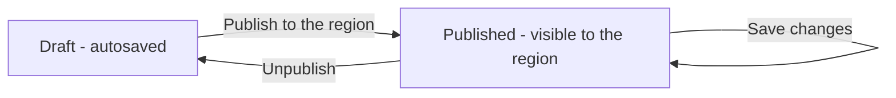

# 11 – Regional Blog

> **Switch.** The Blog is normally on. If the organisation switches it off, the **Blog** link in the header disappears and the addresses stop working.

## 1. Purpose

The Regional Blog is where the **Public Relations (PR) team of each region** publishes articles about the region's activities, meetings, workshops, training and announcements, with pictures, galleries, tables and videos. Every member of staff reads the articles of **their own region**. It is not a public web site: you need your portal login.

The Blog is **not a tab** in the ERP. It is a separate, magazine-style page that opens in a **new browser tab** from the **Blog** link at the right of the header.

## 2. Who can do what

| Person | Reads | Writes |
|---|---|---|
| Any member of staff (every role, including HR and Global Admin) | **Published** articles of their own region | Nothing |
| Public Relations Officer (PR Officer) | The same, **plus drafts and pictures** of their region | Create, edit, publish, unpublish, pin and delete articles of **their own region only**; upload pictures to it |
| Super Admin | Every region (a region filter is offered) | Any region (picks the region on a new article) |
| A login with no staff record, or a staff record with no region | Nothing (the page says the account is not linked to a region) | Nothing |

**Reach.** Only your region counts. There is **no Head Office or manager exception**: Head Office staff read the blog of the region their Head Office district belongs to, like everyone else there. An article, district or picture of another region answers **"not found"**.

The PR Officer role is given out only by the Global Admin or Super Admin, normally to one or two people per region.

## 3. How to open it

Click **Blog** at the right of the header (next to the bells). It opens in a new tab. Inside the blog, **Back to ERP** returns you to the portal. A signed-out person who opens a blog address is sent to the login and brought back.

## 4. Screen-by-screen guide

### 4.1 Reading

[Screenshot: Blog front page – lead story, latest stream, sidebar]

- **Masthead:** company logo and "<Region> Regional Blog", a **search** box, **Back to ERP**, the light/dark switch, an account menu; writers also see **Manage**.
- **Section strip:** All, Activities, Meetings, Workshops, Training, Announcements, Other, **Photo Gallery**.
- **Front page:** the pinned (or newest) article as the lead story beside up to three more; a **Latest** list with thumbnail, kind, headline, a two-line teaser, date, district and reading time, with **Newer / Older** paging. The sidebar has **Upcoming events** (future event dates), **Pinned**, **Browse by district** and **Topics** (tags). No story appears twice on a page.
- **Article:** kind, headline, standfirst (summary), byline (author, date, district, reading time), copy-link and print buttons, cover photo with caption and credit, an **event details** box (date, venue, district) when set, the body, tags, older/newer links, "More from <district>" and related articles — all from your own region.
- **Search:** looks in title, summary, text, venue and tags.
- **Photo Gallery:** pictures of published articles of your region, grouped by article, newest first; click one to open the viewer (arrow keys, Esc, swipe on a phone); the title links to the article.
- **Print:** an article prints without the page furniture.

### 4.2 Manage (PR Officers and Super Admin)

[Screenshot: Manage articles list]

A table: **Article**, **Kind**, **Region**, **Status** (draft / published), **Activity date**, **Updated**, with actions to edit, publish/unpublish, pin and delete, and paging. Super Admin can filter by region.

### 4.3 The article editor

[Screenshot: Article editor – details panel and toolbar]

**Article details**

| Field | Meaning |
|---|---|
| **Headline** | The title. Required (a new article is created as soon as it has a region, headline and kind). |
| **Standfirst** | Short summary under the headline |
| **Kind of article** | Activities, Meetings, Workshops, Training, Announcements, Other |
| **District** | The district the story is about |
| **Venue** and event date | Shown in the event box and in **Upcoming events** when in the future |
| **Tags** | Up to 5 |
| **Cover photo** | Optional picture with caption, credit and a **focal point** (two sliders with live preview) so cards crop around the right part |
| **Region** | Only Super Admin chooses; everyone else writes in their own |

**Body (toolbar):** Heading and Subheading, **Bold** (Ctrl+B), **Italic** (Ctrl+I), **Underline** (Ctrl+U), Strikethrough, **Link** (Ctrl+K; only `https`, `mailto` and `tel` links are kept), Bulleted and Numbered lists, **Quotation** (with an optional "who said it"), **Divider**, alignment, **Table** (add/remove rows and columns, header row, merge/split), Undo/Redo, word and character count, and a pop-up menu on selected text. On a phone the toolbar scrolls sideways.

- **Picture:** add with the button, **drag and drop**, or **paste**. Each picture asks for a **description** (alt text), and has caption, credit, width (column / wide / full) and position.
- **Gallery:** several pictures in one block, layout **grid**, **mosaic** or **carousel**, reordered by dragging or the earlier/later buttons.
- **Video:** **YouTube or Vimeo** only; paste the address.
- Pictures, galleries and videos sit at the top level of the article (not inside lists, quotes or table cells).

**Buttons:** **Save draft**, **Save changes** (when published), **Publish to the region**, **Preview** (shows the article exactly as readers will see it; nothing is saved), a status line ("Draft saved at 14:03"), and a warning if you leave with unsaved changes.

**Saved versions:** a panel lists the last 20 versions ("Versions appear here each time you save"); choose one to restore it (the version it replaces stays in the list).

## 5. Step-by-step tasks

### 5.1 Read the blog

1. Click **Blog** (top right of the header).
2. Use the section strip, search or the sidebar to find an article; click to read.

### 5.2 Write and publish an article (PR Officer)

1. In the blog, click **Manage** → create a new article.
2. Enter the **Headline**, **Kind of article**, **District**, and optional **Standfirst**, **Venue**, event date and **Tags**.
3. Add a **Cover photo** and set its focal point.
4. Write the body. Add pictures (give each a description), a gallery, a table or a video.
5. Click **Preview** to check how it looks.
6. Click **Save draft** as you go (drafts also save automatically every few seconds).
7. When ready click **Publish to the region**. It becomes visible to your region's staff.

### 5.3 Change a published article

1. **Manage** → edit the article.
2. Make the changes and click **Save changes**. (Automatic saving never changes a published article.)

### 5.4 Resolve an edit conflict

If someone else saved after you opened the article, the editor says "This article was saved by someone else after you opened it." Choose **Load their version**, or **Save mine over theirs** (theirs stays in the saved versions).

### 5.5 Restore an older version

1. Open the article in the editor → **Saved versions**.
2. Choose the version and restore it.

### 5.6 Unpublish, pin or delete

From **Manage**: unpublish to return it to draft; pin to keep it as the lead story; delete when no longer needed.

## 6. Workflow and status lifecycle

An article is a **Draft** or **Published**. Each save creates a saved version. Drafts are visible only to writers of that region.

No e-mails or bell notices are sent when an article is published.

## 7. Reports, exports and printing

None, apart from printing an article from the browser. There are no exports.

## 8. Imports

None. Older articles written before the editor stay readable as they were; the first save that carries the editor's content converts them once.

## 9. Rules and gotchas in user terms

- **Your region only.** You cannot read or write another region's blog. Super Admin can.
- **Pictures:** JPG, PNG, WebP or GIF only (the real picture is checked, not just the name; SVG and renamed files are refused). Each is turned upright, stripped of hidden data (including GPS location) and stored privately. Limits: about 8 MB per file, longest side 6,000 pixels, 24 megapixels, 60 pictures per article; a cover up to 3 MB. A small picture is never enlarged.
- **Unused pictures** are deleted automatically after about a day if no article or saved version uses them.
- **Links** must be `https`, `mailto` or `tel`.
- **Videos** only from YouTube or Vimeo.
- **Autosave touches drafts only.**
- **Two people editing:** the editor warns instead of overwriting.
- **A picture is visible to readers only while a published article of their region shows it.**

## 10. Troubleshooting and FAQ

1. **There is no Blog link.** The Blog is switched off, or you are signed out.
2. **The page says my account is not linked to a region.** Your staff record has no region; ask HR.
3. **I see no articles.** None are published for your region yet, or you filtered too much.
4. **I can't see Manage.** Only PR Officers and Super Admin write.
5. **My picture was refused.** It must be a real JPG/PNG/WebP/GIF within the size limits; the message says which limit.
6. **My link vanished.** Only https, mailto and tel links are kept.
7. **Autosave didn't save my published article.** By design; click **Save changes**.
8. **"Saved by someone else".** Another editor saved first; load theirs or save yours over it.
9. **A district link gives "not found".** That district belongs to another region.
10. **A video won't embed.** Use a YouTube or Vimeo address.
11. **Can I write for another region?** No (Super Admin only).

## 11. Glossary

- **Standfirst** – the short summary under a headline.
- **Kind** – the article category.
- **Focal point** – the part of the cover photo kept when the picture is cropped.
- **Pinned** – kept as the lead story.
- **Version** – a saved copy of an article.

## 12. Screenshot placeholders

- [Screenshot: Blog front page]
- [Screenshot: Article page with event details]
- [Screenshot: Photo Gallery with viewer]
- [Screenshot: Manage list]
- [Screenshot: Editor – article details and cover focal point]
- [Screenshot: Editor – gallery block]
- [Screenshot: Saved versions panel]

## To confirm

- The exact label and position of the pin, unpublish and delete buttons on the Manage list (taken from the design notes).
- Whether the editor script works on the browsers used in your offices; the design notes say the editor can only be tested by hand, using a browser checklist.
- The date field label for an event ("Activity date" in the list; the editor's field name was not captured).
