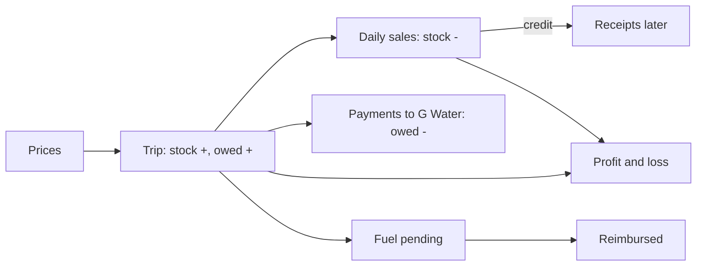

# 12 – G-Water (Bottled and Sachet Water)

> **Switch.** G-Water is normally **off** and is switched on for the organisation by the ICT team. If you cannot see a **G-Water** tab, it is off or you do not hold the G-Water role.

## 1. Purpose

Some locations buy bottled and sachet water from the company G Water and sell it. G-Water replaces the hand-written ledger and Excel sheets. For **your own location** it records:

- **Prices** (buying and selling, by date),
- **Daily sales** (cash or on credit) and money received later,
- **Purchases (trips)** to collect water, with the waybill,
- **Damages**, **expenses** (fuel, loading and offloading, other), **payments to G Water** and the amount still owed,
- the **stock** (in packs), and a **profit and loss** report with charts and exports.

Stock is counted in **packs** (a bottle pack and a sachet pack). Money is entered in cedis (GH¢) and kept exactly in pesewas.

## 2. Who can do what

Module access: the **G-Water** role and Super Admin. (Global Admin does **not** have G-Water access by design.) The G-Water role can be given to staff at Head Office, in a region, or in a district; it is handed out by the ICT team.

| Action | G-Water role | Super Admin |
|---|---|---|
| Overview, sales, trips, damages, expenses, payments, stock, prices, reimbursements (view) | Yes | Yes |
| Record sales, trips, damages, expenses, payments, stock corrections, opening balance, credit receipts | Yes | Yes |
| **Void** an entry (with a reason) | Yes | Yes |
| Mark fuel as reimbursed | Yes (not for entries they recorded or fuel they paid) | Yes (same rule) |
| Add prices, change Settings | Yes | Yes (also the system default prices) |
| Profit and loss | Yes | Yes |
| Export Excel/PDF | Yes | Yes |
| Import past records | Yes | Yes |

**Reach — each location keeps its own books.**

- A **location** is **Head Office**, or a **region without Head Office**. A Head Office user sees Head Office only; a regional or district user sees their region only (not Head Office).
- **Super Admin** sees every location but must choose the district whose books a new entry goes into.
- A login with no staff record or no region has no books.
- Another location's record answers **"not found"**.

## 3. How to open it

Click **G-Water** in the header. Sidebar: **Overview**; **Daily work**: **Daily sales**, **Purchases (trips)**, **Damages**, **Expenses**, **Payments to G Water**, **Stock**, **Profit and loss**, **Reimbursements**; **Set-up**: **Prices**, **Settings**, **Import past records**, **Opening balances**.

## 4. Screen-by-screen guide

### 4.1 Overview

[Screenshot: G-Water Overview]

Tiles: **Sales this month**, **Bought this month (at cost)**, **Net profit this month (so far)**, **Owed to G Water**, **Owed by customers**, **Fuel to pay back**, and **In stock** for each product. Lists of the **Latest sales** and **Latest trips**, with shortcuts **Record sales** and **Record a trip**.

### 4.2 Prices

A dated list. **Add a price** with the product, **Effective from**, **Selling price per pack (GH¢)** and **Cost price per pack (GH¢)** and an optional **Note**. A **Price history** per product shows every change. Your location's latest price dated on or before a day is used; if you have none, a system default applies. Prices already used on sales and trips are frozen; a new price never changes history, and a price that would re-price entries already posted is refused.

### 4.3 Daily sales

[Screenshot: Daily sales – record form and Who owes card]

**Record sales**: **Date**, per **Product**: **Packs sold**, **Price** (selling price in force that day, frozen), payment type **cash** or **credit**. A credit sale needs **Customer's name** (at least 2 characters) and an optional **Customer's phone (optional)**. Columns: Date, Product, Packs, Price, Amount, **Credit (owed)** (Unpaid / Part paid / Paid in full), By, Status.

- **Receive payment** on a credit sale: **Amount received (GH¢)**, **Received on**, **Reference (optional)**.
- **Who owes** (**Customers who owe**) groups open debts by customer (a name typed in a different case is one customer). A filter shows all / credit / still owing.
- **Void sale** / **Void payment** need a **Reason**.

### 4.4 Purchases (trips)

**Record a trip**: **Trip date**, **Waybill number** (required, up to 30 characters, unique within your location), **Vehicle** (from Transport; optional), **Driver**, the packs bought per product, **Cost** (from the price list, or type the price), **Fuel** (see below), **Loading / offloading (paid in cash)**, **Paid to (optional)**, **Receipt reference (optional)**, **Note (optional)**, and **Photo, scan or PDF of the paper waybill** (JPG, PNG, WebP or PDF; up to 5 MB). **Preview waybill** opens the file. **Void trip** needs a reason.

**Fuel** comes from **one** source per trip: either linked from Transport (**Vehicle**, **Mileage entry**, **Fuel expense in Transport** — read live, never copied) **or** typed here (**Fuel (when not taken from Transport)**, with **Fuel paid out of pocket by**). Never both.

### 4.5 Damages

**Record damaged packs**: product, packs, **Where it happened** (**Stage**: transit, loading, offloading, storage), optional **Trip**, **What happened** (reason, at least 3 characters). Damages are written off at their frozen cost.

### 4.6 Expenses

**Record an expense**: **Category** (**Fuel**, **Loading / offloading**, **Other**), **Amount (GH¢)** (above zero), date, optional **Trip**, **Vehicle (optional, from Transport)**, **Paid to**, **Receipt reference**, **Paid out of pocket by** (fuel only).

### 4.7 Payments to G Water

**Record a payment** when you pay: **Date paid** (not in the future), **Reference** (cheque, transfer or voucher number; unique among your non-voided payments), the packs paid for and/or the **Amount (GH¢)**, **Note**. The screen shows **Owed to G Water**, **Opening balance**, **Bought on trips** and **Paid**, and a **Statement of the account** (oldest first, with the balance after each line). There is no "request" step; a payment is recorded when it is paid.

### 4.8 Stock

**Stock ledger**: per product, **Opening balance**, **Delivered**, **Paid for**, **Outstanding on waybills**, and each movement with date, type, packs, balance, by. **Correct the stock** (**Record correction**) takes **Packs (negative takes away)** and a **Reason**.

### 4.9 Reimbursements

Only **fuel** paid out of pocket is paid back. The screen lists **Pending fuel** per **Person** with amounts, and **Mark fuel as reimbursed** with **Paid on** and **Payment reference**; **Recently paid back** lists history.

### 4.10 Profit and loss

[Screenshot: Profit and loss with charts]

Choose a period. Lines: **Revenue**, **cost of water sold**, **Gross profit**, damages, **Fuel**, **Loading / offloading**, other expenses, **Net profit**; extra **Measures** (landed cost per pack, margin, trip cost per pack and per km, damage rate); **Owed to G Water**, **Owed by customers**, credit sales and cash collected; **Net profit by month** and **Revenue and costs by month** charts; and **How these figures are worked out**. The current month is labelled "in progress". Ratios are blank when there is nothing to divide by.

### 4.11 Settings, Opening balances, Import

- **Settings** (price managers): per-location limits and defaults; stored only when different from the standard.
- **Opening balances**: **Record the opening balance** once: **As of** date, per product **opening balance (packs)**, **paid for, not yet delivered (packs)**, **Amount owed to G Water (GH¢)**. **Void to correct it** if wrong.
- **Import past records**: choose a workbook (see section 8).

## 5. Step-by-step tasks

### 5.1 Start the books (first time)

1. **Prices** → add the current selling and cost price for each product.
2. **Opening balances** → record stock brought forward, packs already paid for but not delivered, and the amount owed.
3. Optionally **Import past records**.

### 5.2 Record the day's sales

1. **Daily sales → Record sales**.
2. Enter the date, packs per product, and cash or credit (customer name for credit).
3. Save. Stock reduces and revenue is recognised.

### 5.3 Collect later payment on a credit sale

1. **Daily sales** → the sale (or **Who owes**) → **Receive payment**.
2. Enter the amount (never more than is owed), the date, optional reference.

### 5.4 Record a collection trip

1. **Purchases (trips) → Record a trip**.
2. Enter the waybill number, packs, vehicle/driver, fuel (from Transport **or** typed), loading/offloading, and attach the waybill picture.
3. Save. Stock rises by the packs; what you owe G Water rises by the cost.

### 5.5 Pay G Water

1. **Payments to G Water → Record a payment**.
2. Enter **Date paid**, **Reference**, amount and/or packs. Save.

### 5.6 Pay back fuel

1. **Reimbursements** → select the pending fuel.
2. Enter **Paid on** and **Payment reference** → **Mark fuel as reimbursed**.
3. You may not mark your own entry or fuel you paid yourself ("You recorded this entry or paid this fuel yourself, so someone else has to mark it reimbursed.").

### 5.7 Correct a mistake

Nothing is deleted. **Void** the entry with a **Reason** (at least 3 characters); stock, balances and profit are reversed automatically. Then record the right entry.

### 5.8 Export

Open **Profit and loss** (or a list) and use the export button: Excel or PDF, one location per file.

## 6. Common refusals

| Message | What to do |
|---|---|
| Enter the waybill number (up to 30 characters). / a duplicate waybill | Waybills are unique per location among non-voided trips |
| No selling price is on the price list for … | Add a price on the **Prices** screen effective on or before that date |
| No purchase price is on the price list for … | Same, or type the price per pack |
| Enter the packs bought for at least one product. | Fill a quantity |
| Enter the name of the customer who will pay later. | Credit sales need a customer name |
| Enter an amount above zero. / Enter the amount received. | Fill the amount |
| That vehicle is based at another location. / That driver is not based at this location. | Choose a vehicle/driver of your location |
| That trip already has a fuel expense. Fuel is counted once per trip: void it first to replace it. | One fuel source per trip |
| That trip already takes its fuel from Transport. Fuel is counted once per trip. | Don't type fuel as well |
| Enter or link the fuel before saying who paid it. | |
| Only fuel is paid back. Loading / offloading is paid in cash, and other costs are not reimbursable. | |
| This fuel was already paid back, so it cannot be voided. | |
| Money has been received on this credit sale. Void those payments first, then the sale. | |
| The money cannot have come in before the sale | Check the date |
| Give a reason for voiding (at least 3 characters). / This entry is already voided. | |
| Say why the stock is being corrected. / A movement of zero packs is not recorded. / Enter the packs to add (positive) or take away (negative). | |
| The waybill file must be a JPG, PNG or WebP picture, or a PDF. / at most 5 MB | |
| Enter the reference of the payment (cheque, transfer or voucher number). / Reference … is already used | |

A sale, void or correction that would take the stock below zero on **any day** is refused: you cannot back-date a sale to a day when the shelf was empty, and you cannot void a purchase whose packs were already sold.

## 7. Workflow and status lifecycle

Every entry is **Recorded** or **Voided** (with reason). Voiding posts reversing stock rows dated like the original.

Reminders: a scheduled job tells the G-Water staff of a location (in-app notice with counts only) about items waiting, once per repeat period.

## 8. Reports, exports and imports

**Exports** (need the export and reports rights): Profit and loss (with the credit rows), other registers, and **Owed by customers** (customer, sale by sale, with the phone typed). Excel or PDF; one location per file; each download is recorded.

**Import past records:** a workbook with sheets for Daily sales (optional `on_credit`, `customer_name`, `customer_phone`), Trips, Payments (`paid_on`, `reference`, `amount`, packs, `note`), etc. Steps: **1. Choose the file** → the system checks and shows **Rows per sheet**, **Ready**, **Problems** → fix or choose to import only valid rows → confirm. A preview runs the real rules and is rolled back; the file is re-read on confirm; the import only creates rows, always in your own location, and each row passes the same stock and waybill checks as a typed entry. Download the template from the screen.

## 9. Rules and gotchas in user terms

- **Packs, not bottles.** Quantities are whole packs.
- **Money is exact** (pesewas); enter cedis with up to two decimals.
- **Prices are frozen** on each sale, trip line and damage.
- **Stock never goes negative** on any day.
- **Nothing is deleted** — void with a reason.
- **Only fuel is reimbursed.** Loading/offloading is paid in cash.
- **Fuel is counted once per trip.**
- **Cost of water sold** is a rolling average cost over the whole history.
- **Customer names and phones** never appear in audit records, notices or logs.
- **Waybill files** are private and only the people of your location can open them.
- **Past months** are fixed history; the current month is "so far".

## 10. Troubleshooting and FAQ

1. **No G-Water tab.** Module off, or you lack the G-Water role.
2. **I can't see another region's sales.** Each location sees only its own.
3. **"No selling price…"** Add a price effective by that date.
4. **I can't void a sale.** It has receipts; void those first.
5. **Stock cannot be reduced.** It would go below zero on some day.
6. **Who owes?** Use **Who owes** on Daily sales, or export **Owed by customers**.
7. **Fuel counted twice.** It isn't; one source per trip. Void and re-record.
8. **I recorded my own fuel and can't reimburse it.** Another person must.
9. **Waybill duplicate.** An earlier non-voided trip has it.
10. **Profit looks low this month.** The current month is "so far"; costs of trips are included when recorded.

## 11. Glossary

- **Pack** – the unit of stock.
- **Waybill** – the paper delivery note, with its number.
- **Landed cost** – cost per pack including fuel and labour.
- **Opening balance** – stock and money brought forward.
- **Receipt** – money received later on a credit sale.
- **Reimbursement** – paying back someone who paid fuel from their pocket.
- **Void** – cancel with a reason and reverse its effects.

## 12. Screenshot placeholders

- [Screenshot: G-Water Overview]
- [Screenshot: Prices with history]
- [Screenshot: Daily sales – Record sales]
- [Screenshot: Purchases – Record a trip with waybill photo]
- [Screenshot: Payments – statement of account]
- [Screenshot: Stock ledger]
- [Screenshot: Profit and loss]
- [Screenshot: Import past records – preview]

## To confirm

- G-Water is off by default: confirm whether it is on in production.
- Settings screen contents (labels depend on the settings defined for each location).
- Whether Global Admin should see G-Water (by design, no).
- The wording of the import workbook's sheet names (download the template).
- There is no screen yet to add or replace a waybill picture on a trip already recorded.
