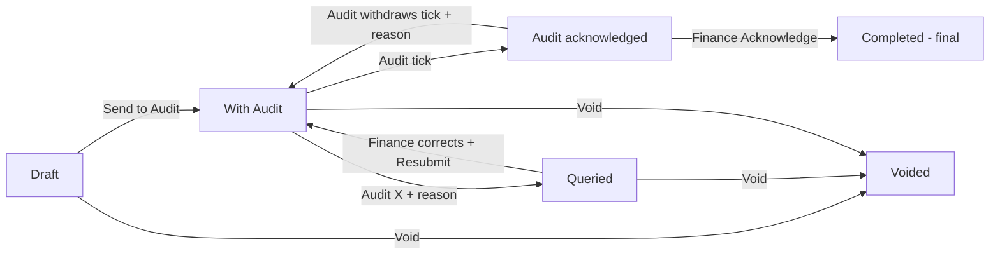

# 13 – Finance (Payment Vouchers)

> **Switch.** Finance and Audit share one on/off switch. When it is off, neither the **Finance** nor the **Audit** tab appears. Read this manual together with manual 14 (Audit): they are two views of the **same** voucher.

## 1. Purpose

Finance prepares **payment vouchers (PVs)**: the form that asks for a payment to be made to a person, a district or a supplier. Each voucher is sent to **Audit** to be checked. Audit either **ticks** it (acknowledges) or **queries** it (X, with a reason). Finance corrects and resubmits queried vouchers, and when Audit has ticked, Finance **acknowledges** to complete the voucher. Finance also keeps the **suppliers list**, the **categories and types** of payment, **batches** of vouchers, reports, exports and reminders.

Users: **Finance Officers** (prepare and send), **Finance Managers** (read everything of their location, run the catalogue, reports and reminders), and Super Admin.

## 2. Who can do what

Module access: Finance Officer, Finance Manager, Super Admin.

| Action | Finance Officer | Finance Manager | Super Admin |
|---|---|---|---|
| See the voucher list and a voucher (their location) | Yes | Yes (everything of the location) | Yes (all locations) |
| Create / edit a voucher (Draft or Queried) | Yes | **No** | Yes (must pick a district to write) |
| Send to Audit, Resubmit, Void | Yes | **No** | Yes |
| Acknowledge (complete) an Audit-ticked voucher | Yes | **No** | Yes |
| Create/send a **batch** | Yes | No | Yes |
| Print vouchers and batches | Yes | Yes | Yes |
| Suppliers: add, edit, import | Yes | No (read only) | Yes |
| Suppliers: switch off / on (deactivate) | **No** | Yes | Yes |
| Categories and types (catalogue) | No | Yes (for their location) | Yes (also the standard list) |
| Reminders | No | Yes | Yes |
| Reports and exports | Yes | Yes | Yes |

**Reach.** The location is **Head Office**, or a **region without Head Office**; a Super Admin sees all but must **pick a district** to write. You see only your location's vouchers; another location's voucher answers **"not found"**. A login with no staff record or region sees nothing. Suppliers are one company-wide list (not location-limited).

**Cannot do:** a Finance Manager cannot add, edit, send, resubmit, void or acknowledge. Finance cannot tick or query (that is Audit). **Separation of duties:** whoever sent a voucher to Audit in any round cannot tick, query or withdraw on it, even if they hold both roles and even if Super Admin.

## 3. How to open it

Click **Finance** in the header. Sidebar: **Payment vouchers**, **Batches**, **New voucher**, **Suppliers**, **Import suppliers**, **Reports**, and **Settings** (**Categories and types**, **Reminders**). Items you cannot use are hidden.

## 4. Screen-by-screen guide

### 4.1 Payment vouchers (list)

[Screenshot: Payment vouchers list with Audit and Finance marks]

Filters: **Search** (PV number or payee name), **Status**, **Category**, **PV date from**, **PV date to**. Each row shows the PV number, payee, category/type, amount (GH¢), status and two **marks**: an **Audit** column and a **Finance** column, each a **tick** (acknowledged), **X** (queried) or **clock** (waiting), always with a word and a pop-up showing who, when, reason and comment.

Select several drafts to **Create batch from selected** (see 4.5).

### 4.2 New voucher / Edit voucher

[Screenshot: New voucher form]

| Field | Meaning | Rules |
|---|---|---|
| **PV date** | Date on the voucher | Required; not in the future ("The voucher date cannot be in the future.") |
| **PV number** | The number on the paper voucher | Required, up to 60 characters, unique in the whole company, even among voided ones: "This PV number is already used." (never says which) |
| **Who is being paid** | **Employee**, **Retiree**, **District** or **Supplier** | Required. Choose this first; changing it clears the payee |
| Payee search | Type 2+ characters; up to 20 matches; staff show staff ID and department, suppliers show their code | Employees = current staff of your location; Retirees = former staff (not transfers); District = a district of your region; Supplier = active suppliers |
| **Category**, **Type** | Chosen from your location's list | Required; only active items are offered |
| **Details** | What the payment is for | |
| **Amount (GH¢)** | Whole cedis and up to two decimals | More than zero; capped at a maximum ("That amount is above the limit of GH¢ …"). Example 1250.50 |
| **Remarks (Finance's own note)** | Finance's private note | Not where Audit's queries go |
| **Supporting documents (optional)** | PDF or picture files | Checked by content; up to 10 files, 5 MB each |
| **Your reply to Audit (optional)** | Shown when resubmitting a queried voucher | |

If no supplier matches, **Add "<name>" as a new supplier** (if you may add suppliers) opens a quick panel (**Add and choose this supplier**).

A warning appears on the voucher if an employee payee **has left service** (before or after the voucher date). It is only information and blocks nothing.

### 4.3 A voucher page

[Screenshot: Voucher page with event history]

Shows the voucher, payee (frozen when saved), category/type labels (showing your location's **current** names), attachments, and the full event history. Buttons depend on status: **Send to Audit**, **Resubmit to Audit**, **Acknowledge**, **Void voucher**, **Print**. For a queried voucher a box **Audit queried this voucher** gives the reason code and comment, and a note "Changed since Audit's last query" lists what you changed.

### 4.4 Suppliers

**Suppliers**: filter by **Show** (Active suppliers / Switched off / All) and **Search**; columns **Supplier**, **Code**, **TIN**, **Phone**, **Vouchers**, **Total (GH¢)**, **Last used** (counted only within your own location). **Add a supplier** / edit: name (required), code, TIN, phone (all optional; a blank is stored as empty, never as "").

- A duplicate **name** or **TIN** is refused, naming the supplier already there.
- A look-alike name (similar spelling) is a **warning** that you must acknowledge on the screen.
- Suppliers are never deleted; only a Finance Manager switches them off.

**Import suppliers:** a spreadsheet of up to 2,000 rows; the preview lists duplicates and look-alikes; confirm to import (create-only).

### 4.5 Batches

A **batch** is a container to send several vouchers together; **Audit still ticks or queries each voucher on its own.**

**Batches** list: **Batch no.** (like `BT-<code>-<year>-0001`), **Title**, **Vouchers**, **Total (GH¢)**, **State**, **Audit officer**, **Sent**. A batch page has **Title and remarks**, **Add vouchers**, **Send batch / Send to Audit**, **Cancel this batch**, **History**, and **Print with each voucher**.

- Up to 100 vouchers per batch. A voucher is in at most one batch. Create one from the voucher list (**Create batch from selected**) or **Create a batch**.
- Membership is frozen once sent. **Sending is all or nothing**: if any member cannot be sent the whole batch is refused and the failures are listed.
- A draft in a draft batch must be taken out before it can be sent alone or voided.
- Batch states: **Draft**, **Awaiting assignment**, **In progress**, **Completed**, **Cancelled**.

### 4.6 Reports

**Reports** (view-reports right) for one location at a time and a **Period (by PV date)**: spend by category, by type, by month, by payee type, top suppliers paid, status counts, **How long each step takes**, **Audit responds in**, **Longest-waiting vouchers** (Overdue uses your location's reminder settings), queried counts, **Batches by state**, **Assignment to Audit officers** and **Officer workload** (managers only). Money is shown in GH¢; ratios are blank if there is nothing to divide by. **Export** buttons produce Excel or PDF (need the export right as well as the reports right; Excel 5,000 rows, PDF 1,500).

### 4.7 Settings

- **Categories and types** (Finance Manager, Super Admin): see the effective list of your location. **Add category**, **Add type** to a category, rename or switch off any item **for your location only**, move your own types to another category. **Change the standard list itself (every location sees it)** is for Super Admin. Names must be unique (case-insensitive) within the location; nothing is deleted. A switched-off category takes its types off with it.
- **Reminders** (Finance Manager): **When to remind** — days a voucher may stay **Queried**, days **Audit acknowledged** before Finance completes it, days a **Draft** may sit unsent, and the repeat interval (defaults 5, 3, 7 and 3 days), plus an on/off switch.

## 5. Step-by-step tasks

### 5.1 Prepare and send a voucher

1. **Finance → New voucher**.
2. Enter **PV date**, **PV number**, **Who is being paid** and the payee, **Category**, **Type**, **Details**, **Amount (GH¢)**; attach supporting documents.
3. Save as a **Draft**. (Only Finance sees a draft.)
4. Open it and click **Send to Audit**. It becomes **With Audit**.

### 5.2 Answer a query

1. The voucher shows **Queried** and you are notified.
2. Open it: read the reason code and Audit's comment.
3. Edit what is needed (only Draft and Queried vouchers are editable); optionally write **Your reply to Audit**.
4. Click **Resubmit to Audit**. It returns to **With Audit** (round + 1).

### 5.3 Complete a voucher

1. When Audit ticks, the status becomes **Audit acknowledged** and you are notified.
2. Open it and click **Acknowledge**. Status becomes **Completed**. This is final.

### 5.4 Void a voucher

1. Open a Draft, Queried or With Audit voucher → **Void voucher**.
2. Enter the **Reason** (required) and confirm. The voucher stays on record as **Voided**; its PV number can never be reused.
3. A voucher that Audit has already ticked cannot be voided until Audit withdraws its tick. A voucher in a batch must be taken out of the batch (or the batch sent) first.

### 5.5 Add a supplier

1. **Suppliers → Add a supplier**; type name (and optional code, TIN, phone); save.
2. If a look-alike warning shows, check it is a different supplier, tick to acknowledge and save.

### 5.6 Send several vouchers as a batch

1. In **Payment vouchers**, tick the drafts → **Create batch from selected** (add a title and remarks).
2. Open the batch → check the list → **Send batch**.
3. The audit manager then assigns it to officers.

### 5.7 Print

1. Open a voucher → **Print**, or open a batch → **Print** (or **Print with each voucher**), or tick several vouchers and print the selection (up to 200). A PDF opens with the voucher and the amount in words.

### 5.8 Add a category or type for your location

1. **Settings → Categories and types** → **Add category** / **Add type**.
2. To hide an item from the form for your location, switch it off. The vouchers that used it keep it and show its current name.

## 6. Workflow and status lifecycle

Statuses: **Draft** → **With Audit** → **Audit acknowledged** → **Completed**; **Queried** (returns to With Audit after resubmission); **Voided**.

**Who moves it on:** Finance: send, resubmit, acknowledge, void. Audit: tick, query, withdraw a tick (see manual 14).

**Notifications** (bell; counts, statuses and PV numbers only — never the payee, amount or comment): Finance is told when Audit ticks, queries or withdraws; Audit is told when a voucher or batch arrives or is resubmitted. Reminders go as one **digest** per person per location (see 4.7).

**Locked:** every action is stored as a permanent event (who, when, reason); nothing is deleted. A voucher's content changes are counted so that two people editing at once are warned (see section 9).

## 7. Reports, exports and printing

| Output | Who | Format / limit |
|---|---|---|
| Finance reports | View-reports right | On screen |
| Export | Export right + view-reports | Excel (5,000 rows), PDF (1,500 rows); one location per file |
| Voucher / batch / selection print | Anyone who can open the voucher | PDF; up to 200 vouchers per print |

Each print and export is recorded (counts only) and prints a counter on the voucher.

## 8. Imports

**Suppliers import:** Finance → **Import suppliers**; download the template; fill name (and optional code, TIN, phone); **Preview**; duplicates are errors naming the existing supplier, look-alikes are warnings you must acknowledge; confirm. Create-only; max 2,000 rows. The file is read again when you confirm.

## 9. Rules and gotchas in user terms

- **Money** is cedis only, more than zero, at most two decimals; stored exactly.
- **A PV number is never reusable**, even if voided; the error never reveals which voucher holds it.
- **Nothing is deleted** — void with a reason.
- **Draft = Finance only.** Audit never sees drafts.
- **Edit only Draft or Queried.**
- **Two people editing:** if someone else changed the voucher after you opened it you get a conflict message instead of overwriting; reload and re-apply.
- **A payee is frozen** when saved; it stays even if the person later leaves or the supplier is switched off.
- **Names of categories and types follow your location's current list.**
- **Separation of duties** — the sender never reviews.
- **Documents** are private and only reachable from vouchers you can open.

## 10. Troubleshooting and FAQ

1. **"This PV number is already used."** A voucher (maybe voided, maybe elsewhere) has it; use another number.
2. **I can't edit a voucher.** It is With Audit, Audit acknowledged, Completed or Voided.
3. **I can't void a voucher.** If it is Audit acknowledged, Audit must withdraw its tick first; if it is in a batch, take it out first.
4. **The payee isn't in the list.** Employees must be current staff of your location; retirees former staff; suppliers must be active; add a supplier if missing.
5. **My batch was refused.** One voucher could not be sent; the message lists it. Fix and resend.
6. **"That amount is above the limit".** Check the decimal point.
7. **Who queried my voucher?** Open it; the history shows the officer, time, reason and comment.
8. **I'm a Finance Manager and have no New voucher.** Managers read only; officers prepare.
9. **A supplier can't be switched off by me.** Only the Finance Manager can.
10. **The category I need is missing.** The Finance Manager adds it under **Categories and types**.
11. **Why do I get "not found" for a voucher link?** It belongs to another location.

## 11. Glossary

- **PV** – payment voucher.
- **Tick / X / clock** – acknowledged / queried / waiting.
- **Round** – how many times a voucher has been sent (1 = first send).
- **Round trip** – a query and resubmission.
- **Batch** – a container of vouchers sent together.
- **Catalogue** – the list of categories and types.
- **Retiree** – former staff paid as a payee.

## 12. Screenshot placeholders

- [Screenshot: Payment vouchers list with marks]
- [Screenshot: New voucher – payee picker]
- [Screenshot: Voucher page – Queried with Audit's reason]
- [Screenshot: Void voucher dialog]
- [Screenshot: Suppliers list and add form]
- [Screenshot: Batch page]
- [Screenshot: Categories and types]
- [Screenshot: Finance Reports]
- [Screenshot: Printed voucher PDF]

## To confirm

- Finance is switched on only when the shared switch is on; confirm for production.
- The exact label of the actions inside the voucher form for adding supporting documents (taken from code labels).
- Whether Finance Managers should be able to create batches (currently no).
- Exact wording of notification titles.
