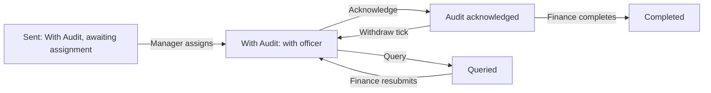

# 14 – Audit (Payment Voucher Review)

> **Switch.** Audit shares its on/off switch with Finance. If the Audit tab does not appear, the switch is off or your role does not include Audit. Read this with manual 13 (Finance): both modules show the **same** vouchers.

## 1. Purpose

Audit is the **review side** of the payment-voucher workflow. Finance sends a voucher (or a batch of vouchers) to Audit. The **Audit Manager** gives each voucher to an **Audit Officer**. The officer checks it and either **ticks** it (acknowledges) or **queries** it (X) with a reason. A tick returns it to Finance to complete; a query sends it back to Finance to correct and resubmit.

Users: **Audit Officers** (review), **Audit Manager** (assign, read what has been worked on, run reports and reminders), and Super Admin.

## 2. Who can do what

Module access: Audit Officer, Audit Manager, Super Admin.

| Action | Audit Officer | Audit Manager | Super Admin |
|---|---|---|---|
| See vouchers **assigned to them** (**My work**) | Yes | – | – |
| See vouchers an officer has **ticked, queried or withdrawn** (**Reviewed vouchers**) | Their own | Yes | Yes (all) |
| See a voucher nobody has worked on yet | Only if assigned to them | **No** (404) | Only via the assignment list |
| **Assign / reassign** vouchers and batches | No | Yes | Yes (for the location they choose) |
| **Tick (Acknowledge), Query, Withdraw a tick** | Yes — only on vouchers **assigned to them** | **No** | **No** — nothing is ever assigned to Super Admin |
| Batches (view) | Their own vouchers of a batch | All sent batches | All |
| Suppliers (read) | Yes | No | Yes |
| Reports and export | Yes | Yes | Yes |
| Reminders | No | Yes | Yes |
| Categories and types | **No** (Audit has no such screen; an old bookmark answers 403) | No | Via Finance |

**Reach.** Same location rule as Finance: Head Office, or a region without Head Office; another location's voucher is **"not found"**. **Drafts are never visible to Audit.** The Audit Manager's **Assignments** list shows every sent voucher and batch of the location but only minimal columns (PV number, category/type, amount, sent date, days waiting, who holds it) — **no payee, details, remarks or files**; a voucher opens only after an officer has acted on it.

**Cannot do:** nobody who **sent** a voucher to Audit (in any round) can tick, query or withdraw on it — even holding both roles and even Super Admin. An officer cannot work on a voucher assigned to someone else ("This voucher is assigned to another Audit officer."), nor on one waiting for assignment ("This voucher is awaiting assignment. The Audit manager must give it to an Audit officer first.").

## 3. How to open it

Click **Audit** in the header. The tab opens on **Assignments** for the Audit Manager and on **My work** for officers. Sidebar: **Assignments** (manager), **My work** (officer) / **Reviewed vouchers** (manager and read-only), **Batches**, **Suppliers** (officer), **Reports**, **Settings → Reminders** (manager).

## 4. Screen-by-screen guide

### 4.1 My work / Reviewed vouchers

[Screenshot: My work queue]

Filters: **Search**, **Status** (**All**, **With Audit**, **Queried**, **Audit acknowledged**, **Completed**), **Category**, **PV date from**, **PV date to**. Each row shows PV number, payee, category/type, amount, status, days waiting, the two **marks** (Audit and Finance: tick, X, clock) and a **Left service** badge when an employee payee has left (information only).

### 4.2 Voucher for review

[Screenshot: Voucher for review with Acknowledge and Query]

The voucher with payee, details, amount, attachments and the history. For the assigned officer:

- **Acknowledge** — the tick.
- **Query voucher** — opens **Query this voucher** with **Reason** (**Choose a reason**: Amount does not match, Missing supporting document, Wrong category/type, Duplicate, Payee not eligible, Calculation error, Other) and **Comment** (free text, required).
- **Withdraw tick** — **Withdraw your tick** with a required reason; allowed only while the status is **Audit acknowledged** (before Finance completes it).
- **Print**.

A voucher resubmitted after a query shows **Changed since Audit's last query**: what Finance changed.

### 4.3 Assignments (Audit Manager)

[Screenshot: Assignments – single vouchers and batches]

Two lists: **Batches sent to Audit** and **Single vouchers sent to Audit**, each with PV no./Batch no., Title, Category/type, Amount (GH¢), Sent, Days waiting, **Assigned to**, State. A filter **Show** (e.g. **Waiting for an officer**, **Everything sent to Audit**) and **Search**. Select items, choose **Assign to** (only eligible officers appear, each with their open workload), add an optional **Note** and click **Assign**. Super Admin first picks **Location (the vouchers you are working in)**. Only a voucher that is With Audit can be assigned.

### 4.4 Batches

A batch is only a container; each voucher is still ticked or queried on its own. An **officer** sees only their own vouchers of a batch (count, total and state are theirs) with **Acknowledge all remaining** (ticks, one by one, the With-Audit vouchers assigned to them; queries are never bulk). The **manager** sees every voucher's minimal columns, can assign the whole batch or ticked vouchers (so one batch can be split between officers), and sees the officer workload. Batch states: **Awaiting assignment**, **In progress**, **Completed**.

### 4.5 Suppliers

Read-only view for officers, with counts and totals of the location.

### 4.6 Reports and Settings

**Reports** — as in Finance (spend, status counts, how long each step takes, **Audit responds in**, longest-waiting vouchers, queried counts, batches by state), plus, for the manager, **Assignment to Audit officers** and **Officer workload**. Export to Excel/PDF needs both the export and the reports rights.

**Settings → Reminders** (manager): on/off, **days With Audit** before a reminder (also the "overdue" mark in Audit's reports; default 3), and repeat interval. The Finance reminder set is separate and not visible here.

## 5. Step-by-step tasks

### 5.1 Assign vouchers (Audit Manager)

1. **Audit → Assignments**.
2. Tick the vouchers and/or batches that are **Waiting for an officer**.
3. Choose the officer in **Assign to**. Add a note if useful.
4. Click **Assign**. The officer is told. To change officer later, assign again (reassign).
5. An officer must be based at the voucher's location and must **not** be the person who sent it.

### 5.2 Review and tick (Audit Officer)

1. **My work** → open a voucher assigned to you.
2. Check the payee, amount, category/type, details and attachments against the paper voucher.
3. Click **Acknowledge**. The voucher becomes **Audit acknowledged**; Finance is told.

### 5.3 Query a voucher

1. Open the voucher → **Query voucher**.
2. Choose the **Reason** and write a **Comment** explaining what is wrong (a reason code **and** a comment are both required: "Choose why the voucher is queried.").
3. Confirm. The voucher becomes **Queried**; Finance is told. The voucher stays assigned to you.
4. When Finance resubmits it returns to your **My work** (round + 1).

### 5.4 Withdraw a tick

1. Open a voucher that is still **Audit acknowledged** (Finance has not completed it).
2. Click **Withdraw tick**, give the reason, confirm. It returns to **With Audit**; Finance is told.
3. Once it is **Completed** it is final and cannot be withdrawn.

### 5.5 Acknowledge a whole batch

1. **Batches** → open the batch.
2. Click **Acknowledge all remaining** to tick every With-Audit voucher assigned to you. Vouchers you cannot act on are skipped and listed.

### 5.6 Print

Open a voucher or batch → **Print**, or print a selection. Each print is counted.

### 5.7 Set reminders (Audit Manager)

1. **Settings → Reminders**.
2. Set **days With Audit** and the repeat interval; **Save**. Reminders for unassigned vouchers go to the people who can assign (after about 1 day); reminders for assigned vouchers go only to the assigned officer.

## 6. Workflow and status lifecycle

See manual 13 for the whole picture. Audit's moves:

Statuses Audit works with: **With Audit**, **Queried**, **Audit acknowledged**, **Completed**.

Notifications go to the assigned officer when assigned or when a voucher is resubmitted; the manager and officers receive reminder digests (counts, longest wait and PV numbers; never payees, amounts or comments).

## 7. Reports, exports and printing

As in manual 13, section 7: Excel (5,000 rows) / PDF (1,500 rows), one location per file, plus voucher/batch printing (counts and prints are recorded).

## 8. Imports

None in Audit.

## 9. Rules and gotchas in user terms

- **Nobody works on a voucher until it is assigned.** Vouchers sent before assignment existed show "Awaiting assignment".
- **The sender never reviews.**
- **Assigned officer only.** Super Admin and the manager cannot tick, query or withdraw.
- **A query needs a reason code and a comment**; the comment is Audit's, Finance's own **Remarks** field is separate.
- **A tick can be withdrawn only before Finance completes.**
- **Audit never sees drafts**; the manager sees no payee or details until an officer has acted.
- **Everything is recorded** as permanent events.
- **Officers cannot see vouchers they merely sent** (they cannot act on them either).

## 10. Troubleshooting and FAQ

1. **I can't see a voucher a colleague mentioned.** It is not assigned to you, or you did not work on it; ask the manager.
2. **"This voucher is awaiting assignment."** The manager must assign it first.
3. **"You sent this voucher to Audit, so you cannot review it."** Separation of duties.
4. **The manager sees "Opens after an officer has acted on it".** Intentional; the manager sees details only after an officer acted.
5. **I can't withdraw my tick.** Finance may already have completed it.
6. **The officer list is empty when assigning.** No active officer is based at that location (or the only ones sent the voucher).
7. **Where are categories?** Finance's manager owns them; Audit has no such screen.
8. **A query reason is missing.** Choose a reason and write a comment.
9. **I receive reminders for a voucher.** It has been With Audit longer than your location's limit.
10. **Why does Audit not show Suppliers for the manager?** Suppliers are an officer's reference list.

## 11. Glossary

- **Assign** – give a voucher to an officer.
- **Tick / Acknowledge** – Audit's approval.
- **Query (X)** – Audit's refusal with reason; returns to Finance.
- **Withdraw tick** – Audit takes back an approval before Finance completes.
- **Workload** – the number of open vouchers with an officer.
- **Round** – number of times the voucher has been sent to Audit.

## 12. Screenshot placeholders

- [Screenshot: Assignments – Waiting for an officer]
- [Screenshot: Assign dialog with officer list]
- [Screenshot: My work queue]
- [Screenshot: Query this voucher dialog]
- [Screenshot: Withdraw your tick dialog]
- [Screenshot: Batch page for an officer]
- [Screenshot: Audit Reports – Officer workload]

## To confirm

- That Audit Managers should not see Suppliers (currently only officers do).
- Wording of the batch buttons ("Acknowledge all remaining") taken from the design notes.
- Reminder timings in production (defaults: 3 days With Audit, 1 day for unassigned).
