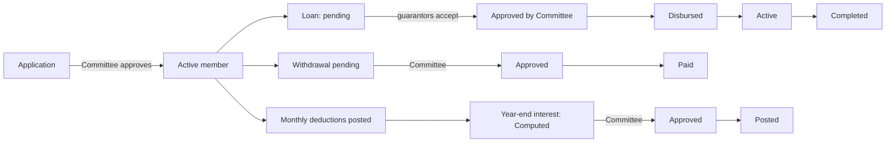

# 15 – Credit Union

> **Switch.** The Credit Union module is **off by default** and is switched on by the ICT team. If you see no **Credit Union** tab, it is off. This manual was written from the screens and rules in the program; there is no separate design document for this module, so some details are listed in "To confirm" at the end. Treat the wording of messages as indicative.

## 1. Purpose

The Credit Union module keeps the staff credit union's records: **members**, their **shares** and **savings** accounts, monthly **payroll deductions**, **loans** with guarantors, **withdrawals**, **refunds**, manual **receipts**, and the yearly **interest distribution**. A member can apply for membership and download a **statement**.

Users: **Credit Union Officers** (record and prepare), the **Credit Union Committee** (approve), and **any employee** (apply for membership and view their own statement).

## 2. Who can do what

Module access: Employee (everyone), Credit Union Officer, Credit Union Committee, Super Admin.

| Action | Employee | Credit Union Officer | Credit Union Committee | Super Admin |
|---|---|---|---|---|
| Apply for membership | Yes | Yes | Yes | Yes |
| See own statement | Yes | Yes | Yes | Yes |
| Dashboard and reports | No | Yes | Yes | Yes |
| Register a member; view members and member pages; download statements | No | Yes | No | Yes |
| **Approve** or reject membership applications | No | View only (the Applications list opens for them) | **Yes** | Yes |
| Import and post deduction batches | No | Yes | No | Yes |
| Raise a loan; record repayments; disburse | No | Yes | No | Yes |
| **Approve** or reject a loan | No | No | **Yes** | Yes |
| Record a withdrawal request; mark paid | No | Yes | No | Yes |
| **Approve** or reject a withdrawal | No | No | **Yes** | Yes |
| Record manual receipts and refunds | No | Yes | No | Yes |
| Compute an interest distribution | No | Yes | No | Yes |
| **Approve** an interest distribution | No | No | **Yes** | Yes |
| Settings | No | Yes | No | Yes |
| Export reports | No | Yes | Yes | Yes |

**Reach.** There is no region limit in the module; the officers and committee work on the whole membership. Employees see only their own record.

**Cannot do:** an Officer cannot approve a loan, withdrawal, membership or interest distribution; the Committee cannot enter transactions. An ordinary employee cannot see other members.

## 3. How to open it

Click **Credit Union** in the header. Sidebar: **Members**, **Applications**; **Contributions**: **Deductions**, **Loans**, **Receipts**; **Payouts**: **Withdrawals**, **Refunds**, **Interest Distribution**; **Self Service**: **Apply for Membership** (for people who may apply). The home page for an ordinary employee is the membership application page.

## 4. Screen-by-screen guide

### 4.1 Apply for Membership (employees)

[Screenshot: Apply for Membership form]

A short form for your own application: **Phone** (optional, up to 30 characters), **Address** (optional, up to 255). Submit. The application waits in **Applications** for the Committee. You are shown **Registered** once done.

### 4.2 Members

[Screenshot: Members list with Register Staff Member]

Table: **Member No.**, **Name**, **Type** (**staff** or **associate**), **Status** (**pending**, **active**, **inactive**, **exited**), **Form Fee**, **Registered**. **Register Staff Member** (or an associate member) form:

| Field | Meaning | Rules |
|---|---|---|
| Employee (staff members) | Picks the staff record | Required for a staff member |
| Full name (associate members) | Name of a non-staff member | Required for an associate |
| **Phone**, **Address** | | Optional |
| Legacy account number | Number from the old books | Optional, up to 60 |
| Registered on | Date | Optional |
| Membership form fee, date paid | | Optional amounts/dates (default fee is a setting) |
| Initial share amount | | Optional (default is a setting) |
| Default monthly savings and shares amounts | | Optional, 0 or more |

### 4.3 Member page

Shows the member's details, **Account** balances for **shares** and **savings**, the ledger of entries (Date, Amount, **Balance**, **Source**, **Reference**, **Recorded By**), and buttons **Post Entry** / **Post Ledger Entry** (officers: contributions, adjustments), and **Download Statement** (PDF).

### 4.4 Applications

Applications by staff waiting for approval: **Member No.**, **Name**, **Department**, **Applied On**, **Applied By**; **Approve** or **Reject Application** (with a reason).

### 4.5 Deductions (monthly payroll file)

[Screenshot: Deduction batch preview]

**Import Deduction Batch**: choose a **Period** and the file received from payroll (columns `staff_id, name, shares_amount, savings_amount, loan_repayment_amount`; **Download Template** gives the layout). Rows are matched to members: **matched**, **unmatched**, **skipped**, **invalid associate member**. A staff ID repeated in the file is flagged. A file with too many problem rows is blocked, as in the other imports. On the batch page you can resolve unmatched lines and **re-match**, then **Post** the batch into the ledger. Batch statuses: **Draft**, **Imported**, **Posted**, **Reconciled**, **Variance** (the posted total differs from the bank reference). Columns: Period, Bank Reference, Lines, Received, Posted, Variance, Status.

### 4.6 Loans

**Loans** list: **Loan No.**, **Member**, **Principal**, **Monthly**, **Total Repayable**, **Outstanding**, **Status**. **Raise a loan**: **Member**, **Principal amount** (more than 0), **Term (months)** (1–120), **Purpose** (optional). Interest is a yearly percentage set in the system (15% unless changed). A loan above a multiple of the member's holdings (2× unless changed) needs **guarantors** ("No-guarantor limit", "Guarantor shortfall" on the page). Loan page: **Guarantor** section (add; the guarantor **Accept**s or **Decline**s; "Their Holdings" shows what they can cover), then **Approve** or **Reject Loan** (Committee), **Disbursement** (**Disbursed On**), and **Record Repayment** (Date, Amount, Source: payroll deduction, cash, cheque…, **Balance After**).

Loan statuses: **Pending**, **Awaiting guarantor**, **Approved**, **Rejected**, **Disbursed**, **Active**, **Completed**, **Defaulted**. A guarantor must be free of their own outstanding loan and able to stand in trust for the amount.

### 4.7 Receipts

Manual receipts (cash, cheque, bank transfer): **Member** (optional), **Method**, **Purpose**, **Cheque no.**, **Payer name**, **Amount** (more than 0), **Received date**, **Banked** (tick), **Remarks**. Button **Record Receipt**.

### 4.8 Withdrawals

Requests by members to take money out: **Member**, **Requested**, **Savings**, **Shares**, **Total**, **Status**: **Pending** → **Approved** / **Rejected** → **Paid**. On the page: **Approve**, **Reject** (with reason), **Mark paid**.

### 4.9 Refunds

**Record Refund**: **Member**, **Account** (shares or savings), **Amount**, **Reason** (required), **Refunded at** (date). Refunds appear in the member's ledger.

### 4.10 Interest Distribution

**Compute Distribution**: choose a **Year End**; the system works out the **Interest Pool** and each member's share (**Members**). Statuses: **Draft** → **Computed** → **Approved** (Committee) → **Posted** (credited to members' accounts: **Credited To**).

## 5. Step-by-step tasks

### 5.1 Join the credit union (employee)

1. **Credit Union → Apply for Membership**.
2. Fill the optional phone and address and submit.
3. Wait for the Committee's decision under **Applications**.

### 5.2 Approve a membership (Committee)

1. **Applications** → review → **Approve**, or **Reject Application** with a reason.

### 5.3 Register a staff member directly (Officer)

1. **Members → Register Staff Member**; pick the employee; add fees and initial share if paid; save.

### 5.4 Post a monthly deduction batch (Officer)

1. **Deductions → Download Template** (optional).
2. **Import Batch**: choose the period, bank reference, and the file; the preview shows matched and unmatched rows.
3. Resolve unmatched lines and re-match.
4. **Post** the batch. The totals appear as ledger entries for each member.
5. Compare with the bank: a difference shows as **Variance**.

### 5.5 Raise and approve a loan

1. **Loans → Raise** a loan (Officer): member, principal, months, purpose.
2. If guarantors are needed, add them on the loan page; each must **Accept**.
3. The Committee **Approves** (or **Reject Loan** with a reason).
4. The Officer records the **Disbursement** date.
5. Record each **Repayment** (or they come from payroll deductions).

### 5.6 Process a withdrawal

1. Officer records the request; Committee **Approves** or **Rejects**.
2. When paid, an Officer clicks **Mark paid**.

### 5.7 Refund a mistaken amount

1. **Refunds → Record Refund** with the member, account, amount, reason, date.

### 5.8 Year-end interest

1. Officer: **Interest Distribution → Compute Distribution** for the year end.
2. Committee: open it → **Approve**.
3. Officer: **Post** to credit members.

### 5.9 Download a statement

1. **Members →** member → **Download Statement** (PDF). Employees get their own statement from their own page.

## 6. Workflow and status lifecycle

The member's ledger is a permanent list of entries; corrections are made by posting a new entry or a refund, not by editing.

## 7. Reports, exports and printing

- **Member statement** (PDF).
- **Reports** are available to Officers and the Committee (export right); formats and layouts were not confirmed.
- The deduction template is an Excel file.

## 8. Imports

**Deduction batch** only (see 4.5). Typical errors: missing required columns; "Staff ID … appears more than once in this file."; unmatched staff ID (not a member); too many failing rows (the import is blocked until fixed).

## 9. Rules and gotchas in user terms

- **Two accounts per member:** shares and savings.
- **Staff and associate members.** Associates are not staff; payroll deductions do not apply to them in the same way (their rows may be flagged "invalid associate member").
- **Approvals need the Committee** — Officers prepare, the Committee approves.
- **Loan limits depend on holdings** and guarantors.
- **A guarantor cannot have their own outstanding loan.**
- **No edits to the ledger;** corrections are new entries.
- **Money is in cedis.**

## 10. Troubleshooting and FAQ

1. **I can't see the Credit Union tab.** The module is off or your role does not include it (all employees normally do when it is on).
2. **I applied but nothing happened.** The Committee has to approve it under **Applications**.
3. **Officer can't approve a loan.** Only the Committee (and Super Admin) approve.
4. **Deduction row is unmatched.** The staff ID is not a member; register them or fix the file.
5. **Variance shown on a batch.** The posted total differs from the bank reference; recheck the file.
6. **Guarantor can't accept.** They have an outstanding loan or insufficient holdings.
7. **Why can't I edit a ledger entry?** It is permanent; post a correcting entry or a refund.
8. **Where is my statement?** Your own page, or ask an officer to download it.
9. **Withdrawal stuck at Approved.** An officer must click **Mark paid** when paid.
10. **The interest figure looks wrong.** Check the year end and that all deduction batches for the year are posted.

## 11. Glossary

- **Shares / savings** – the two accounts of a member.
- **Associate member** – a non-staff member.
- **Deduction batch** – the monthly payroll file.
- **Guarantor** – a member who stands in trust for a loan.
- **Variance** – difference between posted and banked totals.
- **Interest pool** – the amount shared among members at year end.

## 12. Screenshot placeholders

- [Screenshot: Members list]
- [Screenshot: Member page with ledger]
- [Screenshot: Deductions – batch preview]
- [Screenshot: Loan page – guarantors]
- [Screenshot: Withdrawal page]
- [Screenshot: Interest Distribution]

## To confirm

- There is **no design document** for this module; the full set of rules (loan eligibility maths, interest method, dates, who may see reports) should be confirmed with the Credit Union team and the development team before this manual is issued.
- Whether the module is switched on in production.
- Exact labels on the Reports and Settings screens (Settings were not located among the sidebar items).
- Whether Officers should see the Applications list (they can open it but cannot approve).
- The meaning of "Contributions" and "Payouts" sidebar group headings in practice.
